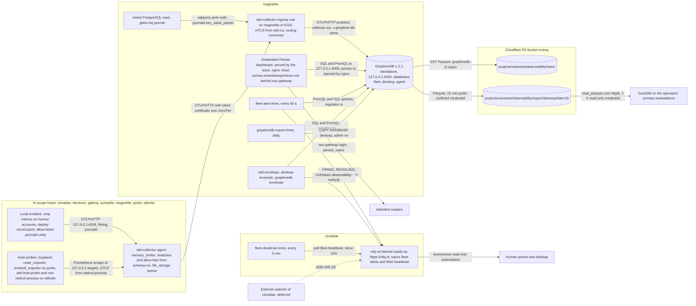

## Scope and consumers

This document assembles the nine decision records under `decisions/` into one system view, and adds no decision of its own.
The charter objective is a deployment-ready design for a fleet observability platform and for the continuous-feedback loop that consumes it (charter, Objective).
The platform serves two consumers: fleet infrastructure operation, and the development loop.
The development loop is the primary consumer, and it decides retention, cardinality and schema wherever the two conflict (charter, Scope; ADR-004 Context).
A development-loop signal is admitted only if a named coverage-model decision rule reads it, D5-R1 to D5-R8 (ADR-005 Decision).
Fleet signals exist to make the recorded host failures visible to a human: the magnetite OOM kills of 2026-09-27 and 2026-10-01, the `omnigent-host-*` restart loop of 2026-10-15, the exit 78 of `org.nixos.omnigent-host-cameron` on stibnite on 2026-10-15, and magnetite's storage exhaustion (ADR-003 Context; ADR-009 Context).
Admitted humans read all stored telemetry through one shared read zone, and the store holds no content and no person identifier (ADR-008 Decision; ADR-004 Decision).
Implementation proceeds through OpenSpec changes under `openspec/changes/`, following `openspec/changes/stand-up-nixbot-on-magnetite/` and `openspec/changes/stand-up-gitea-mq-on-magnetite/` (charter, Scope, clarified in v8).

The component documents are:

- [components/greptimedb.md](../components/greptimedb.md): the store (ADR-001, ADR-006 store side, ADR-007).
- [components/parquet-export.md](../components/parquet-export.md): the daily `devloop` Parquet export to R2 and its DuckDB readers (ADR-006).
- [components/perses.md](../components/perses.md): the dashboard layer (ADR-002, ADR-008 read side).
- [components/fleet-alert.md](../components/fleet-alert.md): the alert evaluator, the dead-man and ntfy delivery (ADR-009, ADR-003 notifier).
- [components/otel-collector.md](../components/otel-collector.md): the per-host agents, the magnetite ingress, the darwin root process collector and redaction (ADR-003, ADR-004, ADR-008).
- [components/host-probes.md](../components/host-probes.md): the loopback node_exporter, the smartctl exporter and the darwin `otel-host-probe` job (ADR-003, ADR-004).
- [components/devloop-exporters.md](../components/devloop-exporters.md): the nixbot PostgreSQL reader, gitea-mq journal events, deploy records and omp metrics (ADR-005).

## System context

Every arrow into the store crosses loopback on magnetite, and the only mesh-facing telemetry listener is the ingress receiver (ADR-003 items 9 and 13; ADR-007 Decision).
Ingest uses OTLP over HTTP with protobuf, because GreptimeDB serves no OTLP gRPC trace or logs service and rejects JSON content types (ADR-001 Context; ADR-003 Context).

## Deployment view

| Host | Kind | Components | Notes |
|---|---|---|---|
| magnetite | NixOS, always on, Hetzner `cx53` | `opentelemetry-collector.service` with `agent` and `ingress` roles, devloop collection (`sqlquery`, gitea-mq `journald`), loopback `prometheus-node-exporter`, `greptimedb.service` serving the embedded dashboard, `greptimedb-schema.service`, `greptimedb-export.service` and `.timer`, `greptimedb-envelope.service` and `.timer`, the nginx vhost `perses.scientistexperience.net` registered with `sso-gateway` and proxying to the store's API listener `127.0.0.1:4006`, `perses-dashboards.service`, `fleet-alert.service` and `.timer`, `otel-envelope` service and timer, `devloop-reconcile` service and timer, `observability-notify@` template, loopback nginx server `127.0.0.1:9180` for nixbot `/metrics`, deploy-record snippet | store placement and containment per ADR-007; dashboard admission through the shared `sso-gateway` Kanidm client per ADR-002 |
| cinnabar | NixOS, always on, Hetzner `cx43` | collector `agent`, loopback `prometheus-node-exporter`, `observability-notify@` template, `ntfy-sh` with `auth-access` and `environmentFile`, `fleet-deadman.service` and `.timer`, deploy-record snippet | ZeroTier controller and `.zt` resolver; not a store host (ADR-007 Rationale) |
| pyrite | NixOS, laptop, bare metal | collector `agent`, loopback `prometheus-node-exporter`, `prometheus-smartctl-exporter` on `127.0.0.1:9633` with `smartDevices = [ "/dev/nvme0" ]`, `observability-notify@` template, deploy-record snippet | KVM-capable host for the on-demand QEMU `vmTests` (S1's OOM-order test), while ADR-005's `devloop-ingest` is a container test on magnetite (charter v22); silence raises nothing (ADR-009 item 16) |
| electrum, galena, scheelite | NixOS, cloud hosts provisioned on demand | collector `agent`, loopback `prometheus-node-exporter`, `observability-notify@` template, deploy-record snippet | silence fails R3.2 only while terranix provisions them (ADR-003 R3.2; ADR-009 item 16); `scheelite` deploys report as out-of-band under D5-R7 while its machine check stays deferred (ADR-005 Consequences) |
| stibnite | nix-darwin, laptop | `launchd.daemons.otelcol` as `_otelcol`, `launchd.daemons.otelcol-process` as root, `launchd.daemons.otel-host-probe` as `_prometheus-node-exporter` with `smartDevices = [ "disk0" ]`, loopback node_exporter with only the `textfile` collector, deploy-record snippet | darwin configuration is made gating through R3.1 on `x86_64-linux` (ADR-003 Q5) |
| blackphos, rosegold, argentum | nix-darwin, other people's primary laptops | deploy-record snippet only, no collector | excluded until each primary user consents (ADR-003 Q3); D5-R7 records each as an exemption owned by that user (ADR-005 Decision) |
| Android ZeroTier members | unmanaged mesh members | none | refused by mTLS because they hold no `otel-ca` certificate (ADR-003 Q4); may subscribe anonymously to `fleet-*` topics (ADR-009 item 12) |

The `telemetry-export-reader` parent token and the reader command live on the human operators' primary workstations only (ADR-006 Q3).
omp exports metrics only from human-account sessions, and no omnigent worker account receives an OTLP endpoint or credential in this slice (ADR-005 Decision; ADR-008 emitter posture item 3).

## Trust boundaries and credentials

Transport is ZeroTier only, and no public ingress exists (ADR-003 item 13).
The ingress receiver binds `[${flake.lib.hosts.magnetite.zt}]:4318`, is opened on `zt+` only, and requires client certificates from the `otel-ca` CA (ADR-003 item 9).
`otel-ca` is a new shared clan vars CA, and `otel-cert` issues one certificate per machine with CN equal to the machine name (ADR-003 items 12, Implementation surface).
`nix-grpc-ca` is not reused, because a certificate from it with a dispatcher CN is a trusted remote-build credential (ADR-003 Q2).
The ingress does not bind certificate CN to the stamped `host.name`, so a compromised host can write telemetry as any host (ADR-003 Consequences).
Every other collector and exporter listener binds loopback only (ADR-003 Envelope, exposure).

The store requires credentials on every `/v1/` path, loopback included, because loopback is reachable by magnetite's worker accounts (ADR-008 Decision item 1).
The open build authenticates but authorizes nothing beyond a per-user mode, so a database is a label and not a boundary (ADR-008 Context).
The `greptimedb-users` generator holds exactly four users (ADR-007 Decision):

| User | Mode | Holders |
|---|---|---|
| `admin` | `rw` | `greptimedb-schema` and `greptimedb-export` only (ADR-007) |
| `collector` | `wo` | the `ingress` collector on magnetite only (ADR-003 item 10; ADR-007) |
| `perses` | `ro` | nginx on magnetite from S6, injecting it into dashboard readers' requests (ADR-002; ADR-007) |
| `regulator` | `ro` | `otel-envelope`, `devloop-reconcile`, `greptimedb-envelope` and `fleet-alert.service` (ADR-007; ADR-009 item 1) |

No worker account and no worker-run process holds any store credential (ADR-008 Readers and admission item 5).
Rotating a store credential restarts the store and the consuming unit through `restartUnits` (ADR-007 Consequences).
Restart on rotation stays after a `v1.3` release is deployed, because `LoadCredential` snapshots credentials at unit start (ADR-007 Q6).

The store holds one long-lived Object Read & Write token on the whole `sciexp` bucket, `greptimedb-r2`, because `[storage]` takes only static credentials; its blast radius equals that of `omnigraph-r2` on the same host (ADR-006 Decision, Q9).
The export oneshot and the envelope probe sign 15-minute temporary credentials confined to the export prefix from that token and unset the parent after signing (ADR-006 Decision, R6.1).
Readers sign one-hour `object-read-only` credentials for the export prefix locally from the `telemetry-export-reader` parent, which can read all of `sciexp` (ADR-006 Decision, Consequences).

Humans read only through the dashboard GreptimeDB embeds, at `perses.scientistexperience.net`, admitted by `sso-gateway` with `allowedGroups = [ "perses_users" ]` (ADR-002 Decision; ADR-008 Readers and admission item 1).
nginx proxies only `/dashboard/` and `/v1/` to the store's API listener `127.0.0.1:4006` and overwrites `Authorization` with the `perses:ro` credential, so no reader's browser holds a store password and the store rejects every dashboard save or delete a reader attempts (ADR-002 Decision; ADR-008 Readers and admission item 2).
Dashboards change only through the reconcile oneshot `perses-dashboards.service`, whose `rw` credential holder is open (ADR-002 Q9).
Any admitted reader can send arbitrary SQL and PromQL to the store under the `perses` credential, which the shared read zone accepts (ADR-002 Consequences; ADR-008 Q1).

The per-host collector is the only content boundary and the only path into the store (ADR-008 Decision).
No logs pipeline consumes the local OTLP receiver, so OTLP log records are refused whatever the emitter sets (ADR-008 content stage 1; ADR-003 item 3).
The omp pipeline applies `redaction` with `allow_all_keys: false` and a metric-name filter, spans lose status messages and `exception` events, journald records outside the unit allow-list are dropped and surviving bodies are reduced to `MESSAGE`, and `devloop` rows keep only allow-listed columns (ADR-008 content stages 2 to 6; ADR-004 Decision).
Process identity attributes are disabled at the source, so no command line leaves the collector (ADR-003 item 16).
Each NixOS collector runs outside every worker UID, the darwin agent runs as `_otelcol`, and the root `otelcol-process` has no receiver endpoint and no credential (ADR-008 Decision item 4).
`OTEL_` is reserved in the worker environment, which stops role settings from enabling an emitter content gate but does not constrain code a worker runs (ADR-008 emitter posture item 2, Q4).
omp runs with `OTEL_LOGS_EXPORTER=none` and without the content-capture variable (ADR-005 Decision; ADR-008 Q6).

On ntfy, the user `alerter` alone may publish to `fleet-*` topics, anonymous clients may read them, and every other topic keeps anonymous read-write access (ADR-009 item 12).
Delivery to `ntfy.zt` follows `ntfy-send`'s `-k` convention, so the `alerter` token's confidentiality rests on ZeroTier encryption and cinnabar's dnsmasq (ADR-009 Consequences).

## Data lifecycle

| Database | Content | In-store retention | Export |
|---|---|---|---|
| `fleet` | host, service, process, systemd, launchd, ZFS, swap and SMART metrics, allow-listed journald logs | metrics 30 d; logs table 14 d | none (ADR-006 Q2) |
| `devloop` | CI attribute outcomes, CI build timing, merge-queue batch events, deploy records | 365 d | daily Parquet to `projects/vanixiets/observability/export/devloop/date=<D>/` |
| `agent` | omp `omp.agent.tool.calls` and `omp.agent.errors` | 90 d | none, because an export copy would escape the TTL and the read zone (ADR-006 Rationale) |

Retention values and budgets are ADR-004's.
The `greptimedb-schema` oneshot creates the three databases with these TTL defaults and sets the `fleet` logs table TTL (ADR-007 Decision).
R4.2 in `otel-envelope` compares each TTL against ADR-004's table, so TTLs are asserted as well as set (ADR-004 Regulator R4.2).
The metric engine's metadata region and the pipeline table never expire (ADR-004 Consequences).

The store's SSTs live in R2 under `projects/vanixiets/observability/store/`, and its WAL and caches live on the ZFS dataset `zroot/root/greptimedb` with `quota = 16G` and `reservation = 12G` (ADR-006 Decision; ADR-007 Decision).
No lifecycle rule covers the store prefix, because a delete-by-age rule would remove live SSTs and manifests (ADR-006 Decision).
The export runs daily with `parallelism = 1` and rewrites each of the last three UTC days, so late data from intermittent hosts converges (ADR-006 Decision).
The export prefix carries no expiry until a year of data exists and its size is measured (ADR-006 Q4).
Any later expiry is a rule added to the existing `cloudflare_r2_bucket_lifecycle.sciexp`, and no second lifecycle resource is created (ADR-006 Decision).
The bucket-wide 7-day multipart-abort rule also applies to the store prefix (ADR-006 Consequences).
A DuckLake catalog is deferred (ADR-006 Q5).
nixbot's own rows are still pruned at 90 days, so the `devloop` copy is the only CI history older than that (ADR-005 Consequences).
Each agent's `file_storage` queue absorbs at least 24 h of that host's output below 512 MiB (ADR-003 Envelope, buffering).
ntfy keeps published messages for its default 12 h cache, which is the only record of sent alerts (ADR-009 Consequences).

## Failure and alert path

Under host memory exhaustion on magnetite the kernel kills the running nixbot evaluator first at `oom_score_adj` 900, then the store at `OOMScoreAdjust = 500`, then the `ingress` collector at 300, all before `nix-daemon` workers at 250 and PostgreSQL and other services at 0 or lower (ADR-003 Envelope; ADR-007 Decision, Q4).
The collector therefore survives the store's death and queues, and its queue depth is the store's real availability bound (ADR-007 Consequences).

Every observability regulator and oneshot sets `OnFailure=observability-notify@%n.service`: `otel-envelope`, `devloop-reconcile`, `greptimedb-envelope`, `greptimedb-export`, `greptimedb-schema`, `fleet-alert.service`, `fleet-deadman.service`, magnetite's six existing `zfs-assert-*` and `zfs-set-*` oneshots and ADR-007's three `greptimedb` dataset oneshots (ADR-003 Q9; ADR-007 Decision; ADR-009 item 11).
The `observability-notify@` template lives in the collector `agent` role on every in-scope NixOS host, cinnabar included, and posts through the existing `ntfy-send` to `ntfy.zt` (ADR-003 Implementation surface).
It posts once per failure episode to `fleet-alerts` with the `alerter` token, keeps a stamp file per unit, and each notified unit's `ExecStopPost=` posts one `RESOLVED` on the next successful exit (ADR-009 item 11).

`fleet-alert.timer` on magnetite runs the evaluator every 60 s against the `fleet` database's Prometheus API with a 10 s per-query timeout (ADR-009 item 1).
From S2 each rule declares its database and query language, and SQL rules, the dev-loop SLO burn rule first, query `devloop` through `/v1/sql` (ADR-009 items 1 and 15; charter v22).
It posts exactly one `FIRING` and one `RESOLVED` per alert instance, re-posts `critical` instances once per 24 h, and appends attribution by top executables, ARC size and swap used to memory and OOM messages (ADR-009 items 4 and 5).
When the store does not answer it raises `StoreQueryFailing` and freezes every other instance, and while a host reports no `system_memory_usage_bytes` it freezes that host's instances (ADR-009 items 6 and 17).
`RuleSignalMissing` reports a rule whose presence selector has returned no series for 30 min while an expected host reports (ADR-009 item 7).
The initial rule set is the eighteen rules of ADR-009's rule table, and `WeeklyPipelineTest` proves the whole path each Monday at 09:00 local time (ADR-009 item 14).
S2 adds the dev-loop SLO burn rule, a 24 h slow-burn `warning` that fires when more than 10% of the pull-request builds in the trailing 24 h waited over 1 h to start (ADR-009 item 15; charter v22).
The one rule that fires for host absence is `RuleSignalMissing` for an always-on host the rule table marks, magnetite alone in S3, silent for 10 min while the store answers; the silence of an always-on host is also R3.2's failure and reaches a human through the notifier, and a laptop's silence raises nothing (ADR-009 item 16).

Every completed evaluation publishes to `fleet-heartbeat`, and `fleet-deadman.timer` on cinnabar raises `AlertEvaluatorSilent` when that topic has been empty for 10 min (ADR-009 items 8 and 9).
Before polling, the dead-man performs an anonymous publish to `fleet-heartbeat` and fails if it is accepted (ADR-009 R9.4).
cinnabar is the single delivery path, and nothing in the accepted design detects a cinnabar or ntfy outage (ADR-009 Consequences).
An external watcher of cinnabar is CAM-76, scheduled before S5, with an external heartbeat from a free uptime service as the candidate fix at the cost of a third-party dependency (ADR-009 Q5; charter v21).

## Consolidated implementation surface

Change numbers refer to the slices S1 to S8 of the next section.

| Item | Kind | Action | Owning ADR | Change |
|---|---|---|---|---|
| root `nixpkgs` input | flake input | no change for the store, and no new flake input is added by any record | ADR-001; ADR-007 | none |
| `pkgs/by-name/greptimedb-bin` | package | add: the upstream release tarball on `x86_64-linux` only, with `passthru.embedsDashboard = true`, `update.sh` and `apps.update-greptimedb-bin` on every system; S6 adds `passthru.dashboardVersion` | ADR-001 R1.1; ADR-007; ADR-002 | 1, 6 |
| `pkgs/by-name/ntfy-send` | package | add: the existing `ntfy-send` script as a package, consumed by the home-manager command, the `observability-notify@` template and the S3 evaluator; S3 adds `NTFY_TOKEN_FILE`, sending the token as `Authorization: Bearer` without placing it on curl's argument list | ADR-009; ADR-003 | 1, 3 |
| `modules/nixos/greptimedb.nix` | file | add: `services.greptimedb`, TOML generation with gRPC bound to `127.0.0.1:4001`, `greptimedb` user, `greptimedb.service`, `greptimedb-schema.service`, export service and timer, `greptimedb-envelope` service and timer, assertions R1.1, R1.2, R1.4 and R6.4 | ADR-007; ADR-001; ADR-006 | 1, 8 |
| `modules/checks/greptimedb-envelope.nix` | file | add: R7.1 with its mutants | ADR-007 | 1 |
| `modules/machines/nixos/magnetite/disko.nix` | file | modify: `root/greptimedb` dataset at `/var/lib/greptimedb` | ADR-007 | 1 |
| `modules/machines/nixos/magnetite/default.nix` | file | modify: import `greptimedb`, set `services.greptimedb`, declare `greptimedb-users` and `greptimedb-r2`, add the three `greptimedb` dataset oneshots | ADR-007; ADR-006 | 1 |
| `modules/machines/nixos/magnetite/default.nix` | file | modify: `OnFailure=observability-notify@%n.service` on the six existing and three new dataset oneshots | ADR-007; ADR-009 | 1 |
| `modules/machines/nixos/magnetite/default.nix` | file | modify: import `perses` and enable `sso-gateway`, which is disabled today | ADR-002; ADR-007 | 6 |
| `modules/machines/nixos/magnetite/default.nix` | file | modify: import `fleet-alert` with the evaluator enabled | ADR-009 | 3 |
| `modules/machines/nixos/magnetite/default.nix` | file | modify: import `devloop-collection`, and add `devloop-reconcile` to the `regulator-password` holders and to `services.observability-notify.units` | ADR-005 | 2 |
| `modules/clan/services/otel-collector/flake-module.nix` | file | add: clan service `otel-collector` with roles `agent` and `ingress`, NixOS and darwin modules, `otel-envelope`, `observability-notify@` in the `agent` role, content stages, R8.2 ownership assertions; S3 moves `observability-notify@` into its own module, which the `agent` role imports | ADR-003; ADR-004; ADR-008; ADR-009 | 1, 3, 4, 5, 7 |
| `modules/nixos/observability-notify.nix` | file | add: `flake.modules.nixos.observability-notify` with the unchanged option `services.observability-notify.units`, the template loading the `alerter` token through `LoadCredential`, resolve hooks reading the token's vars path through `NTFY_TOKEN_FILE`, and a log of posted `FAILED` messages under `/var/lib/observability-notify` | ADR-009; ADR-003 | 3 |
| `modules/clan/inventory/services/otel-collector.nix` | file | add: one instance, `agent` on the seven in-scope hosts, `ingress` on magnetite, `smartDevices` on pyrite and stibnite | ADR-003 | 1, 4, 5 |
| `modules/clan/services/otel-collector/schema.nix` | file | add: allow-lists, keep-lists, label bans, owner-to-alias attrset, signal-to-database map, budget numbers | ADR-004 | 1, 7 |
| `modules/checks/otel-collector-config.nix` | file | add: R3.1 with recorded `launchctl print` fixtures | ADR-003 | 1, 4, 5 |
| `modules/checks/otel-redaction.nix` | file | add: R8.1 with ADR-004's R4.1 fixtures | ADR-008; ADR-004 | 7 |
| `modules/nixos/nixbot.nix` | file | modify: loopback nginx server on `127.0.0.1:9180` proxying `/metrics` to the nixbot socket | ADR-003 | 1 |
| `modules/clan/inventory/services/zerotier.nix` or the zerotier configuration it applies | file | modify: `enableMetrics = true` | ADR-003 | 1 |
| `modules/lib/omnigent-environment.nix` | file | modify: add `OTEL_` to the reserved prefixes | ADR-008 | 7 |
| `modules/checks/omnigent-environment.nix` | file | modify: add an `OTEL_` policy mutant | ADR-008 | 7 |
| `modules/machines/nixos/cinnabar/ntfy.nix` | file | modify: `behind-proxy`, `proxy-trusted-hosts = ::1`, `visitor-prefix-bits-ipv6 = 128`, `environmentFile` from `ntfy-alerter-env`, then `auth-access` entries in the last of three deploys; until then the S1 notifier posts anonymously | ADR-009 | 3 |
| `modules/machines/nixos/cinnabar/ntfy.nix` | file | modify: import `fleet-alert` with the dead-man enabled, and import `observability-notify` so the dead-man's `OnFailure=` has a notifier | ADR-009 | 3 |
| `modules/nixos/perses.nix` | file | add: `sso.services.perses` registration with `allowedGroups = [ "perses_users" ]`, `/dashboard/` and `/v1/` proxied to `127.0.0.1:4006` with the `Authorization` overwrite, `http.enable_api_server = true`, `perses-dashboards.service`, assertions | ADR-002 | 6 |
| `modules/nixos/perses/dashboards/*.json` | file | add: Perses `Dashboard` JSON reconciled through `/v1/dashboards` | ADR-002 | 6 |
| `modules/nixos/perses/lint-rules.yaml`, `modules/nixos/perses/mutants/*.json` | file | add: custom lint rules and mutant set | ADR-002 | 6 |
| `modules/checks/perses-lint.nix` | file | add: `percli lint` at the embedded dashboard's Perses and plugin versions, with the tooling-version assertion | ADR-002 | 6 |
| `modules/checks/perses-config.nix` | file | add: serving-configuration mutant check | ADR-002 | 6 |
| `modules/vm-tests/perses-greptimedb.nix` | file | add: on-demand container test of the vhost-to-store data path | ADR-002 | 6 |
| `modules/terranix/cloudflare.nix` | Terraform resource | modify: one unproxied `CNAME` `perses.scientistexperience.net` to `magnetite.scientistexperience.net` | ADR-002 | 6 |
| `modules/terranix/cloudflare.nix` | Terraform resource | no bucket resource; a rule in `cloudflare_r2_bucket_lifecycle.sciexp` only when an export expiry is decided | ADR-006 Q4 | none now |
| `modules/nixos/fleet-alert.nix` | file | add: evaluator and dead-man services and timers, R9.5 assertion; S2 adds per-rule `database` and `language`, with SQL rules sent to `/v1/sql` | ADR-009 | 2, 3 |
| `modules/nixos/fleet-alert/rules.nix` | file | add: rule table rendered to JSON and YAML, with the `SystemdUnitFailed` exclusion rendered from `services.observability-notify.units`; S3 adds the rules S1's signals feed, S4 and S5 the filesystem, NVMe, launchd and `HostProbeStale` rules, and S2 the dev-loop SLO burn rule, rendering only PromQL rules to YAML | ADR-009 | 2, 3, 4, 5 |
| `modules/checks/fleet-alert.nix` | file | add: R9.2 with fixtures, mutants and the Hypothesis property test of the jq transition function; S2 adds the `/v1/sql` fixture path and a leg querying both `fleet` and `devloop` | ADR-009 | 2, 3 |
| `ntfy-alerter` provisioning check | flake check | add: validates the rendered `NTFY_AUTH_*` strings before deploy; ADR-009 fixes no path | ADR-009 | 3 |
| `modules/nixos/devloop-collection.nix` | file | add: `sqlquery` queries, gitea-mq `journald` receiver, the collector's journal read, PostgreSQL roles, `devloop-reconcile` as its own `DynamicUser` with a peer-authenticated nixbot role and journal read | ADR-005 | 2 |
| `modules/system/deploy-record.nix` | file | add: NixOS and darwin activation snippets | ADR-005 | 2 |
| NixOS and darwin machine aggregates importing `modules/system/` | file | modify: import `deploy-record` on all ten machines | ADR-005 | 2 |
| `modules/checks/devloop-signals.nix` | file | add: omp session-variable check; the marker clause is in `devloop-queries` | ADR-005 | 7 |
| `modules/checks/machines.nix` | file | modify: deploy-record obligation, evaluated with each machine's toplevel | ADR-005 | 2 |
| `modules/checks/devloop-queries.nix` | file | add: queries against nixbot's migrations under `postgresqlTestHook`, and the abandonment-marker clause against the patch's production code | ADR-005 | 2 |
| `modules/vm-tests/devloop-ingest.nix` | file | add: on-demand systemd-nspawn container test on magnetite with mutants | ADR-005 | 2 |
| `modules/home/ai/omp/default.nix` | file | modify: OTLP metrics endpoint, `OTEL_TRACES_EXPORTER=none`, `OTEL_LOGS_EXPORTER=none`, protocol and service name for human accounts | ADR-005; ADR-008 | 7 |
| reader command on each analytics host | file | add: signs the export read credential and prints DuckDB `CREATE SECRET`; ADR-006 fixes no path | ADR-006 | 8 |
| `greptimedb-users` | clan vars generator | add on magnetite: four users, five secret files and the public `users-sha256` | ADR-007 | 1 |
| `greptimedb-r2` | clan vars generator | add on magnetite: hidden prompts for the `sciexp` token, `env` file | ADR-006 | 1 |
| `otel-ca` | clan vars generator | add, `share = true` | ADR-003 | 4 |
| `otel-cert` | clan vars generator | add, per machine | ADR-003 | 4 |
| `ntfy-alerter` | clan vars generator | add, `share = true`, `token` only, on magnetite and cinnabar | ADR-009 | 3 |
| `ntfy-alerter-env` | clan vars generator | add, per machine, on cinnabar only, depends on `ntfy-alerter` | ADR-009 | 3 |
| `telemetry-export-reader` | clan vars generator | add, `share = true`, on the operators' primary workstations | ADR-006 | 8 |

## Implementation sequencing

Implementation proceeds in vertical slices: each slice is one OpenSpec change that closes a feedback loop end to end, from deployment to its own regulators, and each is bound to one issue of the Linear project `Fleet observability` (`openspec/linear.yaml` key `fleet-observability`).
Each change carries the artifacts of the repository's OpenSpec schema under `openspec/changes/`, as the `stand-up-*` precedent does (charter, Scope), and its tasks carry the deployment acceptance items of the decisions it realizes.
Slice status is not recorded here: it is derived from the change's files by `openspec list` and mirrored to its issue by openspec-linear-sync.
No content-bearing record enters the store before S7 brings the content stages and their regulator.
S1 and S3 to S5 are metrics-only, and S2 adds the one non-content logs path, into `devloop` only, through an explicit allow-list and with no message bodies stored (ADR-004 Decision; charter v22).
Change names are chosen in each slice's proposal.

0. Package: the store package is `greptimedb-bin`, packaged from the upstream release tarball because it embeds the dashboard ADR-002 adopts; it lands inside S1, and the root pin is not bumped for the store (ADR-001 R1.1; ADR-007 Q2).
1. S1, CAM-68: the store with its containment, dataset, users, R2 store prefix, `greptimedb-schema` and `greptimedb-envelope`, fed metrics-only by magnetite's own collector in the `ingress` role writing to the loopback store, and the `observability-notify@` template with `OnFailure=` on S1's units and magnetite's dataset oneshots, posting anonymously until S3.
   Realizes ADR-001, ADR-007, the store side of ADR-006, the databases and retention of ADR-004, magnetite's metrics from ADR-003, and the notifier of ADR-003; the embedded dashboard is reachable only through `ssh -L 4000:127.0.0.1:4000 magnetite.zt`.
   Components: [greptimedb](../components/greptimedb.md), [otel-collector](../components/otel-collector.md), [host-probes](../components/host-probes.md).
2. S2, CAM-69: the nixbot reader, the gitea-mq journal parse, the deploy record, `devloop-reconcile`, the `devloop-queries` check and the dev-loop SLO burn rule, which lands with the later of S2 and S3, and S2 is the later.
   Realizes ADR-005 except the omp emitter, which moves to S7.
   Component: [devloop-exporters](../components/devloop-exporters.md).
3. S3, CAM-70: the evaluator on magnetite, the rules whose signals S1 provides, the dead-man on cinnabar with the extracted `observability-notify` module, the `alerter` credential and its provisioning check, and the rule check, deployed in three steps: cinnabar's `alerter` provisioning, magnetite's token-bearing notifier and evaluator, then cinnabar's `auth-access`.
   Realizes ADR-009.
   Component: [fleet-alert](../components/fleet-alert.md).
4. S4, CAM-71: `otel-ca`, the mTLS ingress on ZeroTier, and the agent role on the other in-scope NixOS hosts, with the SMART exporter on pyrite and `otel-envelope`.
   Realizes the rest of ADR-003 for NixOS and its metrics in ADR-004.
   Components: [otel-collector](../components/otel-collector.md), [host-probes](../components/host-probes.md).
5. S5, CAM-72: stibnite on darwin, with the root `otelcol-process` collector, the `otel-host-probe` job for launchd state and SMART, and the darwin rules of ADR-009.
   Realizes ADR-003 items 21 to 25.
   Component: [host-probes](../components/host-probes.md).
6. S6, CAM-73: the `perses.scientistexperience.net` vhost behind `sso-gateway` with the group `perses_users`, nginx proxying to the store's API listener `127.0.0.1:4006` with the `perses:ro` credential injected, the dashboard JSON files and their reconcile oneshot, the `perses-lint` and `perses-config` checks, the container test and the DNS record.
   Realizes ADR-002 and the read side of ADR-008; the holder of the reconcile oneshot's `rw` credential and per-dashboard database selection are decided here (ADR-002 Q9, Q10).
   Component: [perses](../components/perses.md).
7. S7, CAM-74: omp telemetry and journald logs behind the content stages, `OTEL_` reserved in worker environments, and the R8.1 and R8.3 regulators.
   Realizes the collector side of ADR-008, the omp emitter of ADR-005, and the agent and journald schema of ADR-004.
   Component: [otel-collector](../components/otel-collector.md).
8. S8, CAM-75: `greptimedb-export`, R6.1, the `telemetry-export-reader` generator and the reader command.
   Realizes the export side of ADR-006.
   Component: [parquet-export](../components/parquet-export.md).

S2, S3, S4 and S6 depend only on S1 and may proceed in any order; S5 follows S4, which provides the ingress it reports to, and S7 follows S5, because omp's interactive sessions run on stibnite.
S8 follows S2 because R6.1 fails on an empty partition, and `devloop` holds rows only once S2 deploys (ADR-006 E6.1).
The deferred decision ADR-009 Q5 is CAM-76, which blocks S5 (CAM-72), because until it lands an ntfy outage is noticed only by a missing Monday `WeeklyPipelineTest`, up to 7 days later, and S5 adds laptops (charter v21).
A slice whose deployment refutes a detail of a decision record amends that record in place with a charter version entry, and every artifact citing the amended identifier is updated in the same pull request.

## Deferred and future extensions

- External watcher of cinnabar: CAM-76, decided before S5; the candidate fix is an external heartbeat from a free uptime service, at the cost of a third-party dependency (ADR-009 Q5).
- Continuous profiling: trigger is a magnetite memory or CPU incident in which `process_memory_usage_bytes` names the executable but not the code path; adoption needs a profiles-capable store or a second backend, a packaged profiler distribution and a privileged eBPF unit (ADR-003 future extension 5).
- Laptop battery, thermal and sleep-wake state on stibnite and pyrite: trigger is an incident in which a laptop's thermal throttling, battery wear or sleep-wake cycle explains lost builds, stale deploy records or queue replay gaps; adoption needs node_exporter collectors, a sleep-wake source and consent framing (ADR-003 future extension 6).
- ZeroTier peer latency and path state: trigger is a cross-host failure attributed to mesh path degradation, relay fallback or peer flapping; adoption needs a `node_id` keep-list of fleet members and an ADR-004 budget increase (ADR-003 future extension 7).
- Exponential-histogram conversion removal: when the deployed store reaches `1.3.0`, R1.2 tracks removing the collector conversion (ADR-001 E1.2).
- Standalone Perses server: deployed only if a dashboard needs a feature the embedded dashboard lacks, such as `StaticListVariable` or projects with RBAC (ADR-002 Decision).
- Perses 0.54.0 in the dashboard: arrives when a stable GreptimeDB release embeds dashboard `v0.14.2`, moving the lint tooling in the same commit (ADR-002 Consequences).
- Per-unit cgroup memory: revisit when the collector pin reaches `v0.160.0` (ADR-003 Q11).
- blackphos, rosegold and argentum: join the collector topology when each primary user consents (ADR-003 Q3).
- Omnigent and worker telemetry: requires revising ADR-008 (ADR-004 Q5; ADR-005 Q5; ADR-008 Q3).
- omp spans: out of scope for the first deployment (ADR-004 Q3).
- nix-grpc-daemon metrics and macOS unified logging: not collected in this decision (ADR-003 Q6, Q7).
- Alertmanager: adopted when E9.1 is breached in two separate weeks after threshold review or the rule set passes 30 rules (ADR-009 Q3).
- Merge-queue stall rule: not added until ADR-005 names a decision that needs it within hours (ADR-009 Q6).
- Export expiry: no rule until a year of data exists and its size is measured (ADR-006 Q4).
- DuckLake catalog: deferred until a second consumer needs snapshots (ADR-006 Q5).
- Store phase-2 memory work: folded into the incident note's phase-2 `MemoryLow` work when it lands (ADR-007 Q8).
- Local check results through `--result-file`: not shipped until a rule needs data CI rows lack (ADR-005 Q6).
