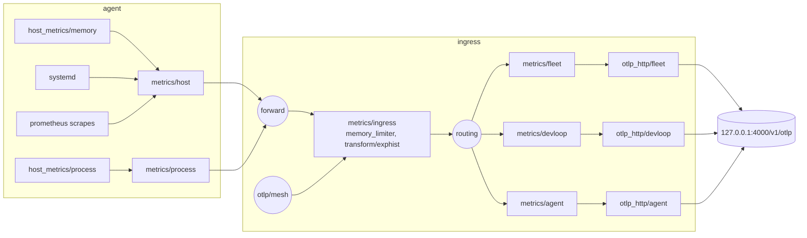
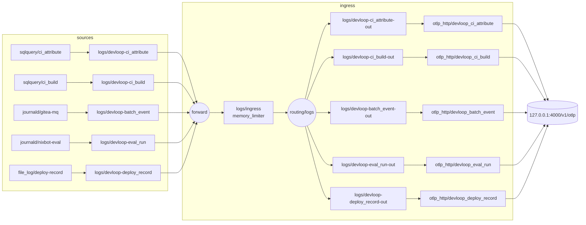

# otel-collector clan service

This clan service collects fleet metrics into the GreptimeDB telemetry store and carries the dev-loop record's logs into `devloop`, and its `agent` role imports the failure notifier that posts unit failures to ntfy.
It has two roles, `agent` and `ingress`, assigned in `modules/clan/inventory/services/otel-collector.nix`: `agent` on every host of `flake.lib.observabilityHosts`, and `ingress` on magnetite alone.
The roles import the plain NixOS modules `flake.modules.nixos.otel-collector-agent` and `flake.modules.nixos.otel-collector-ingress`, so the container tests import them without clan, and on a darwin host the `agent` role's `darwinModule` imports `flake.modules.darwin.otel-collector-agent` (see "Darwin agents").
The clan `agent` role reads the `otel-ca`, `otel-cert` and `ntfy-alerter` vars, and the clan `ingress` role reads the `collector-password` and `regulator-password` files of `greptimedb-users`.

The NixOS module runs one collector per host, so both roles' fragments merge into one `services.opentelemetry-collector` and one `opentelemetry-collector.service`.
Both roles import `collectorCore`, which carries the shared module key `vanixiets#otel-collector-core` so a host holding both roles loads it once.
`collectorCore` sets the package to `opentelemetry-collector-contrib`, defines the `memory_limiter` processor (384 MiB) that the agent pipelines and `metrics/ingress` run first, the `file_storage` extension under `/var/lib/opentelemetry-collector/queue`, and the options `vanixiets.otelCollector.ingress`, `caFile`, `smartDevices`, `agentTelemetry` and `envelopeBudget`, and gives the unit `RestartSec = 5s` with `StartLimitIntervalSec = 0`.

## Agent hosts and the host table

`flake.lib.observabilityHosts` in `modules/lib/observability-hosts.nix` lists the agent hosts, magnetite, cinnabar, pyrite, electrum, galena, scheelite and stibnite, each with `platform`, `collect`, `alwaysOn`, `notifiedUnits` and `smartDevices`.
`platform` is `"nixos"` from the `agent` helper and `"darwin"` on stibnite's row, and an assertion in the clan inventory's `otel-collector` instance requires each row's `platform` to equal the machine's `machineClass` in `modules/clan/inventory/machines.nix`.
The inventory generates `roles.agent.machines` from that table, so a host joins the agent role by a row there.
On every row, whatever its `collect`, the clan agent role declares the `otel-ca` and `otel-cert` generators and imports `flake.modules.nixos.ntfy-alerter`, so one vars step covers every host.
`collect` gates everything else the role runs on the host: the agent fragment, `vanixiets.otelCollector.caFile` and `smartDevices`, the notifier's `units` and `tokenFile`, and the collector's `otel-cert` and `otel-key` credentials.
On a host that does not collect, the certificate and the token are uploaded files that no unit reads.
A new host is therefore added with `collect = false`, and turned on by its own one-line change setting `collect = true`, merged immediately before the host's watched deploy, which magnetite's deploy follows, because magnetite's evaluator takes its expected and always-on hosts from the same table (runbook, "Adding an agent host").
`alwaysOn` marks magnetite and cinnabar, the hosts whose silence the alert rules report, and only pyrite and stibnite list `smartDevices`, `[ "/dev/nvme0" ]` and `[ "disk0" ]`.

## Export by role

`vanixiets.otelCollector.ingress` (default `false`) says whether the host runs the ingress, and `flake.modules.nixos.otel-collector-ingress` sets it to `true`.
On magnetite the agent's pipelines end in the in-process `forward` connector, which `metrics/ingress` and `logs/ingress` receive from.
Everywhere else they end in `otlp_http/ingress` (metrics) and `otlp_http/ingress-logs` (logs), which post to `https://[<magnetite's ZeroTier address>]:4318`, the address taken from `flake.lib.hosts.magnetite.zt`, with `tls.min_version = "1.3"`.
Both present the host's certificate from the credentials `otel-cert` and `otel-key` under `/run/credentials/opentelemetry-collector.service/`, which the clan agent role loads from `otel-cert`'s `cert.pem` and `key.pem` with `LoadCredential`.
Both trust `vanixiets.otelCollector.caFile`, `otel-ca`'s `ca.crt` written to the store with `pkgs.writeText`, so a new CA changes the rendered configuration and restarts the collector.
`otel-cert`'s two files carry `restartUnits = [ "opentelemetry-collector.service" ]` on hosts that collect.
`otel-ca` is shared, its `ca.key` is never deployed, and it signs each host's `otel-cert` only at generation time.
Each `otel-cert` names its host as the CN with the extended key usage `clientAuth`; the ingress host's adds `serverAuth` and the SANs `IP:<its ZeroTier address>`, `DNS:<name>.zt`, `IP:<its mesh address>` and `DNS:<its fqdn>`, read from `flake.lib.hosts`; the ZeroTier pair goes with ZeroTier's retirement.
A non-ingress agent runs with `MemoryMax = "256M"` and its `memory_limiter` at 150 MiB with a 30 MiB spike allowance.
On every non-ingress host an assertion requires every exporter to queue in `file_storage` by bytes and retry without limit, `otlp_http/ingress` to hold 24 hours at `flake.lib.otelCollectorSchema.fleetBytesPerMinute` plus, where `agentTelemetry` is set, `agentMetricsBytesPerMinute`, `otlp_http/ingress-agent` to hold 8 hours at `agentEventBytesPerMinute` and `otlp_http/ingress-traces` 3 hours at `agentSpanBytesPerMinute` where they exist, the queues to sum below 512 MiB, and the limiter to stay below `MemoryMax`; a second assertion keeps `otlp_http/ingress-agent` out of every metrics pipeline, because an exporter keeps one persistent queue per signal and that queue would escape the sum.

The ingress's `otlp/mesh` receiver listens on `[<magnetite's ZeroTier address>]:4318` and its `otlp/mesh-tincr` receiver, with the same TLS, on `[<magnetite's mesh address>]:4318`, both HTTP only, with no gRPC; `otlp/mesh` goes with ZeroTier's retirement.
It presents magnetite's `otel-cert` and `otel-key`, which the clan agent role loads on magnetite too, and sets `client_ca_file` to the same CA and `min_version = "1.3"`, so a client without a certificate from `otel-ca` fails the TLS handshake.
It feeds `metrics/ingress` beside `forward`, and `logs/ingress` where the devloop or agent-session routes exist.
On magnetite a third receiver, `otlp/loopback` on `127.0.0.1:4321` with the same TLS, takes the host's own agent-session collector's output into `metrics/ingress`, `logs/ingress` and `traces/ingress` (see "Agent-session path").
The clan ingress role opens TCP 4318 on the mesh interfaces only (`flake.lib.meshInterfaces`).
magnetite sets `net.ipv6.ip_nonlocal_bind = 1`, so the receiver binds its address even before `zerotierone` holds it.

## What each agent collects

Every agent runs `host_metrics/memory`, `host_metrics/process`, the `systemd` receiver over `schema.systemdUnits`, and a `prometheus` receiver that scrapes loopback targets every 60 s.
The `node` job scrapes the loopback node_exporter at `127.0.0.1:9100` and keeps `schema.nodeExporterKeep`.
The `gitea`, `niks3`, `nixbot` and `greptimedb` jobs exist only where their service is enabled, because a target that never answers would be a permanently down target.
`host_metrics/memory` also runs the `filesystem` scraper over the host's ZFS mountpoints, read from the host's own `fileSystems` with `fsType = "zfs"`, under a `strict` `include_mount_points` list, so container runtime mounts stay out.
The scraper sets `include_virtual_filesystems = true`, because it otherwise drops every ZFS mount as a `nodev` filesystem, and keeps `system.filesystem.usage` alone.
A host without ZFS mounts gets no `filesystem` scraper, because an empty strict list is no filter in otelcol.
The `otelcol` job scrapes the collector's own telemetry at `127.0.0.1:8888`, keeps the eight queue, send-failure, enqueue-failure and refusal series of `schema.otelcolKeep`, and drops the `service_instance_id` label, which changes at every collector start.
Where the host's row sets `langfuse`, the `otelcol-agent-session` job scrapes the agent-session collector's telemetry at `127.0.0.1:8890` and keeps only `schema.otelcolAgentSessionKeep`'s sent and failed span counters of `exporter="otlp_http/langfuse"`, without `service_instance_id`, for the info-level `LangfuseSendFailing` rule (`openspec/changes/darwin-agent-session-telemetry`, design D9).
Where `vanixiets.otelCollector.smartDevices` is non-empty, the agent runs `prometheus-smartctl-exporter.service` on `127.0.0.1:9633` with `openFirewall = false` and `MemoryMax = "64M"`, and the `smartctl` job keeps the eight series of `schema.smartctlKeep`.
The exporter's NixOS module grants the `smartctl-exporter-access` group its ACL on each device by a udev rule that fires only on an `add` event, which a switch does not replay.
The unit therefore runs one privileged `ExecStartPre` per device, `+setfacl -m g:smartctl-exporter-access:rw <device>`.
The exporter's `--smartctl.path` is a wrapper that drops the `--log=error` argument the exporter always passes, then runs the root pin's `smartctl`.
The exporter discards a device whenever smartctl reports an error message, and pyrite's APPLE SSD rejects the Error Information log page, so without the wrapper pyrite publishes no NVMe series.
No kept series comes from that log: `smartctl_device_num_err_log_entries` is read from the health log, and a failed health-log read still drops the device.
An agent assertion keeps `openFirewall` off for both node_exporter and the smartctl exporter.

Where PostgreSQL runs, the agent adds `sqlquery/postgresql-collation` to `metrics/host`: every 60 s it runs `modules/nixos/postgresql-collation/drift.sql` against the `postgres` database as the peer-authenticated role `opentelemetry-collector` and emits the unitless int gauge `vanixiets_postgresql_collation_drift{datname, collversion_recorded, collversion_actual}`, 1 where a recorded collation version differs from the library's, leaving out `vanixiets.postgresqlCollation.parkedDatabases` (F61, Q68a); `checks.x86_64-linux.postgresql-collation` runs the receiver against a real PostgreSQL.
On such a host the collector is also `After=postgresql.service`, so a deploy that restarts both stops the collector first: unordered, PostgreSQL's shutdown broke the receivers' connections and the collector exited 1 on stop (F78), which an agent assertion now forbids for any receiver reading `/run/postgresql`.
The receiver's role comes from `services.postgresql.ensureUsers`. Any change to `ensureUsers` or `ensureDatabases`, by any module, changes `postgresql-setup.service`. nixpkgs' `postgresql.target` `Requires=` that unit, and `postgresql.service` is `PartOf=` the target, so a deploy carrying such a change restarts PostgreSQL and every unit depending on it (gitea, synapse, nixbot, niks3, omnigent, the collector), as on magnetite on 2026-11-19 at 18:51Z; batch such changes.

`file_log/deploy-record` lives in the agent fragment, unchanged in id and settings from when magnetite's dev-loop collection defined it, so magnetite's stored offset carried over.
It reads `/var/log/deploy-record.jsonl` on every agent host into `logs/devloop-deploy_record`, which ends in `forward` on magnetite and in `otlp_http/ingress-logs` elsewhere.
On the ingress host it is configured only where the store declares the devloop pipelines, because `forward` would otherwise feed no logs pipeline.

## Data flow



The agent pipelines stamp `host.name` and `vanixiets.database = fleet` on every resource, then export to the in-process `forward` connector on magnetite, and to `otlp_http/ingress`, which reaches the ingress through `otlp/mesh`, on every other host.
The `metrics/host` pipeline also runs `transform/omnigent-alias`; the `metrics/process` pipeline drops `process.memory.usage` points under `process.minBytes.linux` (64 MiB).
Each stored point is one process's resident memory: the pipeline's `aggregate_labels` sum keys points by their attributes and full nanosecond timestamp, and the scraper stamps each process separately, so same-named processes are not summed and a name is stored when any one of its processes reaches the floor; the per-executable sum is CAM-88's.
The ingress converts exponential histograms to explicit buckets while the store is below 1.3.0, then the `routing` connector sends each resource to `metrics/<database>` by its `vanixiets.database` attribute.
Each per-database pipeline deletes `vanixiets.database` and writes through its own `otlp_http/<database>` exporter.
Each exporter sends `x-greptime-db-name: <database>` and `x-greptime-otlp-metric-promote-resource-attrs` built from `promotedResourceAttributes`, so the store turns those resource attributes into labels.
`fleet` receives the hosts' metrics and `agent` the agent sessions' (see "Agent-session path"); the `devloop` metrics route exists so a later slice adds metric producers without restructuring the ingress, and `devloop`'s rows arrive on the logs path below.

## Logs path

S2 adds a logs path that copies the dev-loop record into `devloop`, one table per source.
`modules/nixos/devloop-collection.nix` (`flake.modules.nixos.devloop-collection`, imported by magnetite) defines the first four of the five receivers below and the agent fragment the fifth, each with `storage: file_storage`, so its position survives a restart:

- `sqlquery/ci_attribute` and `sqlquery/ci_build` read nixbot's PostgreSQL database every 60 s over the local socket as the peer-authenticated role `opentelemetry-collector`, with a cursor on `finished_at` that re-reads a five-minute overlap in pages of 10,000 rows.
- `journald/gitea-mq` reads the five `msg="batch …"` lines of `gitea-mq.service` and keeps only the `batch_event` keys.
  Its `journalctl_path` is a wrapper that runs `journalctl --boot=all`, because the receiver always runs `journalctl --follow` with no boot option, and systemd 261 then reads only the current boot.
- `journald/nixbot-eval` reads the `"msg": "evaluation finished"` lines of `nixbot.service`, one JSON object per nixbot evaluation written by `modules/nixos/nixbot-evaluation-record.patch` (CAM-111), with `json_parser` and the same wrapper, and keeps only the `eval_run` keys.
- `file_log/deploy-record` reads `/var/log/deploy-record.jsonl` with `json_parser`.



Each receiver feeds its own pipeline `logs/devloop-<table>`, which runs `memory_limiter` and `resource/devloop-<table>`, setting `vanixiets.database = devloop`, `vanixiets.table = <table>` and `host.name`, and exports to the `forward` connector, or, for another host's deploy records, to `otlp_http/ingress-logs` and so to `otlp/mesh`.
In the ingress, `logs/ingress` runs `forward`, `memory_limiter` and then `routing/logs`, a second instance of the routing connector with one route per table matching both attributes.
A second instance is needed because one routing instance resolves every route's pipelines as pipelines of the signal it routes (`open-telemetry/opentelemetry-collector-contrib@aaf5045a2:connector/routingconnector/router.go:161-190`).
Each route ends in `logs/devloop-<table>-out`, which runs `resource/strip-database`, deleting `vanixiets.database` and `vanixiets.table`, into its own exporter: `otlp_http/devloop_ci_attribute`, `otlp_http/devloop_ci_build`, `otlp_http/devloop_batch_event` or `otlp_http/devloop_deploy_record`.
Each exporter posts to `http://127.0.0.1:4000/v1/otlp` as `collector` with `x-greptime-db-name: devloop`, `x-greptime-log-table-name: <table>`, `x-greptime-pipeline-name: devloop_<table>` and `x-greptime-hints: auto_create_table=false`, because one exporter carries one table header and one pipeline header.
The store's pipeline `devloop_<table>` keeps exactly the allow-listed fields, and `greptimedb-schema` creates the tables beforehand with `append_mode = 'false'`, so a re-read row replaces the stored one.
With `auto_create_table=false`, a write that races the schema job is rejected instead of creating an append-mode table that would keep every duplicate.
A record the pipeline cannot convert fails the whole request with HTTP 400, which the exporter drops as permanent; for `sqlquery` the cursor has already moved past it, so up to 10,000 rows are lost until a cursor reset, and `devloop-reconcile`'s `C1`, `C2`, `C3` and `C6` are the detectors (runbook, "Replaying a gap").
No `skip_error` is set, because per-row loss would then be silent.
No `logs/*` pipeline takes the local `otlp` receiver, and only the agent-session collector's `logs/agent-session` takes `otlp/local` (see "Agent-session path").

## Agent-session path

Where a host's row in `flake.lib.observabilityHosts` sets `agentTelemetry` (magnetite and pyrite), the clan agent role sets `vanixiets.otelCollector.agentTelemetry`, and the agent fragment runs a second collector, `otel-agent-session.service`, beside the host's own (`openspec/changes/agent-session-telemetry`, design D3, D8, D14).
It holds the loopback receiver `otlp/local` on `127.0.0.1:4318`, HTTP only, for the Claude Code and omp sessions the agent-telemetry home module configures, and nothing else, so an agent flood or an oversized omp span can refuse or kill only agent telemetry; the host's collector carries no agent pipeline, receiver or limiter and keeps the Go runtime's default collection.
Its configuration is `vanixiets.otelCollector.agentSessionSettings`, the value of `flake.lib.agentSessionCollector` (`modules/lib/agent-session-collector.nix`) for the host's name, ingress role, CA, the unit's credential paths and its queue directory, judged by `flake.lib.agentSessionAssertions` and validated at build like the host collector's; the unit has the host collector's hardening (`DynamicUser`, `ProtectSystem = "full"`, `DevicePolicy = "closed"`, `NoNewPrivileges`) without the journal group, its own `StateDirectory` (`/var/lib/otel-agent-session`, queue under `queue/`), its telemetry on `127.0.0.1:8890`, `MemoryMax = "512M"`, a 384 MiB `memory_limiter` (default 20 % spike) first in every pipeline, `GOMEMLIMIT=409MiB`, and on the ingress host `OOMScoreAdjust = 700`.
It loads the host's `otel-cert` and `otel-key` as its own credentials, so the ingress sees the same client identity.
`otlp/local` feeds exactly three pipelines:

- `metrics/agent-session`: `memory_limiter`; `filter/agent-session-service`, which drops a resource whose `service.name` is not `claude-code` or `oh-my-pi`; `filter/agent-session-metrics`, which drops a metric not named in `agentSession.metrics.names`; `transform/agent-session-metrics`, `keep_keys` on datapoint attributes to `pointKeys` and on resource attributes to `resourceKeys`, so no session, prompt or account identifier labels a series; `resource/agent-session`, which upserts `host.name` and `vanixiets.database = agent`.
  It exports to `otlp_http/ingress-metrics`, and the ingress routes it to `otlp_http/agent`, whose promote header adds `user.name` to the shared resource attributes.
- `logs/agent-session`: `memory_limiter`; `filter/agent-session-service`, which admits `claude-code` only; `filter/agent-session-events`, which drops an `event.name` not in `agentSession.events.keys`; `transform/agent-session-events`, which keeps per event its own keys and the correlation keys, sets the body to `""`, cuts every kept value to 64 KiB and keeps the resource keys; `transform/agent-session-mask` (below); `resource/agent-session-events`, which upserts `host.name`, `vanixiets.database = agent` and `vanixiets.table = session_event`.
  It exports to `otlp_http/ingress-agent`.
- `traces/agent-session` (design D13, D15): `memory_limiter`; `filter/agent-session-service`, which admits `claude-code` and `oh-my-pi`; `transform/agent-session-span-links`, which clears every span's links (`set(span.links, span.links)`: at 0.155.0 OTTL has no empty value of that type, and the setter empties the slice it then copies), so Claude Code's `llm_request` spans, which carry the API's `traceresponse` as a link, are kept without it; `filter/agent-session-span-links`, which drops whole any span that still has a link, fail-closed, because the store would write a link's attributes; `transform/agent-session-prompt`, which deletes any emitter-supplied `last_user_message` and then, only on a span named `chat …` with `omp.gen_ai.agent.step.number` 0, no `gen_ai.agent.id`, no `omp.gen_ai.oneshot.kind` and an `omp.gen_ai.request.available_tools` list (the first request of a top-level run with native tools), copies the text of the newest user message of omp's `gen_ai.input.messages` into `last_user_message`, matched in the attribute's last 64 KiB and parsed alone, because parsing the whole history (often several MiB per span) held about ten times its size on the heap; `transform/agent-session-tool-output`, which copies the `diff`, `content` or `output` of Claude Code's `tool.output` span event, the only place its tool output exists, onto the span as `gen_ai.tool.call.result`, the key omp's tool spans carry theirs under (`agentSession.spans.toolOutput`); `filter/agent-session-span-events`, which then drops every span event; `transform/agent-session-tool-result` (below); `transform/agent-session-spans`, `keep_keys` on span attributes to `agentSession.spans.keys` (so `gen_ai.input.messages`, which holds the whole history on every request, and `gen_ai.system_instructions` are dropped, for size), every kept value and the status message cut to 64 KiB, and the resource keys; `transform/agent-session-mask` (below); `resource/agent-session`.
  It exports to `otlp_http/ingress-traces`, one request at a time, each split to a quarter of the ingress's 12 MiB `agent_span` queue (`sending_queue.batch`, by bytes, `max_size` 3 MiB): that queue takes a request whole or not at all and refuses one that does not fit the space it has left, so a request of the whole queue would be refused and retried forever, holding the hand-off, and one of half was refused while two others waited (design D15). An agent assertion and `otel-collector-config` require it.

Tool output is stored (design D15): omp's `gen_ai.tool.call.result` and Claude Code's `tool.output` as `gen_ai.tool.call.result`, and the status message, which holds a failed tool's output or error text, each at most 64 KiB.
omp's result is `JSON.stringify` of its whole tool result, `content` (what the model saw), then `details`, a re-render cache for its TUI that the model never sees: bash's shell trace, with a base64 copy of the parsed command and the expanded argv, env values and stdout, edit's whole-file snapshots, eval's, MCP's and the browser's image and raw-value copies; magnetite stored a token base64-encoded there, where no mask can see it.
On omp's spans only (Claude Code's plain text lands in the same key), before the cut, `transform/agent-session-tool-result` removes everything from the `details` key that follows `content` to the end of the value but a final `"isError":true`, by one RE2 replacement and without parsing: an unescaped `],"details":` cannot occur inside a JSON string, so the first one is the key. A value still holding a `details` key after that (a key follows `{` or `,`) is replaced whole by `agentSession.spans.toolResult.withheld`, so a later omp that orders its keys differently cannot reopen the hole.
A reader loses edit's diff and diagnostics, bash's exit code and timing, and a task's per-subagent usage; the tool status (`omp.gen_ai.tool.status`, `error.type`) and arguments stay.
`transform/agent-session-mask` then replaces with `****` every match of `agentSession.credentialPatterns`, RE2 shapes of private-key blocks, `age` keys, Anthropic, OpenAI, Langfuse (`sk-lf-`), GitHub, GitLab, npm, PyPI, Linear, AWS access key id, Google API, DigitalOcean, Slack and Stripe tokens, JWTs and `Bearer` tokens, and after them every run of 129 or more characters of base64's standard alphabet with its padding or of its URL-safe alphabet (`agentSession.encodedBlobPattern`), in every kept string attribute of events and spans and in the span status message, after the 64 KiB cut that bounds the scan.
The `sk-`, `sk_` and `rk_` shapes take no word boundary: in omp's JSON a key at the start of a line follows the `n` of `\n` (or the `t` of `\t`, or the `m` of a colour code), so a boundary would leave it. They are precise in the body instead: Anthropic 95 or more characters after `sk-ant-`, OpenAI 124 or more after `sk-proj-`, `sk-svcacct-` or `sk-admin-` and the legacy `sk-` and 48 alphanumerics, Langfuse `sk-lf-` and a UUID, Stripe 24 or more alphanumerics after `sk_` or `rk_` and `test_`, `live_` or `prod_`. So `task_test_configuration` and `risk-admin-dashboard-components` are stored as written, and a word holding `sk-` and 48 alphanumerics, or `sk_test_` and 24 (`mask_test_` with a long alphanumeric tail, say), is masked though it is no key.
A private key without its END line is masked up to the next unescaped double quote, which in a JSON-encoded value ends the string holding it, so the JSON stays whole (a length bound cannot cover a key's body: Go's RE2 refuses repeats above 1,000).
The shapes go first because a JWT, a key block, a bearer token or a Slack URL spans several runs and is masked whole before the blob net could take one run and leave the rest; 129 spares a sha512 in hex (128) and everything shorter, and hides images, encrypted reasoning and other unwrapped encoded copies; a shorter blob passes. The net catches unwrapped base64 only: base64 wrapped at 64 or 76 columns (GNU `base64`'s default, PEM certificates, `gpg --armor`) has every line under 129 and passes. The net is two alternatives, one alphabet each, so a path or URL, whose slashes and hyphens a single class of both would join into one run, passes; a dotless segment of 129 characters in one alphabet is masked.
It masks token-shaped and encoded strings, not every secret: a password, an AWS secret access key, or any credential without a fixed prefix is stored as it was sent.
A secret the masks miss cannot be removed selectively afterwards: `agent_span` is an append-mode table (the `greptime_trace_v1` model's), and the store refuses `DELETE` on it ("DELETE is not allowed under append mode", seen on magnetite on 2026-11-22), so a stored secret stays until `agent`'s 30-day TTL unless the table's mode is changed or the table recreated.
A kept key that schema.nix types as a string but that arrives as an array or a map is deleted in `transform/agent-session-spans` and `transform/agent-session-events` (the latter by the `session_event` column's type) before the cut: the cut and the masks act on strings only, so it would pass whole and unmasked, and Langfuse has no typed column to refuse it.
It is in addition to the key allow-lists, never instead of them. It is OTTL `replace_all_patterns`/`replace_pattern` rather than the contrib `redaction` processor, which does not reach the status message.

The three exporters carry one signal each, over mTLS with the host's certificate and a persistent queue: `otlp_http/ingress-metrics` 52 MiB (24 h at `agentMetricsBytesPerMinute`), `otlp_http/ingress-agent` 64 MiB (8 h at `agentEventBytesPerMinute`) and `otlp_http/ingress-traces` 44 MiB (3 h at `agentSpanBytesPerMinute`).
On pyrite they post to `otlp/mesh` like the host's collector.
On magnetite they post to the ingress's `otlp/loopback` on `127.0.0.1:4321`, with `server_name_override` set to magnetite's registry name, which its certificate carries; `otlp/loopback` has `otlp/mesh`'s TLS, so it requires an `otel-ca` client certificate and no local account can write into the store past `otlp/local`'s allow-lists, and it feeds `metrics/ingress`, `logs/ingress` and `traces/ingress`.
An agent assertion requires each of the unit's exporters to serve one pipeline and queue in `file_storage` by bytes, with unlimited retry except `otlp_http/langfuse`'s, those holds, the queues to sum below 512 MiB, and the limiter below `GOMEMLIMIT` and that below `MemoryMax`.
`otel-agent-session-envelope.service` runs `otel-envelope` over the unit's own telemetry every 5 minutes; both units are in the host's notified units, which an agent assertion requires where `agentTelemetry` is set.
The unit's own series are judged by that envelope and not stored: scraping them into `fleet` would change the host collector's configuration.

Every filter and transform but `transform/agent-session-prompt` runs with `error_mode: propagate`, so a statement that cannot run refuses the batch rather than passing it on; the prompt copy ignores its errors, because the span allow-list after it drops whatever it could not read. Every transform also clears scope attributes. The resource `keep_keys` runs before the stamping, so a local process cannot route its records by forging `vanixiets.*` or `host.name`.
On the store's host the unit is also `After=` and `Wants=` `greptimedb-schema.service`, so a switch that adds span keys adds their columns before the unit sends them: switch-to-configuration starts each unit in a transaction of its own, and on magnetite's first D15 switch the unit, ordered `After=` only, started 20 ms before the job and the store refused two spans for unknown columns. Wanting the job pulls its start into the unit's own transaction, where the ordering applies; `Wants=` rather than `Requires=` lets the unit start when the job fails, sending keys the store may refuse until the job is rerun, and the job's failure notice reports it. A host that deploys before magnetite has the columns loses its spans carrying a new key, which the store refuses with HTTP 400, until magnetite deploys.
At the ingress, `routing/logs` routes `vanixiets.database = agent` and `vanixiets.table = session_event` to `logs/agent-session_event-out` and `otlp_http/agent_session_event`, which sends `x-greptime-db-name: agent`, `x-greptime-log-table-name: session_event`, `x-greptime-pipeline-name: agent_session_event` and `x-greptime-hints: auto_create_table=false`; the route exists where the store declares the `agent_session_event` pipeline (`flake.modules.nixos.agent-session-store`), and an assertion requires that pipeline on an ingress host whose `agentTelemetry` is set.
The store's pipeline keeps the column set closed a second time: it returns null for an unlisted event and maps only the listed keys.
At the ingress, `traces/ingress` takes both mesh receivers and, on magnetite, `otlp/loopback`, drops a resource whose `vanixiets.database` is not `agent` (`filter/agent-spans-only`), strips the routing attributes and exports to `otlp_http/agent_span`, which sends `x-greptime-db-name: agent`, `x-greptime-trace-table-name: agent_span`, `x-greptime-pipeline-name: greptime_trace_v1` and `x-greptime-hints: auto_create_table=false`.
The schema job creates `agent_span`, `agent_span_services` and `agent_span_operations` from GreptimeDB 1.2.1's own v1 trace schema with one column per listed span key and full-text indexes on `span_attributes.last_user_message`, `span_attributes.gen_ai.output.messages`, `span_attributes.gen_ai.tool.call.result`, `span_attributes.user_prompt`, `span_attributes.full_command` (Claude Code's commands) and `span_attributes.gen_ai.tool.call.arguments`, so a span carrying a key off the list is refused with HTTP 400 rather than adding a column. Because `CREATE TABLE IF NOT EXISTS` does nothing to a table that exists, the job then runs, every time, `ALTER TABLE "agent_span" ADD COLUMN IF NOT EXISTS` for every span key's column and `MODIFY COLUMN … SET FULLTEXT INDEX` for every full-text column (1.2.1 takes no index inside `ADD COLUMN`), so a table an older generation created ends with the columns and indexes a fresh one has, and a second run changes nothing; `fleet-ingress` shows both on 1.2.1, from main's table before D15 and from the D15 deploy's. Each of the job's statements gets `curl --max-time 90`. The Jaeger query API stays off (`modules/nixos/greptimedb.nix`).

### Langfuse Cloud (design D16)

Where a host's row sets `langfuse` (magnetite and pyrite), `traces/agent-session` also exports to the connector `forward/langfuse`. `traces/langfuse` therefore starts after every allow-list, cut, mask and stamp, and gets exactly the spans the store gets.

`filter/langfuse` drops `claude_code.tool.blocked_on_user` and omp's helper requests, the spans whose `omp.gen_ai.oneshot.kind` is on `agentSession.langfuse.droppedOneshotKinds` (`skill_description`, `mcp_namespace_hint`, `job_caption`, `job_widget`; `darwin-agent-session-telemetry` design D8); the store keeps them. `transform/langfuse` then:

- sets `langfuse.observation.input` and `.output`: from omp's `last_user_message` and `gen_ai.output.messages`, from Claude Code's `user_prompt`, and from a Claude tool's `full_command` or `file_path` and its `gen_ai.tool.call.result`;
- moves Claude's token counts to `gen_ai.usage.*`;
- deletes `vanixiets.*`, `host.name` and `service.version` from the resource, and `tool_use_id`, `duration_ms` and a `full_command` or `file_path` it copied to the input.

The fan-out clones the batch for this branch, so none of these changes reaches the store.

`otlp_http/langfuse` posts protobuf to `https://cloud.langfuse.com/api/public/otel` with the header `x-langfuse-ingestion-version: 4`, verified TLS (no `tls` block), no proxy and a 30 s request timeout, which `otel-collector-config` pins. It authenticates through `basicauth/langfuse` with the shared clan var `langfuse`, which the unit loads as its `langfuse-public-key` and `langfuse-secret-key` credentials.

The branch must never refuse. A refusal there would travel back through the fan-out to `otlp/local`, and the emitters would resend what the store already took. So the branch:

- has no limiter;
- runs processors that ignore their errors;
- has a 32 MiB queue that drains at 10 consumers × 3 MiB batches per 5-minute retry window while Langfuse is down. That is at least ten times `agentSpanBytesPerMinute`, which an agent assertion and `otel-collector-config` require.

The exporter drops a batch after 5 minutes of retrying, or at once on 401, 403 or 413.

Its failed sends do not fail C4 of `otel-agent-session-envelope` (`sendFailedExempt`). Its enqueue failures, its queue at 90 % and refusals at `otlp/local` still do. A broken Langfuse path shows as `otelcol_exporter_send_failed_spans{exporter="otlp_http/langfuse"}` rising on `127.0.0.1:8890`.

`LangfuseSendFailing` (`modules/nixos/fleet-alert/rules.nix`, `darwin-agent-session-telemetry` design D9) reads those counters from `fleet`, through each Langfuse host's `otelcol-agent-session` scrape (magnetite, pyrite and stibnite): per host, when the last day's `otelcol_exporter_send_failed_spans{exporter="otlp_http/langfuse"}` increase exceeds its `otelcol_exporter_sent_spans` increase for an hour, it fires at severity `info`, ntfy priority `low`, without paging. A Langfuse quota block answers 403, which the exporter drops at once and the envelope does not count, so this rule is the only notice of it; the store keeps the spans either way. `fleet-alert`'s legs `langfuseBlocked` and `langfuseHealthy` judge it.

## The schema is the single source

`flake.lib.otelCollectorSchema`, defined in `schema.nix`, holds every allow-list and bound the service reads.
Nothing imports `schema.nix` by path; import-tree loads it as a flake-parts module.

- `databases`: database name to TTL (`fleet` 30d, `devloop` 365d, `agent` 30d).
  The ingress builds one route and one exporter per name, and magnetite's `services.greptimedb.databases` reads the same map, so the schema job creates exactly these databases.
- `systemdUnits`: systemd unit patterns for the systemd receiver, `.service` units only.
  At most `budget.units` (40) units may match on one host.
- `budget`: ADR-004's limits, `activeSeries` 8,000, `agentActiveSeries` 2,000, `labelValues` 200, `processNames` 30, `units` 40, `launchdLabels` 30 and `devloopRows` 100,000; `otel-envelope`'s hourly clauses and the agent role's unit-cap assertion both read them.
- `ownerAliases`: owner name to opaque alias.
  `omnigent-host-<owner>.service` is stored as `omnigent-host-<alias>.service`, so no owner's name becomes a label value.
- `promotedResourceAttributes`: the resource attributes the store promotes to labels.
- `nodeExporterKeep`: the node_exporter series the `node` scrape keeps; every other series is dropped. It includes the six `vanixiets_unit_memory_*` and `vanixiets_zram_*` series of the evaluation host's memory-budget probe (`modules/nixos/magnetite-memory-budget.nix`, CAM-111), which only that host writes, to its node_exporter's textfile collector; `vanixiets_unit_memory_high_events` counts how often user.slice's soft memory guard throttled it.
  Every NixOS textfile writer, this probe among them, names itself in `vanixiets.nodeExporter.textfileWriters` and writes its own `<writer>.prom` by write-then-rename into the host's one `vanixiets.nodeExporter.textfileDirectory` (`/run/node-exporter-textfile`, created 0755 for node_exporter's user by systemd-tmpfiles), because node_exporter refuses a repeated `--collector.textfile.directory` flag (F75); `modules/nixos/node-exporter-textfile.nix` asserts the flag appears at most once in node_exporter's ExecStart, and `checks.x86_64-linux.node-exporter-textfile` shows a second flag failing it.
  The list also keeps the textfile collector's `node_textfile_mtime_seconds` and `node_textfile_scrape_error`, which `HostProbeStale` reads on every host whose `flake.lib.observabilityHosts` row sets `textfile`; the same module asserts that row against the host's registered writers (F76).
- `memoryBudgetUnits`: the systemctl patterns of the units whose `MemoryCurrent` and `MemoryPeak` the memory-budget probe reports, because the `systemd` receiver reports no unit memory at contrib 0.155.0.
- `process.minBytes`: per platform (`linux`, 64 MiB; `darwin`, 384 MiB), the floor below which one process's `process.memory.usage` point is dropped; an executable whose processes are each below the floor is not stored, however large their total.
  The darwin floor is higher because macOS RSS counts each process's share of the dyld shared cache and frameworks.
- `process.darwinFleetExecutables`: launchd label glob to the executable name the darwin process scraper reports; darwin's `otelcol-process` keeps these names below the floor, and the darwin fragment asserts that the globs cover the host's long-running `org.nixos.*` daemons.
- `devloop.tables`: the `devloop` allow-list, table name to `{ columns, primaryKey, timeIndex }`, each column `{ name; type; nullable; }` with `type` one of `int64`, `string`, `boolean` and `timestamp`.
  From it `modules/nixos/devloop-collection.nix` renders, through `flake.lib.greptimedbLogTable` (`modules/lib/greptimedb-log-table.nix`), the store's `CREATE TABLE` statements and ingest pipelines, and itself the nixbot queries' column aliases and order, and the gitea-mq and deploy-record keep-lists.
  Neither a pipeline's write nor `CREATE TABLE IF NOT EXISTS` adds a column to an existing table: under `auto_create_table=false` GreptimeDB 1.2.1 refuses a write carrying a column the table lacks, the whole request, so the column must exist before the pipeline that writes it is uploaded and before any host's collector sends its key, which is why magnetite deploys first when a column is added.
  `flake.lib.greptimedbLogTable`'s `alters` (`ADD COLUMN IF NOT EXISTS`) add such columns, and magnetite's schema job runs them for `session_event` before it uploads the pipeline (`modules/nixos/agent-session-store.nix`); `devloop-collection.nix` applies only the `CREATE TABLE` statements, so a column added to a `devloop` table needs its `ALTER` there too, and a changed type needs an explicit migration.
- `agentSession`: the agent-session allow-list (`openspec/changes/agent-session-telemetry`, design D3, D5), the only declaration of what Claude Code and omp sessions may send from an agent-telemetry host.
  `events`: the admitted `services` (`claude-code`), the `resourceKeys` kept, the `correlationKeys` every event keeps and, under `keys`, each admitted event name with its own keys; `metrics`: the admitted `services` (`claude-code`, `oh-my-pi`), the `resourceKeys`, the metric `names`, the datapoint `pointKeys` and the `promotedResourceAttributes` (`user.name`) the `agent` exporter adds to the shared ones; `tables.session_event`: the columns of `agent.session_event`, each with its type and its `source` (a log attribute, a resource attribute or the record's `Timestamp`), `fulltext` on `prompt` and `response`, primary key `(host_name, session_id, event_sequence)` and time index `ts`.
  `flake.lib.agentSessionStore` (`modules/nixos/agent-session-store.nix`) renders the table's DDL and its version-2 pipeline `agent_session_event`, which magnetite's schema job applies; an assertion there holds every kept key to a column and every column to a kept key.
- `agentSession.spans`: the admitted `services`, the span `keys` with each column's store type (`string`, `int64` or `boolean`), the `resourceKeys`, the `promptSource` the host copies `last_user_message` from, `toolOutput` (Claude Code's `tool.output` event, the attributes copied and the key they become), the `fulltext` columns and the `table` (`agent_span`); `flake.lib.agentSessionStore.spanDdl` renders the three tables and the `ALTER` statements.
- `vanixiets.harness_host`: a resource key of all three signals that an Omnigent worker's home alone stamps, as `omnigent` (`agentTelemetry.harnessHost`; `openspec/changes/darwin-agent-session-telemetry`, design D15).
  It is stored as `agent_span`'s `resource_attributes.vanixiets.harness_host` and `session_event`'s `harness_host`, which the schema job's `ALTER` statements add to an existing table before it uploads the pipeline (GreptimeDB 1.2.1 refuses a write of an unknown column under `auto_create_table=false`); metrics do not promote it, and `traces/langfuse` deletes it with the other `vanixiets.` keys.
- `agentSession.credentialPatterns`: the credential shapes `transform/agent-session-mask` replaces, by issuer.
- `agentMetricsBytesPerMinute` (35,840), `agentEventBytesPerMinute` (133,000) and `agentSpanBytesPerMinute` (240,000): one agent-telemetry host's assumed agent output, beside `fleetBytesPerMinute`, until the measurement after deploy replaces them.

To add a database, add `<name> = "<ttl>";` to `databases`, add a `queueBytes.<name>` entry in `flake-module.nix`, and have the producing pipeline set `vanixiets.database = "<name>"`.
The ingress's queues must still sum to under 640 MiB, the budget of the ingress collector process alone (ADR-003 as amended 2026-11-23); every other collector process's queues stay under 512 MiB.
The ingress assertion fails if the store would create a different set of databases from the one the ingress routes to.

To add a unit, add its pattern to `systemdUnits`; an agent assertion fails the evaluation of any host on which more than `budget.units` services, notifier instances (`systemdUnitsNotifierPattern`) apart, match it.
If the unit is a store unit (`greptimedb*`) or a disk-share oneshot (`zfs-set-*`, `zfs-assert-*`) on magnetite, also add it to magnetite's `notifiedUnits` in `flake.lib.observabilityHosts`.

To add an owner, give the new omnigent worker owner the next alias (`owner-3`, then `owner-4`).
Never renumber an existing alias, and never put any part of an owner's name in an alias.

## Credentials

The ingress authenticates to the store as the write-only `collector` user through the `basicauth/store` extension.
Its `client_auth.password_file` names `/run/credentials/opentelemetry-collector.service/collector-password`, which the clan `ingress` role loads from the `greptimedb-users` generator's `collector-password` file with `LoadCredential`.
That file has `restartUnits = [ "opentelemetry-collector.service" ]`, so a rotation restarts the collector.

When `services.zerotierone.enable` is set, the agent loads `/var/lib/zerotier-one/metricstoken.secret` as the `zerotier-metricstoken` credential and scrapes `127.0.0.1:9993` with it as a bearer token.
nixpkgs validates the rendered configuration at build time, before `/run/credentials` exists, and the prometheus receiver's validation stats its `credentials_file`.
The single `validateConfigOverrides` entry therefore replaces the `prometheus/zerotier` scrape job with itself minus `authorization`, for validation only.
`basicauth` does not open `password_file` during validation, so it needs no override.

The notifier reads no clan var itself; the clan agent role passes the path of the `ntfy-alerter` token through `services.observability-notify.tokenFile` (see Failure notifier).

## Queue

Every exporter uses a persistent `file_storage` sending queue under `/var/lib/opentelemetry-collector/queue`, sized in bytes; the logs receivers keep their positions in the same directory, as `receiver_<type>_<name>` files, with `file_log` spelled `filelog`, beside the exporters' `exporter_otlp_http_<name>_<signal>` files.
On magnetite the ingress's ten store exporters queue: `fleet` gets 480 MiB, `agent` (metrics) 16 MiB, `agent_session_event` 46 MiB, `agent_span` 12 MiB, `devloop` (metrics) 4 MiB, `devloop_ci_attribute` 32 MiB, and `devloop_ci_build`, `devloop_batch_event`, `devloop_deploy_record` and `devloop_eval_run` 4 MiB each, 606 MiB in all, so the total stays under the ingress process's 640 MiB (`darwin-agent-session-telemetry` design D35), `fleet` holds about 29.4 hours at the measured rate (24 required), the two `agent` queues hold about 2.6 h and 2.0 h of three agent-telemetry hosts' assumed agent output while the store is down, and `agent_span` about 17.5 min of their spans (the check requires 15; `darwin-agent-session-telemetry` design D7).

The ingress's agent queues against the three agent-telemetry hosts (magnetite, pyrite, stibnite) at their assumed rates while the store is down (design D7; `otel-collector-config`'s agent-queue clause, mutant `agentQueueShortThreeHosts`):

| Ingress exporter | Size | Hold at three hosts | Required |
|---|---|---|---|
| `otlp_http/fleet` | 480 MiB | about 29.4 h of every host's fleet data at the measured rate | 24 h |
| `otlp_http/agent` (metrics) | 16 MiB | about 2.6 h | |
| `otlp_http/agent_session_event` | 46 MiB | about 2.0 h | |
| `otlp_http/agent_span` | 12 MiB | about 17.5 min, then each host's own `otlp_http/ingress-traces` queue | 15 min |

That is not the whole span hold: a full `agent_span` queue refuses the hand-off with a retryable error (`sending queue is full` becomes HTTP 503 at the receiver, because `otlp_http/agent_span` does not set `block_on_overflow`, which `otel-collector-config` requires), so each host's agent-session collector keeps its spans in its own `otlp_http/ingress-traces` queue, 3.2 h, and the end-to-end hold while the store is down is about 17 min plus 3.2 h.
On every other agent host `otlp_http/ingress` gets 400 MiB and `otlp_http/ingress-logs` 16 MiB, and these queues hold the host's exports while magnetite, its receiver or the mesh is unreachable.
An agent-telemetry host's agent-session collector queues under `/var/lib/otel-agent-session/queue`, 160 MiB in all for the store: 52 MiB for `otlp_http/ingress-metrics`, 25.4 h of agent metrics, 64 MiB for `otlp_http/ingress-agent`, 8.4 h of agent events, and 44 MiB for `otlp_http/ingress-traces`, 3.2 h of spans (`agent-session-telemetry` design D10, D14, D15). Where `langfuse` is set, `otlp_http/langfuse` adds 32 MiB, for 192 MiB in all (design D16).
The rate, `fleetBytesPerMinute` in `schema.nix`, is 285,184 bytes a minute: 2,228 metric points a minute into magnetite's `otlp_http/fleet`, measured on 2026-11-23 over the 237 minutes after the collector's restart, at 128 bytes a point (October's only byte measurement gave about 112). It is every host's points together; the non-ingress hosts' assertion applies it to one host's `otlp_http/ingress`, whose 400 MiB holds 24.5 h of it.
cinnabar's measured rate is far below it: on 2026-10-29 its metrics queue held 524,034 bytes after the 23 minutes between its deploy and the start of magnetite's receiver, about 22,800 bytes a minute, and was empty within 7 minutes of that start.
Retries never stop (`max_elapsed_time = "0s"`), because a persistent queue drops an item whose retries run out.
`devloop_ci_attribute` holds about a day of store outage on the busiest day, about 64,800 attribute rows at roughly 0.5 KiB each; a fuller queue loses rows from the store's copy only, which `devloop-reconcile` reports and a receiver replay restores (runbook, "Replaying a gap").

## Ordering after the schema job

On a host that runs the store, the ingress orders the collector `After=` and `Wants=` `greptimedb-schema.service`.
The store answers HTTP 400 for a database that does not exist, and the exporter drops a 400 as permanent; magnetite's first deployment lost 279 points that way.
`Wants=` rather than `Requires=` keeps collection running and queueing when the schema job fails, and the schema job's own failure notice reports it.

On magnetite, the ingress host, the collector unit runs with `MemoryMax = 512M` and `OOMScoreAdjust = 300`, so under host memory exhaustion the kernel kills the CI evaluator (900) first, the store (500) second and the collector last.

## otel-envelope

`otel-envelope.service`, started by `otel-envelope.timer` every 5 minutes (`OnCalendar = "*:0/5 UTC"`, in UTC so that pyrite's America/New_York zone cannot make it skip an hour at the autumn clock change) on every agent host, judges the host's own collector from its telemetry endpoint at `127.0.0.1:8888` (ADR-003 R3.2).
It is a `DynamicUser` oneshot with `StateDirectory = "otel-envelope"`, `MemoryMax = "64M"` and `TimeoutStartSec = "4min"`, running `flake.lib.otelEnvelope` from `modules/lib/otel-envelope.nix`.
Its targets are rendered by `flake.lib.otelEnvelopeTargets` from every job of the collector's evaluated `prometheus*` receivers, so it probes exactly what the collector scrapes.
Where `zerotierone` runs, the unit loads the same `zerotier-metricstoken` credential as the collector and probes the `zerotierone` job with it.
Each run prints one line per clause, `otel-envelope: <clause> <name>: ok` or `otel-envelope: <clause> <name>: FAIL <detail>`, and exits 1 if any clause failed.
`otel-envelope` is in every host's `notifiedUnits`, so a failed run posts `FAILED otel-envelope.service on <host>`.

- `C1 telemetry` fails when the telemetry endpoint did not answer within 10 s on this run and the previous one.
- `C2 targets` fails when a declared target did not answer `GET` with 200 within 10 s on this run and the previous one, and names it: every target of every scrape job is probed, named `<job>`, or `<job>@<host:port>` in a job with several targets, except the `otelcol-agent-session` job, whose collector its own envelope judges (`darwin-agent-session-telemetry` design D18).
- `C3 queue` fails when telemetry answered and an exporter the collector's configuration declares has no `otelcol_exporter_queue_size` or no `otelcol_exporter_queue_capacity` series, or when an exporter's size reached 90 % of its capacity, or its capacity is absent.
- `C4 loss` fails when, since the previous run, an `otelcol_exporter_send_failed_*` counter rose, an `otelcol_receiver_refused_*` counter rose on any receiver but the ingress's `otlp/mesh`, `otlp/mesh-tincr` and `otlp/loopback`, or, off the ingress host, an `otelcol_exporter_enqueue_failed_*` counter rose; the agent-session collector's envelope is off the ingress host, so a span refused at its `otlp/local` is loss.

On magnetite, `otlp/mesh`, `otlp/mesh-tincr` and `otlp/loopback` refusals and the store exporters' enqueue failures are back-pressure, not loss; the `otlp/loopback` exemption is rendered only into magnetite's script.
A refused agent keeps the data in its own persistent queue and resends it, so the refusal shows in that agent's `C3` once its queue fills, and a full store queue fails magnetite's `C3`.
On an agent that is not the ingress, an enqueue failure is loss, because nothing upstream of its exporter holds the data.
`/var/lib/otel-envelope/state` holds one `<key> <value>` line per loss counter, keyed without the labels that change at each collector start, and the `telemetry` and `down:<job>` flags of the last run.
A counter below its recorded value is a collector restart, and its current value counts as the increase.
A run without telemetry carries the previous counters forward, so the next run does not count their whole value as new loss.
A run without a state file, the first after the unit is deployed, records the baseline and judges `C1` to `C3` only, so counters that were already non-zero do not fail it; magnetite's and cinnabar's first runs on 2026-10-29 passed.

On the ingress host the clan ingress role sets `vanixiets.otelCollector.envelopeBudget` to the store's URL, every host's `notifiedUnits` and `schema.databases`, loads `regulator-password`, and orders the unit after `greptimedb.service`.
A run there whose UTC minute is `00` (`OTEL_ENVELOPE_MINUTE`, default the minute of `OTEL_ENVELOPE_NOW`, itself default `date -u +%s`, both read before `C1`), or any run with `OTEL_ENVELOPE_FORCE_HOURLY=1`, is a budget run and also judges the store's budget as `regulator` through `flake.lib.greptimedbSql`:

- `B1 active-series` fails above `budget.activeSeries` (8,000) series in `fleet` in the last hour.
- `B2 label-values` fails when a tag column of `fleet`'s physical table, other than `__tsid`, `__table_id` and the three that `B3` bounds per host, has over `budget.labelValues` (200) values within one metric in the last hour.
- `B3 per-host` fails when a host has over `budget.processNames` (30) `process_executable_name` values, over `OTEL_ENVELOPE_MAX_UNITS` (default `budget.units`, 40) `systemd_unit_name` values other than notifier instances, or over `budget.launchdLabels` (30) `launchd_label` values in the last hour; while no table carries `launchd_label` it prints `otel-envelope: B3 per-host: launchd_label table absent` and skips that count.
- `B4 notifier-instances` fails when an `observability-notify@<unit>.service.service` instance is stored for a host whose `notifiedUnits` lacks `<unit>`.
  Removing a unit from `notifiedUnits` gives one B4 failure episode, up to about 2 h, because the budget run reads the last hour and the other runs carry its failure; a forced budget run (`OTEL_ENVELOPE_FORCE_HOURLY=1`) once the unit's last stored row is over an hour old ends it early (magnetite, `postgresql-collation`, 2026-11-19).
- `B5 devloop-rows` fails above `budget.devloopRows` (100,000) `devloop` rows in the last 24 hours.
- `B6 ttl` fails when a database of `schema.databases` has a `ttl` other than the declared one, compared as durations.

A query that cannot reach the store, errors, names a missing table or returns no rows fails the clause that sent it.
The state there also holds each budget clause's last verdict, `budget:<clause> ok|FAIL <message>`, and `budget-run <epoch>` of the last budget run.
A run that is not a budget run repeats each clause the last budget run failed, with its message and `(carried from the budget run at <time>)`, so a breach keeps the unit failed until a budget run passes, and the notifier posts its `RESOLVED` then rather than five minutes after each `FAILED` (review F1).
Every run there also prints `B0 budget-run`, which fails when the last budget run is over 65 minutes old: the hourly calendar's 60, the timer's 1 minute accuracy, and the run's own time.
A state without a budget run, fresh or written before `B0` existed, records `budget-since <epoch>` at the first run that finds none and counts from it, so it fails only after a whole calendar hour has passed without a budget run.
A forced hand run of all ten clauses on magnetite on 2026-10-29 took about 1.5 s.

## Failure notifier

The notifier lives in `modules/nixos/observability-notify.nix` as `flake.modules.nixos.observability-notify`, which the agent fragment imports on every collecting host.
It defines `observability-notify@.service` and the options `services.observability-notify.units` and `services.observability-notify.tokenFile`.
Entries in `units` are `systemd.services` attribute names without `.service`.
The clan agent role sets `units` from the host's `notifiedUnits` in `flake.lib.observabilityHosts`, which on every host include `opentelemetry-collector` and `otel-envelope`, and on an agent-telemetry host `otel-agent-session` and `otel-agent-session-envelope`.
magnetite's add the store units, `fleet-alert`, `devloop-pg-grants`, `devloop-reconcile` and its ZFS oneshots, and cinnabar's add `fleet-deadman`.
An agent assertion requires every listed unit to be a service with an `ExecStart`, and the list to include `opentelemetry-collector` and `otel-envelope`, and on an agent-telemetry host the two agent-session units.
For every listed unit the module sets `OnFailure=observability-notify@%n.service`, so an instance is named `observability-notify@<unit>.service.service`.
It also adds two hooks running one script as root: `ExecStartPost=` with mode `start` and `ExecStopPost=` with mode `stop`.

The notifier posts `FAILED <unit> on <host>` to the `fleet-alerts` topic at `https://ntfy.zt` and writes a stamp file `/var/lib/observability-notify/<unit>` containing `posted`.
While the stamp exists it posts nothing, so one failure episode gives one notice.
The hook posts `RESOLVED <unit> on <host>` and removes the stamp when the unit next starts, or next stops with `SERVICE_RESULT=success`.
The start hook is what ends an episode across automatic restarts, because systemd never reports the stop before an automatic restart as a success.

A per-unit timestamp in `/var/lib/observability-notify/last-failed/<unit>` rate-limits the posts.
A failure within `OBSERVABILITY_NOTIFY_MIN_INTERVAL_SEC` (900 s) of the last posted `FAILED` writes a stamp containing `suppressed`, and the hooks remove that stamp without posting.
A crash loop therefore yields one `FAILED`/`RESOLVED` pair, then at most one new pair per 15 minutes per unit.
A failed `FAILED` post writes no stamp, so the next failure posts again; a failed `RESOLVED` post leaves the stamp for the next start or successful stop.
`observability-notify@*.service` is in `systemdUnits`, so a notifier instance whose post failed is a failed unit the collector reports, and the alert evaluator raises `SystemdUnitFailed` for it once it has stayed failed for the rule's 5-minute `for`, retrying that post on every run until ntfy accepts it; the rule's exclusion of notified units does not match these template instances.
A switch runs `reset-failed`, so an instance that failed during a deploy is cleared within that window and its post is never retried (on 2026-10-25 about 75 s after the failure).

For each posted `FAILED` the notifier appends one line `<epoch> <unit> <host>` to `/var/lib/observability-notify/failed.log`, which it creates with mode `0644` so the alert evaluator, a `DynamicUser`, can read it; a suppressed episode and a failed post append nothing.
The evaluator counts that log's lines from the last 24 hours, together with its own `FIRING` posts, for the R9.1 budget; the log is not rotated, and the 15-minute interval bounds its growth.

`services.observability-notify.tokenFile` (default `null`) names the file holding the `alerter` ntfy token.
When it is set, the template loads the file as the credential `alerter-token` with `NTFY_TOKEN_FILE=%d/alerter-token`, and both hooks run the script under `env NTFY_TOKEN_FILE=<tokenFile>`, because they run inside each notified unit and cannot see the template's credential.
`ntfy-send` sends the token as an `Authorization: Bearer` header on curl's stdin, never on a command line.
With `tokenFile` unset the notifier posts anonymously, which ntfy refuses on `fleet-*` topics once cinnabar's access entries are in force.

## Darwin agents

stibnite, rosegold and argentum are the darwin agent hosts; each row sets `platform = "darwin"`, `notifiedUnits` with `otel-envelope` and `smartDevices = [ "disk0" ]`, and stibnite's also sets `agentTelemetry`, `langfuse`, `agentSpanQueueMiB = 256` and `otel-agent-session-envelope` in `notifiedUnits` (`darwin-agent-session-telemetry` design D3, D5, D7). The role sets the darwin `vanixiets.otelCollector.agentTelemetry` and `.langfuse` from the row, so the agent-telemetry home module turns on stibnite's emitters: crs58's, stamped `user.name=cameron` from `flake.userAliases`, and the standalone Omnigent worker's, whose builder sets `agentTelemetry.enable` and its owner as the person (design D10).
On every darwin row, whatever its `collect`, the agent role's `perInstance.darwinModule` in `flake-module.nix` declares the `_otelcol` account (uid and gid 536, in `users.knownUsers` and `users.knownGroups`, home `/var/empty`, shell `/usr/bin/false`) and the generators `otel-ca`, `otel-cert` and, through `flake.modules.darwin.ntfy-alerter`, `ntfy-alerter`.
`otel-cert`'s `key.pem` and the `ntfy-alerter` token are owned by `_otelcol` with mode `0400`, and the key has `neededFor = "services"`, so both have their owner before any collector runs.
`restartUnits` is set only in the NixOS module, because clan-core throws on it on darwin (`clan-core generic-generator.nix:193-208`); instead the `otelcol` plist carries `OTEL_CERT_SHA256`, the sha256 of `otel-cert`'s committed `cert.pem`, so a reissued certificate changes the plist and nix-darwin reloads the job.
Where `collect` is true the role also imports `flake.modules.darwin.otel-collector-agent` from `modules/darwin/otel-collector-agent.nix`, the fragment that runs collection.
Where the row also sets `agentTelemetry`, the role declares `_otelagent` (uid and gid 537) and the group `_otelcert` (gid 538) with members `_otelcol` and `_otelagent`, and `key.pem` becomes `_otelcol:_otelcert` `0440`, so both collectors present the one client certificate; elsewhere it stays `0400`. Where the row sets `langfuse`, the role declares the shared `langfuse` generator from the same `langfuseGenerator` the NixOS module uses, its two files `_otelagent:_otelagent` `0400` with `neededFor = "services"`, which only the agent-session daemon can read; the host must be the var's recipient (`clan vars fix <host> --generator langfuse`), which `flake.lib.sharedVarsObligations` asserts.

The fragment's activation pre-step, ordered before launchd loads the jobs, creates `/var/lib/opentelemetry-collector/queue`, `/var/lib/otel-envelope` and `/var/log/otelcol` for `_otelcol` with mode `0700`, and `/var/lib/prometheus-node-exporter/textfile` for `_prometheus-node-exporter`.
State lives under `/var`, because darwin empties `/run` at boot.
launchd opens a job's `StandardOutPath` as the job's `UserName`, so each job logs into a directory its own account owns.
Every job runs behind `/bin/wait4path /nix/store` through nix-darwin's `script` or `command`, and none uses `StartCalendarInterval`, which a fragment assertion enforces, because launchd coalesces calendar firings missed in sleep and interprets them in local time.
The fragment declares five launchd jobs, and two more where the row sets `agentTelemetry`:

| Label | Account | Schedule | Runs | Log |
|---|---|---|---|---|
| `org.nixos.otelcol` | `_otelcol` | `KeepAlive`, `RunAtLoad` | the agent, after waiting for `otel-cert`'s key path | `/var/log/otelcol/otelcol.log` |
| `org.nixos.otelcol-process` | root | `KeepAlive`, `RunAtLoad` | the process collector, with no listener and no credential | `/var/log/otelcol/otelcol-process.log` |
| `org.nixos.prometheus-node-exporter` | `_prometheus-node-exporter` | `KeepAlive` (nix-darwin's module) | node_exporter on `127.0.0.1:9100` with only the `textfile` collector | nix-darwin's default |
| `org.nixos.otel-host-probe` | `_prometheus-node-exporter` | `StartInterval = 60`, `RunAtLoad` | the probe | `/var/lib/prometheus-node-exporter/otel-host-probe.log` |
| `org.nixos.otel-envelope` | `_otelcol` | `StartInterval = 300` | the envelope under the notifier wrapper | `/var/log/otelcol/otel-envelope.log` |
| `org.nixos.otel-agent-session` | `_otelagent` | `KeepAlive`, `RunAtLoad`, `ThrottleInterval = 5`, `ProcessType = "Standard"`, `InitGroups` | the agent-session collector, after waiting for the client key and any Langfuse key files, with `GOMEMLIMIT=409MiB` and `OTEL_CERT_SHA256` (and `LANGFUSE_VAR_SHA256`, the hash of the encrypted var, where `langfuse`) | `/var/log/otel-agent-session/otel-agent-session.log` |
| `org.nixos.otel-agent-session-envelope` | `_otelcol` | `StartInterval = 300` | the envelope over `127.0.0.1:8890` under the notifier wrapper, with C5 for `org.nixos.otel-agent-session` at 640 MiB and Langfuse's failed sends exempt | `/var/log/otelcol/otel-agent-session-envelope.log` |

The agent-session daemon runs `flake.lib.agentSessionCollector`'s settings for the host, the function the NixOS hosts' `otel-agent-session.service` runs, with the sops paths of the client key and the Langfuse keys, the queue directory `/var/lib/otel-agent-session/queue`, telemetry on `127.0.0.1:8890` and the row's span queue: on stibnite metrics 52, events 64 and spans 256 MiB, plus Langfuse's 32 MiB once its row sets `langfuse`, 404 MiB in all (design D7). The activation pre-step creates `/var/lib/otel-agent-session{,/queue}` and `/var/log/otel-agent-session` for `_otelagent` and `/var/lib/otel-agent-session-envelope` for `_otelcol`, all `0700`. launchd enforces no memory ceiling on it: the bounds are its 384 MiB limiter and `GOMEMLIMIT`, which keep it a separate heap from the fleet collector, and its envelope's C5 notices growth every 5 minutes while awake (design D4). The fragment holds it to `flake.lib.agentSessionAssertions` with no ceiling, to `otlp/local` on `127.0.0.1:4318`, its telemetry on loopback and its exporters only the ingress over the mesh and Langfuse Cloud, to its account, the key's and the Langfuse files' owners and modes and the `_otelcert` membership, and to its envelope in the row's `notifiedUnits`.

The configurations come from `flake.lib.otelCollectorDarwin` in `modules/lib/otel-collector-darwin.nix`, which renders them from `flake.lib` data and its arguments only, so `checks.x86_64-linux.otel-collector-darwin` validates and tests them on Linux without evaluating a darwin host.
Its `agent` runs `host_metrics/memory` with `memory`, a `disk` scraper on `disk0` and a `filesystem` scraper on `/System/Volumes/Data`, both by `strict` match, with `system.disk.io_time` and `system.disk.pending_operations` disabled; the `otlp` receiver on `127.0.0.1:4319`, which only `otelcol-process` feeds, moved from 4318 on every darwin host so that `127.0.0.1:4318` is the agent-session receiver everywhere and an emitter can never reach `metrics/host` (design D2); the `node` scrape of `127.0.0.1:9100` keeping `schema.darwinNodeExporterKeep` and `schema.smartctlKeep`; the `otelcol` scrape of `127.0.0.1:8888`; where the row sets `langfuse`, the `otelcol-agent-session` scrape of `127.0.0.1:8890` keeping only Langfuse's sent and failed span counters, as on NixOS (design D9); and `file_log/deploy-record` with the NixOS agents' id and settings into `logs/devloop-deploy_record`.
It has no `systemd` receiver, no paging or available-memory series and no `transform/omnigent-alias`, because the probe writes the owner's alias itself.
`otlp_http/ingress` and `otlp_http/ingress-logs` export as on a NixOS agent, with queues of 400 MiB and 16 MiB in `file_storage` and the `otel-cert` key and certificate at their sops paths, behind a 150 MiB limiter with a 30 MiB spike allowance.
Its `process` configuration runs `host_metrics/process` with the six identity attributes disabled, a 64 MiB limiter with a 16 MiB spike allowance, the NixOS agent's compaction and `aggregate_labels` stages, which leave each process its own point, and `filter/process-min`, which drops a process's point below `process.minBytes.darwin`, 384 MiB, unless its executable is one of the host's fleet executables; it exports to the agent's `127.0.0.1:4319` and sets `service.telemetry.metrics.level = "none"`, so it opens no listener.
The fleet executables are the names of `process.darwinFleetExecutables` whose label globs match the host's daemons, and the floor is higher than Linux's 64 MiB because macOS RSS counts each process's share of the dyld shared cache, which put 50 to 70 names an hour on stibnite at 64 MiB against the budget of 30 (#3744).
`flake.lib.otelHostProbeLabels` selects the probe's labels: the patterns of `schema.launchdLabels` matched, dots literal, against the host's evaluated `launchd.daemons`.

`flake.lib.otelHostProbe` (`modules/lib/otel-host-probe.nix`) is the probe.
It makes exactly two kinds of vendored call: `/bin/launchctl print system/<label>` per selected label, and the root pin's `smartctl -j -H -A <device>` per `smartDevices` entry.
From the first it writes `launchd_job_state` for the states `running`, `not_running`, `unloaded` and `other`, `launchd_job_last_exit_code` and `launchd_job_runs_total` into `launchd.prom`; it never writes `pid`, and writes each `org.nixos.omnigent-host-<owner>` label as `org.nixos.omnigent-host-<alias>` from `schema.ownerAliases`.
A label answered `Could not find service` is written in state `unloaded` with no exit code and no runs series.
`(never exited)` is written as exit code 0; a missing `last exit code` line is written 0 when `last exit reason` is `JETSAM_REASON_MEMORY_IDLE_EXIT`, launchd's routine reclaim of an idle job, and -1 otherwise, as for a job killed by a signal, whose reply has no `last exit reason` either, only `last terminating signal`; a value that is not an integer is written -1.
From the second it writes smartctl_exporter's eight names under that exporter's `# TYPE`s into `smartctl.prom`, so the store gives stibnite's SMART series the `_total` names pyrite's carry.
Each file is written to a temporary name in the textfile directory and renamed.
The parser's fixtures under `modules/checks/otel-collector-darwin/launchctl/` are `launchctl print` replies recorded on stibnite at macOS 26.7.1 with their `environment` blocks removed, beside `smartctl-disk0.json` and the expected `.prom` files under `expected/`.
One is marked as an edited copy, because no allow-listed job showed it when the replies were recorded: `org.nixos.exit-78`.
`org.nixos.signal-killed` is `org.nixos.otelcol-process`'s reply after its `SIGKILL` on 2026-11-07, with its `default environment` block removed as well (tasks.md 8.4): `runs = 2`, no `last exit code` or `last exit reason` line, and `last terminating signal = Killed: 9`.

`flake.lib.observabilityNotifyRun` (`modules/lib/observability-notify-run.nix`) is the notifier wrapper, the launchd counterpart of `OnFailure` and the resolve hooks.
`observability-notify-run -- <command>` runs the command and exits with its code; it posts `FAILED <label> on <host>` when a run fails after a pass or a first run fails, and `RESOLVED <label> on <host>` when a run passes after a posted `FAILED`.
It shares the `failed` and `resolved` scripts with the NixOS template through `flake.lib.observabilityNotifyScripts`, so the stamps, the 900 s rate limit and the post format are the same on both platforms.
On stibnite its stamps live in `/var/lib/otel-envelope` and each posted `FAILED` appends a line to `/var/lib/otel-envelope/notify.log`; its posts, and a failed post, are logged in `/var/log/otelcol/otel-envelope.log` with the envelope's output.
It sets `NTFY_TOKEN_FILE` to the token's path only for `ntfy-send`'s calls, and `ntfy-send` posts with the store curl on both platforms and verifies `ntfy.zt` against caddy's root (`pkgs/by-name/ntfy-send/package.nix`).
A failed `FAILED` post writes no stamp, so the next failing run posts again; no unit stays failed, so nothing like `SystemdUnitFailed` reports it.

On stibnite `otel-envelope` judges `C1` to `C4` against the targets `node` and `otelcol` and the exporters `otlp_http/ingress` and `otlp_http/ingress-logs` that `flake.lib.otelCollectorDarwin` renders, with `STATE_DIRECTORY=/var/lib/otel-envelope`.
launchd bounds no memory, so the darwin envelope adds `C5 memory`, from the `darwinMemory` argument of `flake.lib.otelEnvelope`: for each job that `launchctl print` shows with a `pid`, it reads the physical footprint from the MEM field of `/usr/bin/top -l 1 -pid <pid> -stats pid,mem`, and fails above 256 MiB for `org.nixos.otelcol` and 128 MiB for `org.nixos.otelcol-process`, the NixOS `MemoryMax` analogues.
The footprint is the kernel's own accounting, which jetsam uses; the resident size that `ps -o rss=` reports also counts the mapped 357 MiB collector binary's file-backed pages, and read 178 MiB for `otelcol-process` when its footprint was 101 MB (#3740).
`top` is setuid root, so `_otelcol` reads root's `otelcol-process`; a `top` that fails or does not answer within 10 s, or an absent or unreadable MEM field, fails the clause.
The limits were confirmed on 2026-11-06 from footprints of 134M for `otelcol` and 106M for `otelcol-process` and 105 consecutive passing runs.
Without `darwinMemory` the script's text is unchanged, so no NixOS envelope changes.

## Hazards

- `otel-ca` certificates have no revocation: a host's lost `otel-cert` key can write to `otlp/mesh` until `otel-ca` and every `otel-cert` are regenerated and deployed (runbook, "Rotating otel-ca").
- `file_log/deploy-record` keeps its offset in a `receiver_filelog_deploy-record` file named after its receiver id, so renaming the receiver re-sends every host's whole `/var/log/deploy-record.jsonl` once.
- `validateConfigOverrides` may remove only the zerotierone job's `authorization`; the R3.1 override clause fails on any wider override.
  A new receiver whose validation opens a credential file needs that clause changed in the same edit.
- `hostmetricsreceiver` ignores unknown top-level keys, so a misspelt key in a `host_metrics/*` receiver passes build-time validation and silently has no effect.
  Confirm a changed receiver by reading its series back from the store.
- The process scraper must keep `process.pid`, `process.parent_pid`, `process.command`, `process.command_line`, `process.executable.path` and `process.owner` disabled at source; an agent assertion enforces this.
- The exponential-histogram conversion stays while the store is below 1.3.0; R1.2 fails if it is removed earlier.
- A host's ZFS and store notices depend on its importing `observability-notify`, through the `agent` role or directly; the module's key `vanixiets#observability-notify` makes a host doing both load it once.
- `sqlquery` stores each query's position under a key that contains the query's text (`open-telemetry/opentelemetry-collector-contrib@aaf5045a2:receiver/sqlqueryreceiver/logs_receiver.go:123`, `:276`), so any later change to an export query, such as a column a later slice adds to the allow-list, starts again from `tracking_start_value` and re-sends nixbot's retained history once, about 200,000 attribute rows; the store keeps one row per key, but that day exceeds ADR-004's 100,000 rows.
- `sqlquery` and `journald` advance their position before delivery (`logs_receiver.go:337-346`; `pkg/stanza/operator/input/journald/input.go:186-189`), so a `memory_limiter` refusal loses journal lines, and nixbot rows older than the five-minute overlap, until a replay; `journald/gitea-mq` sets `retry_on_failure` with no time limit to narrow that loss.
- `journald/gitea-mq` depends on its `journalctl --boot=all` wrapper: without it, systemd 261's `journalctl --follow` reads only the current boot, so a replay or first start copies only the lines since the last reboot, and `C3` fails.
- The `sqlquery` logs signal is at Development stability and `journald` at Alpha in 0.155.0, so a collector bump runs `vmTests.x86_64-linux.devloop-ingest` before merge.

## Coverage

Module assertions run whenever a host imports the modules:

- agent: the six process identity attributes are disabled; node_exporter and the smartctl exporter do not open the firewall; the notified units are services with an `ExecStart` and include `opentelemetry-collector` and `otel-envelope`, and with agent telemetry the two agent-session units; at most 40 services, notifier instances apart, match `systemdUnits`; every `omnigent-host-<owner>` service has an alias that contains no owner's name; off the ingress host, the queues and limiter keep the envelope of "Export by role"; and with agent telemetry the agent-session collector keeps its own (see "Agent-session path").
- magnetite: the kill order nix-eval-jobs > `otel-agent-session` > perses > greptimedb > `opentelemetry-collector` > fleet-alert, an absent unit reading as 1000.
- darwin fragment (`modules/darwin/otel-collector-agent.nix`), which stibnite's activation evaluates before it switches: both ingress exporters queue in `file_storage` by bytes with unlimited retry and the metrics queue holds 24 h at `fleetBytesPerMinute`; the two queues sum below 512 MiB; every receiver, telemetry and node_exporter listener and `otelcol-process`'s exporter is on loopback; none of the five jobs sets `StartCalendarInterval`; every `omnigent-host-<owner>` daemon has an alias free of owner names; `schema.launchdKeptAlive` equals the allow-listed labels whose evaluated `KeepAlive` is `true`; and every long-running `org.nixos.*` daemon matches exactly one glob of `process.darwinFleetExecutables`, the omnigent glob naming the omnigent package's interpreter.
- clan inventory: each host-table row's `platform` equals its machine's `machineClass`.
- ingress: the store's `services.greptimedb.databases` names equal `otelCollectorSchema.databases` whenever the host runs the store.
- `modules/nixos/greptimedb.nix`: listeners on loopback, unused protocols off, a static user provider, usage reporting off, `MemoryHigh` in whole gibibytes.
- `modules/nixos/observability-notify.nix`: with `tokenFile` set, every notified unit's resolve hooks run under `env NTFY_TOKEN_FILE=<tokenFile>`.
- magnetite: R8.2, only the allowed units load each `greptimedb-users` file.
- `modules/nixos/devloop-collection.nix`: the collector's `SupplementaryGroups` contains `systemd-journal`, so `journald/gitea-mq` can read the journal, and `services.postgresql.package` has the major `flake.lib.devloopCollection.postgresqlMajor` that `devloop-queries` tests against.

`checks.x86_64-linux.otel-collector-config` (`modules/checks/otel-collector-config.nix`) judges R3.1 and R1.2 over magnetite's evaluated configuration, each clause with a mutant that must fail.
R3.1 covers loopback endpoints except `otlp/mesh`, whose address must equal the one ZeroTier assigned to magnetite in `vars/shared/zerotier-ip-magnetite-zerotier/ip/value` (mutants `meshWildcard`, `secondMeshReceiver` and `ztAddressOther`), the 64 MiB floor stage, the owner-alias transform, the signals pipelines may carry, with logs pipelines writing only into `devloop` (mutants `logsToFleet` and `logsToMetricsExporter`), queue storage and sizes over every exporter including the four logs exporters (mutant `logsQueueNotPersistent`), no `logs/*` pipeline taking the local OTLP receiver (`logsTakeLocalReceiver`, mutant `otlpInLogsPipeline`), `memory_limiter` under `MemoryMax`, the override scope, the notifier wiring against the failure-path policy, which includes `devloop-*` units and `otel-envelope` (mutants `reconcileNotNotified` and `envelopeNotNotified`), and the order after the schema job.
Its build runs `observability-notify-rehearsal`, which drives the notifier scripts through a crash loop against a recording `ntfy-send`, requires one pair per interval and one `failed.log` line, mode `0644`, per posted `FAILED`, and rejects two mutants of the `failed` script, one without the append and one without the mode.
Its agent-session clauses (`agent-session-telemetry` design D3, D5, D10, D13, D14) read the agent-session collector's own configuration and unit: `otlp/local` its only receiver, on `127.0.0.1:4318`, feeding exactly its three pipelines; their stage order, `memory_limiter` first, with `error_mode: propagate` (`ignore` for the prompt copy alone); filter values equal to `agentSession` and every transform's statement list equal, whole, to the one `agentSession` renders; its limiter below its `GOMEMLIMIT` and that below its `MemoryMax`, with no `GOMEMLIMIT` on the host's collector; its every endpoint on loopback and its hand-off to `otlp/loopback`, which has `otlp/mesh`'s TLS and feeds exactly the three ingress pipelines. Against the host's collector they require no `otlp/local` receiver, no receiver on its address and no agent-session pipeline; the agent events route and its four headers; exactly two traces pipelines, the agent-session collector's and `traces/ingress` on `otlp/loopback` and the mesh receivers, with `otlp_http/agent_span`'s four headers and `agent_span`'s attribute columns equal to `agentSession.spans`; the promote headers; the `agent` queues at their holds of the agent-telemetry hosts' assumed rates; and both agent-session units notified. Each mutant must fail its named clause, and the build log prints each with its failures.
The D15 fix adds clauses for the tool-result strip before the cut, on omp's spans only, with its withholding (mutants `toolResultStripRemoved`, `toolResultStripAfterCut`, `toolResultStripIgnoresErrors`, `toolResultStripUngated`, `toolResultNotWithheld`); the blob net after the credential shapes in events, spans and the status message (`blobNetRemovedFromSpans`, `blobNetRemovedFromEvents`, `blobNetBeforeShapes`); the seventeen shape names, so a set emptied in `schema.nix` fails though the statements still match it (`credentialPatternsEmptied`); the collector at 0.155.0, the release `fleet-ingress`'s `agentSpans` and `handoffCap` cases proved the link clearing, the strip, the masks and the hand-off cap at, to be rerun before a bump (`collectorUpgraded`); the hand-off's one request at a time below the ingress's `agent_span` queue (`handoffUncapped`, `handoffCapAtQueue`, `handoffConsumersMany`); and the agent unit wanting the schema job (`agentSchemaNotWanted`).

`checks.x86_64-linux.greptimedb-envelope` (`modules/checks/greptimedb-envelope.nix`) covers the store side: R7.1's memory and kill-order relations, R1.1, R8.2 file ownership, disko against the dataset binding, the PromQL read path, the users-file generator run, the SQL helper and table clause against recorded answers, and R7.2 against recorded cgroup files.

`checks.x86_64-linux.otel-envelope` (`modules/checks/otel-envelope.nix`) runs `otel-envelope`'s script against recorded collector telemetry served on loopback, one case per sequence of runs, and requires each mutant of the script to fail its case; it also holds the budget clauses to minute `00` and to the ingress host, runs a darwin case set over stibnite-shaped telemetry and `C5` over recorded `top` text with the mutants `c5WrongPid`, `c5ReadsRss` and `c5UnreadablePasses`, runs stibnite's agent-session envelope with `C5` at 639 and 641 MiB against its 640 MiB limit (`c5AgentSessionAt639`, `c5AgentSessionAt641`) and Langfuse's failed sends exempt (`darwinLangfuseSendFailed`), and needs no running collector or store.

`checks.x86_64-linux.otel-collector-darwin` (`modules/checks/otel-collector-darwin.nix`) renders the darwin agent's and `otelcol-process`'s configurations from `flake.lib.otelCollectorDarwin` and runs the root pin's Linux `otelcol-contrib validate` over each.
It judges R3.1's darwin clauses: node_exporter on `127.0.0.1` with only `textfile`, `otelcol-process` with the six attributes disabled and no endpoint, listener or credential path, item 21's include lists, every endpoint on loopback except the exporters', whose address equals `vars/shared/zerotier-ip-magnetite-zerotier/ip/value`, and the probe's labels against a fixture list of stibnite's daemons.
It runs the probe over the recorded `launchctl print` and `smartctl` replies and compares its files with the expected ones; runs the wrapper over a recording `ntfy-send`; and feeds process points to the rendered `filter/process-min` in a running collector, which must keep the fleet executables below the floor.
For the agent-session daemon (`darwin-agent-session-telemetry` design D2, D7, D12) it judges `fleetOffAgentPort` (the fleet collector's receiver and `otelcol-process`'s exporter on `127.0.0.1:4319`, and no agent-session receiver, pipeline or exporter in the fleet collector), `agentSessionEqualsPyrite` (`flake.lib.agentSessionCollector` over placeholder host facts, with stibnite's Langfuse flag, equals stibnite's evaluated settings once host names, key and queue paths, queue sizes and the telemetry port are normalised), `agentSessionQueues` (52, 64 and 256 MiB, with Langfuse's 32 where `langfuse`, below 512) and `agentSessionC5` (640 MiB), and validates stibnite's agent-session file; of the machines it evaluates only stibnite.
The agent role's assertion that each NixOS agent-telemetry host's `otel-agent-session` settings are that call over its own facts, read back from the settings, makes the equality stand for pyrite; `nixos-pyrite` and `nixos-magnetite` evaluate it.
The daemon's account, the key's and Langfuse files' modes and the kept-alive list are the fragment's assertions, seen failing under `extendModules` mutants (`logs/darwin-ast-darwin-assertions-*.log`); the Langfuse files' clause and the notified-unit clause read the host table, which `extendModules` cannot reach, and have no mutant.
Where stibnite's row sets `langfuse`, `agentSessionScrape` requires its fleet collector's one `otelcol-agent-session` job on `127.0.0.1:8890`, the daemon's own listener, keeping only Langfuse's sent and failed span counters without `service_instance_id` (mutants `agentSessionScrapeWidened` and `agentSessionScrapeMissing`).
Each mutant runs only its own clause or case, printed as `mutant <name> rejected: <case>`, among them `labelDotUnescaped`, `aliasDropped`, `pidWritten`, `missingExitCodeAsZero`, `idleExitAsFailure`, `postEveryFailure`, `keepListIgnored`, `fleetReceiverOn4318`, `agentPipelineInFleet`, `stibniteProcessorDropped`, `stibniteCaFileDropped` and `stibniteCertFileDropped` (the equality's normaliser replaces only the TLS keys an exporter has), `stibniteSpanQueueDefault`, `agentSessionC5Raised`, `agentSessionScrapeWidened` and `agentSessionScrapeMissing`.
It establishes nothing about a darwin process starting: launchd's loading of the jobs, the collector's start on macOS and its connection over ZeroTier were observed at stibnite's activation.

`checks.x86_64-linux.nixos-magnetite` builds the toplevel, which runs nixpkgs' `otelcol-contrib validate` on the rendered collector configuration.

Four runtime tests live in the on-demand `vmTests` lane, outside the pull-request checks:

- `vmTests.x86_64-linux.greptimedb-pipeline` (`modules/vm-tests/greptimedb-pipeline.nix`) is a systemd-nspawn container test needing `uid-range`, so it builds on pyrite or magnetite.
  It covers the dashboard route, schema TTLs, the auth matrix, OTLP through both connectors into `fleet` only, the owner alias, delivery across a store restart, and the envelope's table clause.
- `vmTests.x86_64-linux.devloop-ingest` (`modules/vm-tests/devloop-ingest.nix`) is a systemd-nspawn container test needing `uid-range`, so it builds on pyrite or magnetite.
  It runs PostgreSQL with nixbot's migrations, the store with its schema job, the collector with the logs path, a stub `gitea-mq.service` and `devloop-reconcile`, and covers every `otlp_http/devloop_<table>` exporter's first send, the tables' shape against the allow-list, the rejection of a write to a table the schema job did not create (`auto_create_table=false`), overlap deduplication, the deploy-record line of a switch to an `extendModules` variant of the container's system, each reconcile clause's mutant, the burn rule and the three documented queries on the real store.
- `vmTests.x86_64-linux.fleet-ingress` (`modules/vm-tests/fleet-ingress.nix`) is a systemd-nspawn container test needing `uid-range`, so it builds on pyrite or magnetite.
  It runs the store, a collector of both roles with `otlp/mesh` on loopback, and electrum's evaluated non-ingress collector exporting to it over mTLS with throwaway certificates, and covers the refusal of a client without a certificate, with a rogue CA's certificate or at TLS 1.2, delivery of metrics and three deploy-record lines, back-pressure without loss while the store is stopped or the ingress's limiter refuses, each envelope clause's negative control, a crash loop, ten envelope runs whose state file stays the same size, an ingress whose client CA file is absent failing to start with one `FAILED` and one `RESOLVED` post, and the budget clauses against fixtures as the ingress host's unit; the real ZeroTier address and refusal are observed at deploy, not here.
  Its `agentSession` case runs pyrite's evaluated agent-session collector as `otel-agent-session.service`, with pyrite's unit settings and only its exporters pointed at the test CA's `otlp/mesh`, posts Claude-shaped events and metrics with a canary of each forbidden kind under one nonce, and requires the admitted rows as `regulator`, `matches_term` on the prompt, the table's index and options, the metric without session or account labels, the nonce only in the admitted prompt in what left the host and in every string column of every database, and no failed send.
- `vmTests.x86_64-linux.greptimedb-oom-order` (`modules/vm-tests/greptimedb-oom-order.nix`) is a QEMU test needing `kvm`, so it builds only on pyrite.
  It covers the kill order 900, 500, 300.

Run a container test from a checkout of the revision under test on pyrite with `--builders ''`, which keeps it off the store host, or on magnetite, or from a workstation with `--max-jobs 0` so it routes to a builder advertising `uid-range` (`modules/README.md`):

```sh
nix build -L --no-link .#vmTests.x86_64-linux.greptimedb-pipeline
nix build -L --no-link --max-jobs 0 .#vmTests.x86_64-linux.greptimedb-pipeline
nix build -L --no-link .#vmTests.x86_64-linux.devloop-ingest
nix build -L --no-link --max-jobs 0 .#vmTests.x86_64-linux.devloop-ingest
nix build -L --no-link .#vmTests.x86_64-linux.fleet-ingress
nix build -L --no-link --max-jobs 0 .#vmTests.x86_64-linux.fleet-ingress
```

Run the OOM test from any host with `--max-jobs 0`; it fails with `missing system features` while pyrite is offline:

```sh
nix build -L --no-link --max-jobs 0 .#vmTests.x86_64-linux.greptimedb-oom-order
```

## Further reading

- [otel-collector component](../../../../docs/notes/development/observability/components/otel-collector.md)
- [greptimedb component](../../../../docs/notes/development/observability/components/greptimedb.md)
- [host-probes component](../../../../docs/notes/development/observability/components/host-probes.md)
- [fleet-alert component](../../../../docs/notes/development/observability/components/fleet-alert.md)
- [ADR-003 collection topology](../../../../docs/notes/development/observability/decisions/ADR-003-collection-topology.md)
- [ADR-004 signal scope and schema](../../../../docs/notes/development/observability/decisions/ADR-004-signal-scope-and-schema.md)
- [ADR-007 packaging, placement and clan service](../../../../docs/notes/development/observability/decisions/ADR-007-packaging-placement-and-clan-service.md)
- [ADR-008 access control and tenancy](../../../../docs/notes/development/observability/decisions/ADR-008-access-control-and-tenancy.md)
- [ADR-009 alerting](../../../../docs/notes/development/observability/decisions/ADR-009-alerting.md)
- [S1 design](../../../../openspec/changes/stand-up-greptimedb-on-magnetite/design.md)
- [Fleet observability runbook](../../../../packages/docs/src/content/docs/development/operations/fleet-observability.md)
