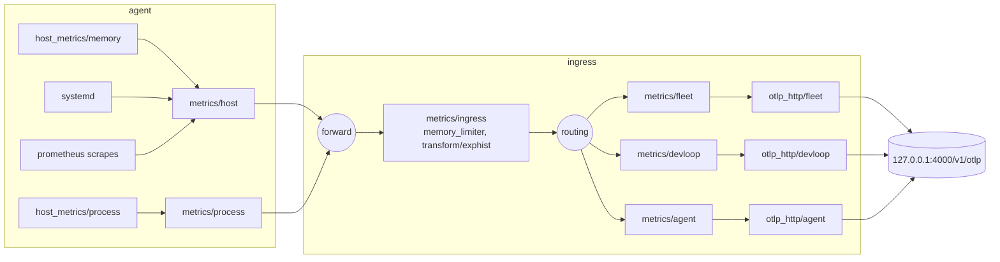
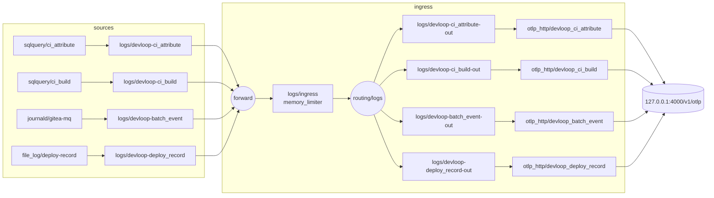

# otel-collector clan service

This clan service collects fleet metrics into the GreptimeDB telemetry store and carries the dev-loop record's logs into `devloop`, and its `agent` role imports the failure notifier that posts unit failures to ntfy.
It has two roles, `agent` and `ingress`, and in slice S1 both are assigned to magnetite in `modules/clan/inventory/services/otel-collector.nix`.
The roles import the plain NixOS modules `flake.modules.nixos.otel-collector-agent` and `flake.modules.nixos.otel-collector-ingress`, so the container test imports them without clan.
Only the clan `ingress` role reads a clan var: the `collector-password` credential.

The NixOS module runs one collector per host, so both roles' fragments merge into one `services.opentelemetry-collector` and one `opentelemetry-collector.service`.
Both roles import `collectorCore`, which carries the shared module key `vanixiets#otel-collector-core` so a host holding both roles loads it once.
`collectorCore` sets the package to `opentelemetry-collector-contrib`, defines the `memory_limiter` processor (384 MiB) that the two agent pipelines and `metrics/ingress` run first, and gives the unit `RestartSec = 5s` with `StartLimitIntervalSec = 0`.

## Data flow



The agent pipelines stamp `host.name` and `vanixiets.database = fleet` on every resource, then export to the in-process `forward` connector.
The `metrics/host` pipeline also runs `transform/omnigent-alias`; the `metrics/process` pipeline sums `process.memory.usage` per executable name and drops executables under `process.minBytes` (64 MiB).
The ingress converts exponential histograms to explicit buckets while the store is below 1.3.0, then the `routing` connector sends each resource to `metrics/<database>` by its `vanixiets.database` attribute.
Each per-database pipeline deletes `vanixiets.database` and writes through its own `otlp_http/<database>` exporter.
Each exporter sends `x-greptime-db-name: <database>` and `x-greptime-otlp-metric-promote-resource-attrs` built from `promotedResourceAttributes`, so the store turns those resource attributes into labels.
Only `fleet` receives metrics; the `devloop` and `agent` metrics routes exist so later slices add metric producers without restructuring the ingress, and `devloop`'s rows arrive on the logs path below.

## Logs path

S2 adds a logs path that copies the dev-loop record into `devloop`, one table per source.
`modules/nixos/devloop-collection.nix` (`flake.modules.nixos.devloop-collection`, imported by magnetite) defines four receivers, each with `storage: file_storage`, so its position survives a restart:

- `sqlquery/ci_attribute` and `sqlquery/ci_build` read nixbot's PostgreSQL database every 60 s over the local socket as the peer-authenticated role `opentelemetry-collector`, with a cursor on `finished_at` that re-reads a five-minute overlap in pages of 10,000 rows.
- `journald/gitea-mq` reads the five `msg="batch …"` lines of `gitea-mq.service` and keeps only the `batch_event` keys.
  Its `journalctl_path` is a wrapper that runs `journalctl --boot=all`, because the receiver always runs `journalctl --follow` with no boot option, and systemd 261 then reads only the current boot.
- `file_log/deploy-record` reads `/var/log/deploy-record.jsonl` with `json_parser`.



Each receiver feeds its own pipeline `logs/devloop-<table>`, which runs `memory_limiter` and `resource/devloop-<table>`, setting `vanixiets.database = devloop`, `vanixiets.table = <table>` and `host.name`, and exports to the `forward` connector.
In the ingress, `logs/ingress` runs `forward`, `memory_limiter` and then `routing/logs`, a second instance of the routing connector with one route per table matching both attributes.
A second instance is needed because one routing instance resolves every route's pipelines as pipelines of the signal it routes (`open-telemetry/opentelemetry-collector-contrib@aaf5045a2:connector/routingconnector/router.go:161-190`).
Each route ends in `logs/devloop-<table>-out`, which runs `resource/strip-database`, deleting `vanixiets.database` and `vanixiets.table`, into its own exporter: `otlp_http/devloop_ci_attribute`, `otlp_http/devloop_ci_build`, `otlp_http/devloop_batch_event` or `otlp_http/devloop_deploy_record`.
Each exporter posts to `http://127.0.0.1:4000/v1/otlp` as `collector` with `x-greptime-db-name: devloop`, `x-greptime-log-table-name: <table>`, `x-greptime-pipeline-name: devloop_<table>` and `x-greptime-hints: auto_create_table=false`, because one exporter carries one table header and one pipeline header.
The store's pipeline `devloop_<table>` keeps exactly the allow-listed fields, and `greptimedb-schema` creates the tables beforehand with `append_mode = 'false'`, so a re-read row replaces the stored one.
With `auto_create_table=false`, a write that races the schema job is rejected instead of creating an append-mode table that would keep every duplicate.
A record the pipeline cannot convert fails the whole request with HTTP 400, which the exporter drops as permanent; for `sqlquery` the cursor has already moved past it, so up to 10,000 rows are lost until a cursor reset, and `devloop-reconcile`'s `C1`, `C2`, `C3` and `C6` are the detectors (runbook, "Replaying a gap").
No `skip_error` is set, because per-row loss would then be silent.
No `logs/*` pipeline takes the local `otlp` receiver.

## The schema is the single source

`flake.lib.otelCollectorSchema`, defined in `schema.nix`, holds every allow-list and bound the service reads.
Nothing imports `schema.nix` by path; import-tree loads it as a flake-parts module.

- `databases`: database name to TTL (`fleet` 30d, `devloop` 365d, `agent` 90d).
  The ingress builds one route and one exporter per name, and magnetite's `services.greptimedb.databases` reads the same map, so the schema job creates exactly these databases.
- `systemdUnits`: systemd unit patterns for the systemd receiver, `.service` units only.
  At most 40 units may match on one host.
- `ownerAliases`: owner name to opaque alias.
  `omnigent-host-<owner>.service` is stored as `omnigent-host-<alias>.service`, so no owner's name becomes a label value.
- `promotedResourceAttributes`: the resource attributes the store promotes to labels.
- `nodeExporterKeep`: the node_exporter series the `node` scrape keeps; every other series is dropped.
- `process.minBytes`: the floor below which an executable's summed `process.memory.usage` is dropped.
- `devloop.tables`: the `devloop` allow-list, table name to `{ columns, primaryKey, timeIndex }`, each column `{ name; type; nullable; }` with `type` one of `int64`, `string`, `boolean` and `timestamp`.
  From it `modules/nixos/devloop-collection.nix` renders the store's `CREATE TABLE` statements and ingest pipelines, the nixbot queries' column aliases and order, and the gitea-mq and deploy-record keep-lists.
  A column added to an existing table is created by the pipeline's first write of it; a changed type needs an explicit migration.

To add a database, add `<name> = "<ttl>";` to `databases`, add a `queueBytes.<name>` entry in `flake-module.nix`, and have the producing pipeline set `vanixiets.database = "<name>"`.
The queues must still sum to under 512 MiB.
The ingress assertion fails if the store would create a different set of databases from the one the ingress routes to.

To add a unit, add its pattern to `systemdUnits` and confirm the host still matches no more than 40 units.
If the unit is a store unit (`greptimedb*`) or a disk-share oneshot (`zfs-set-*`, `zfs-assert-*`) on magnetite, also list it in `services.observability-notify.units`.

To add an owner, give the new omnigent worker owner the next alias (`owner-3`, then `owner-4`).
Never renumber an existing alias, and never put any part of an owner's name in an alias.

## Credentials

The ingress authenticates to the store as the write-only `collector` user through the `basicauth/store` extension.
Its `client_auth.password_file` names `/run/credentials/opentelemetry-collector.service/collector-password`, which the clan `ingress` role loads from the `greptimedb-users` generator's `collector-password` file with `LoadCredential`.
That file has `restartUnits = [ "opentelemetry-collector.service" ]`, so a rotation restarts the collector.

When `services.zerotierone.enable` is set, the agent loads `/var/lib/zerotier-one/metricstoken.secret` as the `zerotier-metricstoken` credential and scrapes `127.0.0.1:9993` with it as a bearer token.
nixpkgs validates the rendered configuration at build time, before `/run/credentials` exists, and the prometheus receiver's validation stats its `credentials_file`.
The single `validateConfigOverrides` entry therefore replaces the `prometheus/zerotier` scrape job with itself minus `authorization`, for validation only.
`basicauth` does not open `password_file` during validation, so it needs no override.

The notifier reads no clan var itself; a host passes the path of the `alerter` ntfy token through `services.observability-notify.tokenFile` (see Failure notifier).

## Queue

Every exporter uses a persistent `file_storage` sending queue under `/var/lib/opentelemetry-collector/queue`, sized in bytes; the logs receivers keep their positions in the same directory, as `receiver_<type>_<name>` files, with `file_log` spelled `filelog`, beside the exporters' `exporter_otlp_http_<name>_<signal>` files.
`fleet` gets 400 MiB, `agent` 48 MiB, `devloop` (metrics) 4 MiB, `devloop_ci_attribute` 32 MiB, and `devloop_ci_build`, `devloop_batch_event` and `devloop_deploy_record` 4 MiB each, 496 MiB in all, so the total stays under 512 MiB and `fleet` holds at least 24 hours at the assumed rate.
The assumed rate, `fleetBytesPerMinute` in `modules/checks/otel-collector-config.nix`, is an unmeasured estimate.
Retries never stop (`max_elapsed_time = "0s"`), because a persistent queue drops an item whose retries run out.
`devloop_ci_attribute` holds about a day of store outage on the busiest day, about 64,800 attribute rows at roughly 0.5 KiB each; a fuller queue loses rows from the store's copy only, which `devloop-reconcile` reports and a receiver replay restores (runbook, "Replaying a gap").

## Ordering after the schema job

On a host that runs the store, the ingress orders the collector `After=` and `Wants=` `greptimedb-schema.service`.
The store answers HTTP 400 for a database that does not exist, and the exporter drops a 400 as permanent; magnetite's first deployment lost 279 points that way.
`Wants=` rather than `Requires=` keeps collection running and queueing when the schema job fails, and the schema job's own failure notice reports it.

The collector unit runs with `MemoryMax = 512M` and `OOMScoreAdjust = 300`, so under host memory exhaustion the kernel kills the CI evaluator (900) first, the store (500) second and the collector last.

## Failure notifier

The notifier lives in `modules/nixos/observability-notify.nix` as `flake.modules.nixos.observability-notify`, which the `agent` role imports; a host without the role imports it directly.
It defines `observability-notify@.service` and the options `services.observability-notify.units` and `services.observability-notify.tokenFile`.
Entries in `units` are `systemd.services` attribute names without `.service`.
The agent lists `opentelemetry-collector` itself, and magnetite lists the store units, `fleet-alert`, `devloop-pg-grants`, `devloop-reconcile` and its ZFS oneshots in `modules/machines/nixos/magnetite/default.nix`.
For every listed unit the module sets `OnFailure=observability-notify@%n.service`, so an instance is named `observability-notify@<unit>.service.service`.
It also adds two hooks running one script as root: `ExecStartPost=` with mode `start` and `ExecStopPost=` with mode `stop`.

The notifier posts `FAILED <unit> on <host>` to the `fleet-alerts` topic at `https://ntfy.zt` and writes a stamp file `/var/lib/observability-notify/<unit>` containing `posted`.
While the stamp exists it posts nothing, so one failure episode gives one notice.
The hook posts `RESOLVED <unit> on <host>` and removes the stamp when the unit next starts, or next stops with `SERVICE_RESULT=success`.
The start hook is what ends an episode across automatic restarts, because systemd never reports the stop before an automatic restart as a success.

A per-unit timestamp in `/var/lib/observability-notify/last-failed/<unit>` rate-limits the posts.
A failure within `OBSERVABILITY_NOTIFY_MIN_INTERVAL_SEC` (900 s) of the last posted `FAILED` writes a stamp containing `suppressed`, and the hooks remove that stamp without posting.
A crash loop therefore yields one `FAILED`/`RESOLVED` pair, then at most one new pair per 15 minutes per unit.
A failed `FAILED` post writes no stamp, so the next failure posts again; a failed `RESOLVED` post leaves the stamp for the next start or successful stop.
`observability-notify@*.service` is in `systemdUnits`, so a notifier instance whose post failed is a failed unit the collector reports, and the alert evaluator raises `SystemdUnitFailed` for it once it has stayed failed for the rule's 5-minute `for`, retrying that post on every run until ntfy accepts it; the rule's exclusion of notified units does not match these template instances.
A switch runs `reset-failed`, so an instance that failed during a deploy is cleared within that window and its post is never retried (on 2026-10-25 about 75 s after the failure).

For each posted `FAILED` the notifier appends one line `<epoch> <unit> <host>` to `/var/lib/observability-notify/failed.log`, which it creates with mode `0644` so the alert evaluator, a `DynamicUser`, can read it; a suppressed episode and a failed post append nothing.
The evaluator counts that log's lines from the last 24 hours, together with its own `FIRING` posts, for the R9.1 budget; the log is not rotated, and the 15-minute interval bounds its growth.

`services.observability-notify.tokenFile` (default `null`) names the file holding the `alerter` ntfy token.
When it is set, the template loads the file as the credential `alerter-token` with `NTFY_TOKEN_FILE=%d/alerter-token`, and both hooks run the script under `env NTFY_TOKEN_FILE=<tokenFile>`, because they run inside each notified unit and cannot see the template's credential.
`ntfy-send` sends the token as an `Authorization: Bearer` header on curl's stdin, never on a command line.
With `tokenFile` unset the notifier posts anonymously, which ntfy refuses on `fleet-*` topics once cinnabar's access entries are in force.

## Hazards

- The agent pipelines export only to `forward`, which is valid only where the ingress role runs on the same host; the collector rejects a connector that no pipeline receives from.
  S4 must choose the agent's exporter by role: `forward` beside the ingress, and an OTLP exporter to the ingress elsewhere.
- `validateConfigOverrides` may remove only the zerotierone job's `authorization`; the R3.1 override clause fails on any wider override.
  A new receiver whose validation opens a credential file needs that clause changed in the same edit.
- `hostmetricsreceiver` ignores unknown top-level keys, so a misspelt key in a `host_metrics/*` receiver passes build-time validation and silently has no effect.
  Confirm a changed receiver by reading its series back from the store.
- The process scraper must keep `process.pid`, `process.parent_pid`, `process.command`, `process.command_line`, `process.executable.path` and `process.owner` disabled at source; an agent assertion enforces this.
- The exponential-histogram conversion stays while the store is below 1.3.0; R1.2 fails if it is removed earlier.
- A host's ZFS and store notices depend on its importing `observability-notify`, through the `agent` role or directly; the module's key `vanixiets#observability-notify` makes a host doing both load it once.
- `sqlquery` stores each query's position under a key that contains the query's text (`open-telemetry/opentelemetry-collector-contrib@aaf5045a2:receiver/sqlqueryreceiver/logs_receiver.go:123`, `:276`), so any later change to an export query, such as a column a later slice adds to the allow-list, starts again from `tracking_start_value` and re-sends nixbot's retained history once, about 200,000 attribute rows; the store keeps one row per key, but that day exceeds ADR-004's 100,000 rows.
- `sqlquery` and `journald` advance their position before delivery (`logs_receiver.go:337-346`; `pkg/stanza/operator/input/journald/input.go:186-189`), so a `memory_limiter` refusal loses journal lines, and nixbot rows older than the five-minute overlap, until a replay; `journald/gitea-mq` sets `retry_on_failure` with no time limit to narrow that loss.
- `journald/gitea-mq` depends on its `journalctl --boot=all` wrapper: without it, systemd 261's `journalctl --follow` reads only the current boot, so a replay or first start copies only the lines since the last reboot, and `C3` fails.
- The `sqlquery` logs signal is at Development stability and `journald` at Alpha in 0.155.0, so a collector bump runs `vmTests.x86_64-linux.devloop-ingest` before merge.

## Coverage

Module assertions run whenever a host imports the modules:

- agent: the six process identity attributes are disabled, and node_exporter does not open the firewall.
- ingress: the store's `services.greptimedb.databases` names equal `otelCollectorSchema.databases` whenever the host runs the store.
- `modules/nixos/greptimedb.nix`: listeners on loopback, unused protocols off, a static user provider, usage reporting off, `MemoryHigh` in whole gibibytes.
- `modules/nixos/observability-notify.nix`: with `tokenFile` set, every notified unit's resolve hooks run under `env NTFY_TOKEN_FILE=<tokenFile>`.
- magnetite: R8.2, only the allowed units load each `greptimedb-users` file.
- `modules/nixos/devloop-collection.nix`: the collector's `SupplementaryGroups` contains `systemd-journal`, so `journald/gitea-mq` can read the journal, and `services.postgresql.package` has the major `flake.lib.devloopCollection.postgresqlMajor` that `devloop-queries` tests against.

`checks.x86_64-linux.otel-collector-config` (`modules/checks/otel-collector-config.nix`) judges R3.1 and R1.2 over magnetite's evaluated configuration, each clause with a mutant that must fail.
R3.1 covers loopback endpoints, the 64 MiB floor stage, the 40-unit cap, owner aliases, the signals pipelines may carry, with logs pipelines writing only into `devloop` (mutants `logsToFleet` and `logsToMetricsExporter`), queue storage and sizes over every exporter including the four logs exporters (mutant `logsQueueNotPersistent`), no `logs/*` pipeline taking the local OTLP receiver (`logsTakeLocalReceiver`, mutant `otlpInLogsPipeline`), `memory_limiter` under `MemoryMax`, the override scope, the notifier wiring against the failure-path policy, which includes `devloop-*` units (mutant `reconcileNotNotified`), and the order after the schema job.
Its build runs `observability-notify-rehearsal`, which drives the notifier scripts through a crash loop against a recording `ntfy-send`, requires one pair per interval and one `failed.log` line, mode `0644`, per posted `FAILED`, and rejects two mutants of the `failed` script, one without the append and one without the mode.

`checks.x86_64-linux.greptimedb-envelope` (`modules/checks/greptimedb-envelope.nix`) covers the store side: R7.1's memory and kill-order relations, R1.1, R8.2 file ownership, disko against the dataset binding, the PromQL read path, the users-file generator run, the SQL helper and table clause against recorded answers, and R7.2 against recorded cgroup files.

`checks.x86_64-linux.nixos-magnetite` builds the toplevel, which runs nixpkgs' `otelcol-contrib validate` on the rendered collector configuration.

Three runtime tests live in the on-demand `vmTests` lane, outside the pull-request checks:

- `vmTests.x86_64-linux.greptimedb-pipeline` (`modules/vm-tests/greptimedb-pipeline.nix`) is a systemd-nspawn container test needing `uid-range`, so it builds on magnetite.
  It covers the dashboard route, schema TTLs, the auth matrix, OTLP through both connectors into `fleet` only, the owner alias, delivery across a store restart, and the envelope's table clause.
- `vmTests.x86_64-linux.devloop-ingest` (`modules/vm-tests/devloop-ingest.nix`) is a systemd-nspawn container test needing `uid-range`, so it builds on magnetite.
  It runs PostgreSQL with nixbot's migrations, the store with its schema job, the collector with the logs path, a stub `gitea-mq.service` and `devloop-reconcile`, and covers every `otlp_http/devloop_<table>` exporter's first send, the tables' shape against the allow-list, the rejection of a write to a table the schema job did not create (`auto_create_table=false`), overlap deduplication, the deploy-record line of a switch to an `extendModules` variant of the container's system, each reconcile clause's mutant, the burn rule and the three documented queries on the real store.
- `vmTests.x86_64-linux.greptimedb-oom-order` (`modules/vm-tests/greptimedb-oom-order.nix`) is a QEMU test needing `kvm`, so it builds only on pyrite.
  It covers the kill order 900, 500, 300.

Run a container test on magnetite from a checkout of the revision under test, or from a workstation with `--max-jobs 0` so it routes to a builder advertising `uid-range`:

```sh
nix build -L --no-link .#vmTests.x86_64-linux.greptimedb-pipeline
nix build -L --no-link --max-jobs 0 .#vmTests.x86_64-linux.greptimedb-pipeline
nix build -L --no-link .#vmTests.x86_64-linux.devloop-ingest
nix build -L --no-link --max-jobs 0 .#vmTests.x86_64-linux.devloop-ingest
```

Run the OOM test from any host with `--max-jobs 0`; it fails with `missing system features` while pyrite is offline:

```sh
nix build -L --no-link --max-jobs 0 .#vmTests.x86_64-linux.greptimedb-oom-order
```

## Further reading

- [otel-collector component](../../../../docs/notes/development/observability/components/otel-collector.md)
- [greptimedb component](../../../../docs/notes/development/observability/components/greptimedb.md)
- [host-probes component](../../../../docs/notes/development/observability/components/host-probes.md)
- [fleet-alert component](../../../../docs/notes/development/observability/components/fleet-alert.md)
- [ADR-003 collection topology](../../../../docs/notes/development/observability/decisions/ADR-003-collection-topology.md)
- [ADR-004 signal scope and schema](../../../../docs/notes/development/observability/decisions/ADR-004-signal-scope-and-schema.md)
- [ADR-007 packaging, placement and clan service](../../../../docs/notes/development/observability/decisions/ADR-007-packaging-placement-and-clan-service.md)
- [ADR-008 access control and tenancy](../../../../docs/notes/development/observability/decisions/ADR-008-access-control-and-tenancy.md)
- [ADR-009 alerting](../../../../docs/notes/development/observability/decisions/ADR-009-alerting.md)
- [S1 design](../../../../openspec/changes/stand-up-greptimedb-on-magnetite/design.md)
- [Fleet observability runbook](../../../../packages/docs/src/content/docs/development/operations/fleet-observability.md)
