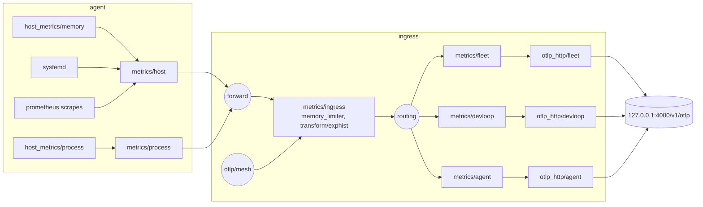
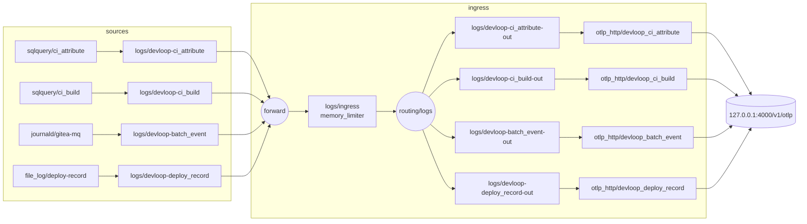

# otel-collector clan service

This clan service collects fleet metrics into the GreptimeDB telemetry store and carries the dev-loop record's logs into `devloop`, and its `agent` role imports the failure notifier that posts unit failures to ntfy.
It has two roles, `agent` and `ingress`, assigned in `modules/clan/inventory/services/otel-collector.nix`: `agent` on every host of `flake.lib.observabilityHosts`, and `ingress` on magnetite alone.
The roles import the plain NixOS modules `flake.modules.nixos.otel-collector-agent` and `flake.modules.nixos.otel-collector-ingress`, so the container tests import them without clan.
The clan `agent` role reads the `otel-ca`, `otel-cert` and `ntfy-alerter` vars, and the clan `ingress` role reads the `collector-password` and `regulator-password` files of `greptimedb-users`.

The NixOS module runs one collector per host, so both roles' fragments merge into one `services.opentelemetry-collector` and one `opentelemetry-collector.service`.
Both roles import `collectorCore`, which carries the shared module key `vanixiets#otel-collector-core` so a host holding both roles loads it once.
`collectorCore` sets the package to `opentelemetry-collector-contrib`, defines the `memory_limiter` processor (384 MiB) that the agent pipelines and `metrics/ingress` run first, the `file_storage` extension under `/var/lib/opentelemetry-collector/queue`, and the options `vanixiets.otelCollector.ingress`, `caFile`, `smartDevices` and `envelopeBudget`, and gives the unit `RestartSec = 5s` with `StartLimitIntervalSec = 0`.

## Agent hosts and the host table

`flake.lib.observabilityHosts` in `modules/lib/observability-hosts.nix` lists the agent hosts, magnetite, cinnabar, pyrite, electrum, galena and scheelite, each with `collect`, `alwaysOn`, `notifiedUnits` and `smartDevices`.
The inventory generates `roles.agent.machines` from that table, so a host joins the agent role by a row there.
On every row, whatever its `collect`, the clan agent role declares the `otel-ca` and `otel-cert` generators and imports `flake.modules.nixos.ntfy-alerter`, so one vars step covers every host.
`collect` gates everything else the role runs on the host: the agent fragment, `vanixiets.otelCollector.caFile` and `smartDevices`, the notifier's `units` and `tokenFile`, and the collector's `otel-cert` and `otel-key` credentials.
On a host that does not collect, the certificate and the token are uploaded files that no unit reads.
A new host is therefore added with `collect = false`, and turned on by its own one-line change setting `collect = true`, merged immediately before the host's watched deploy (runbook, "Adding an agent host").
`alwaysOn` marks magnetite and cinnabar, the hosts whose silence the alert rules report, and only pyrite lists `smartDevices`, `[ "/dev/nvme0" ]`.

## Export by role

`vanixiets.otelCollector.ingress` (default `false`) says whether the host runs the ingress, and `flake.modules.nixos.otel-collector-ingress` sets it to `true`.
On magnetite the agent's pipelines end in the in-process `forward` connector, which `metrics/ingress` and `logs/ingress` receive from.
Everywhere else they end in `otlp_http/ingress` (metrics) and `otlp_http/ingress-logs` (logs), which post to `https://[<magnetite's ZeroTier address>]:4318`, the address taken from `flake.lib.hosts.magnetite.zt`, with `tls.min_version = "1.3"`.
Both present the host's certificate from the credentials `otel-cert` and `otel-key` under `/run/credentials/opentelemetry-collector.service/`, which the clan agent role loads from `otel-cert`'s `cert.pem` and `key.pem` with `LoadCredential`.
Both trust `vanixiets.otelCollector.caFile`, `otel-ca`'s `ca.crt` written to the store with `pkgs.writeText`, so a new CA changes the rendered configuration and restarts the collector.
`otel-cert`'s two files carry `restartUnits = [ "opentelemetry-collector.service" ]` on hosts that collect.
`otel-ca` is shared, its `ca.key` is never deployed, and it signs each host's `otel-cert` only at generation time.
Each `otel-cert` names its host as the CN with the extended key usage `clientAuth`; magnetite's adds `serverAuth` and the SANs `IP:<magnetite's ZeroTier address>` and `DNS:magnetite.zt`.
A non-ingress agent runs with `MemoryMax = "256M"` and its `memory_limiter` at 150 MiB with a 30 MiB spike allowance.
On every non-ingress host an assertion requires both exporters to queue in `file_storage` by bytes and retry without limit, the metrics queue to hold 24 hours at `flake.lib.otelCollectorSchema.fleetBytesPerMinute`, the two queues to sum below 512 MiB, and the limiter to stay below `MemoryMax`.

The ingress's `otlp/mesh` receiver listens on `[<magnetite's ZeroTier address>]:4318`, HTTP only, with no gRPC.
It presents magnetite's `otel-cert` and `otel-key`, which the clan agent role loads on magnetite too, and sets `client_ca_file` to the same CA and `min_version = "1.3"`, so a client without a certificate from `otel-ca` fails the TLS handshake.
It feeds `metrics/ingress` beside `forward`, and `logs/ingress` where the devloop routes exist.
The clan ingress role opens TCP 4318 on the `zt+` interfaces only (`networking.firewall.interfaces."zt+".allowedTCPPorts`).
magnetite sets `net.ipv6.ip_nonlocal_bind = 1`, so the receiver binds its address even before `zerotierone` holds it.

## What each agent collects

Every agent runs `host_metrics/memory`, `host_metrics/process`, the `systemd` receiver over `schema.systemdUnits`, and a `prometheus` receiver that scrapes loopback targets every 60 s.
The `node` job scrapes the loopback node_exporter at `127.0.0.1:9100` and keeps `schema.nodeExporterKeep`.
The `gitea`, `niks3`, `nixbot` and `greptimedb` jobs exist only where their service is enabled, because a target that never answers would be a permanently down target.
`host_metrics/memory` also runs the `filesystem` scraper over the host's ZFS mountpoints, read from the host's own `fileSystems` with `fsType = "zfs"`, under a `strict` `include_mount_points` list, so container runtime mounts stay out.
The scraper sets `include_virtual_filesystems = true`, because it otherwise drops every ZFS mount as a `nodev` filesystem, and keeps `system.filesystem.usage` alone.
A host without ZFS mounts gets no `filesystem` scraper, because an empty strict list is no filter in otelcol.
The `otelcol` job scrapes the collector's own telemetry at `127.0.0.1:8888`, keeps the eight queue, send-failure, enqueue-failure and refusal series of `schema.otelcolKeep`, and drops the `service_instance_id` label, which changes at every collector start.
Where `vanixiets.otelCollector.smartDevices` is non-empty, the agent runs `prometheus-smartctl-exporter.service` on `127.0.0.1:9633` with `openFirewall = false` and `MemoryMax = "64M"`, and the `smartctl` job keeps the eight series of `schema.smartctlKeep`.
The exporter's NixOS module grants the `smartctl-exporter-access` group its ACL on each device by a udev rule that fires only on an `add` event, which a switch does not replay.
The unit therefore runs one privileged `ExecStartPre` per device, `+setfacl -m g:smartctl-exporter-access:rw <device>`.
An agent assertion keeps `openFirewall` off for both node_exporter and the smartctl exporter.

`file_log/deploy-record` lives in the agent fragment, unchanged in id and settings from when magnetite's dev-loop collection defined it, so magnetite's stored offset carried over.
It reads `/var/log/deploy-record.jsonl` on every agent host into `logs/devloop-deploy_record`, which ends in `forward` on magnetite and in `otlp_http/ingress-logs` elsewhere.
On the ingress host it is configured only where the store declares the devloop pipelines, because `forward` would otherwise feed no logs pipeline.

## Data flow



The agent pipelines stamp `host.name` and `vanixiets.database = fleet` on every resource, then export to the in-process `forward` connector on magnetite, and to `otlp_http/ingress`, which reaches the ingress through `otlp/mesh`, on every other host.
The `metrics/host` pipeline also runs `transform/omnigent-alias`; the `metrics/process` pipeline sums `process.memory.usage` per executable name and drops executables under `process.minBytes` (64 MiB).
The ingress converts exponential histograms to explicit buckets while the store is below 1.3.0, then the `routing` connector sends each resource to `metrics/<database>` by its `vanixiets.database` attribute.
Each per-database pipeline deletes `vanixiets.database` and writes through its own `otlp_http/<database>` exporter.
Each exporter sends `x-greptime-db-name: <database>` and `x-greptime-otlp-metric-promote-resource-attrs` built from `promotedResourceAttributes`, so the store turns those resource attributes into labels.
Only `fleet` receives metrics; the `devloop` and `agent` metrics routes exist so later slices add metric producers without restructuring the ingress, and `devloop`'s rows arrive on the logs path below.

## Logs path

S2 adds a logs path that copies the dev-loop record into `devloop`, one table per source.
`modules/nixos/devloop-collection.nix` (`flake.modules.nixos.devloop-collection`, imported by magnetite) defines the first three of the four receivers below and the agent fragment the fourth, each with `storage: file_storage`, so its position survives a restart:

- `sqlquery/ci_attribute` and `sqlquery/ci_build` read nixbot's PostgreSQL database every 60 s over the local socket as the peer-authenticated role `opentelemetry-collector`, with a cursor on `finished_at` that re-reads a five-minute overlap in pages of 10,000 rows.
- `journald/gitea-mq` reads the five `msg="batch …"` lines of `gitea-mq.service` and keeps only the `batch_event` keys.
  Its `journalctl_path` is a wrapper that runs `journalctl --boot=all`, because the receiver always runs `journalctl --follow` with no boot option, and systemd 261 then reads only the current boot.
- `file_log/deploy-record` reads `/var/log/deploy-record.jsonl` with `json_parser`.



Each receiver feeds its own pipeline `logs/devloop-<table>`, which runs `memory_limiter` and `resource/devloop-<table>`, setting `vanixiets.database = devloop`, `vanixiets.table = <table>` and `host.name`, and exports to the `forward` connector, or, for another host's deploy records, to `otlp_http/ingress-logs` and so to `otlp/mesh`.
In the ingress, `logs/ingress` runs `forward`, `memory_limiter` and then `routing/logs`, a second instance of the routing connector with one route per table matching both attributes.
A second instance is needed because one routing instance resolves every route's pipelines as pipelines of the signal it routes (`open-telemetry/opentelemetry-collector-contrib@aaf5045a2:connector/routingconnector/router.go:161-190`).
Each route ends in `logs/devloop-<table>-out`, which runs `resource/strip-database`, deleting `vanixiets.database` and `vanixiets.table`, into its own exporter: `otlp_http/devloop_ci_attribute`, `otlp_http/devloop_ci_build`, `otlp_http/devloop_batch_event` or `otlp_http/devloop_deploy_record`.
Each exporter posts to `http://127.0.0.1:4000/v1/otlp` as `collector` with `x-greptime-db-name: devloop`, `x-greptime-log-table-name: <table>`, `x-greptime-pipeline-name: devloop_<table>` and `x-greptime-hints: auto_create_table=false`, because one exporter carries one table header and one pipeline header.
The store's pipeline `devloop_<table>` keeps exactly the allow-listed fields, and `greptimedb-schema` creates the tables beforehand with `append_mode = 'false'`, so a re-read row replaces the stored one.
With `auto_create_table=false`, a write that races the schema job is rejected instead of creating an append-mode table that would keep every duplicate.
A record the pipeline cannot convert fails the whole request with HTTP 400, which the exporter drops as permanent; for `sqlquery` the cursor has already moved past it, so up to 10,000 rows are lost until a cursor reset, and `devloop-reconcile`'s `C1`, `C2`, `C3` and `C6` are the detectors (runbook, "Replaying a gap").
No `skip_error` is set, because per-row loss would then be silent.
No `logs/*` pipeline takes the local `otlp` receiver.

## The schema is the single source

`flake.lib.otelCollectorSchema`, defined in `schema.nix`, holds every allow-list and bound the service reads.
Nothing imports `schema.nix` by path; import-tree loads it as a flake-parts module.

- `databases`: database name to TTL (`fleet` 30d, `devloop` 365d, `agent` 90d).
  The ingress builds one route and one exporter per name, and magnetite's `services.greptimedb.databases` reads the same map, so the schema job creates exactly these databases.
- `systemdUnits`: systemd unit patterns for the systemd receiver, `.service` units only.
  At most 40 units may match on one host.
- `ownerAliases`: owner name to opaque alias.
  `omnigent-host-<owner>.service` is stored as `omnigent-host-<alias>.service`, so no owner's name becomes a label value.
- `promotedResourceAttributes`: the resource attributes the store promotes to labels.
- `nodeExporterKeep`: the node_exporter series the `node` scrape keeps; every other series is dropped.
- `process.minBytes`: the floor below which an executable's summed `process.memory.usage` is dropped.
- `devloop.tables`: the `devloop` allow-list, table name to `{ columns, primaryKey, timeIndex }`, each column `{ name; type; nullable; }` with `type` one of `int64`, `string`, `boolean` and `timestamp`.
  From it `modules/nixos/devloop-collection.nix` renders the store's `CREATE TABLE` statements and ingest pipelines, the nixbot queries' column aliases and order, and the gitea-mq and deploy-record keep-lists.
  A column added to an existing table is created by the pipeline's first write of it; a changed type needs an explicit migration.

To add a database, add `<name> = "<ttl>";` to `databases`, add a `queueBytes.<name>` entry in `flake-module.nix`, and have the producing pipeline set `vanixiets.database = "<name>"`.
The queues must still sum to under 512 MiB.
The ingress assertion fails if the store would create a different set of databases from the one the ingress routes to.

To add a unit, add its pattern to `systemdUnits`; an agent assertion fails the evaluation of any host on which more than 40 services, notifier instances (`systemdUnitsNotifierPattern`) apart, match it.
If the unit is a store unit (`greptimedb*`) or a disk-share oneshot (`zfs-set-*`, `zfs-assert-*`) on magnetite, also add it to magnetite's `notifiedUnits` in `flake.lib.observabilityHosts`.

To add an owner, give the new omnigent worker owner the next alias (`owner-3`, then `owner-4`).
Never renumber an existing alias, and never put any part of an owner's name in an alias.

## Credentials

The ingress authenticates to the store as the write-only `collector` user through the `basicauth/store` extension.
Its `client_auth.password_file` names `/run/credentials/opentelemetry-collector.service/collector-password`, which the clan `ingress` role loads from the `greptimedb-users` generator's `collector-password` file with `LoadCredential`.
That file has `restartUnits = [ "opentelemetry-collector.service" ]`, so a rotation restarts the collector.

When `services.zerotierone.enable` is set, the agent loads `/var/lib/zerotier-one/metricstoken.secret` as the `zerotier-metricstoken` credential and scrapes `127.0.0.1:9993` with it as a bearer token.
nixpkgs validates the rendered configuration at build time, before `/run/credentials` exists, and the prometheus receiver's validation stats its `credentials_file`.
The single `validateConfigOverrides` entry therefore replaces the `prometheus/zerotier` scrape job with itself minus `authorization`, for validation only.
`basicauth` does not open `password_file` during validation, so it needs no override.

The notifier reads no clan var itself; the clan agent role passes the path of the `ntfy-alerter` token through `services.observability-notify.tokenFile` (see Failure notifier).

## Queue

Every exporter uses a persistent `file_storage` sending queue under `/var/lib/opentelemetry-collector/queue`, sized in bytes; the logs receivers keep their positions in the same directory, as `receiver_<type>_<name>` files, with `file_log` spelled `filelog`, beside the exporters' `exporter_otlp_http_<name>_<signal>` files.
On magnetite the ingress's seven store exporters queue: `fleet` gets 400 MiB, `agent` 48 MiB, `devloop` (metrics) 4 MiB, `devloop_ci_attribute` 32 MiB, and `devloop_ci_build`, `devloop_batch_event` and `devloop_deploy_record` 4 MiB each, 496 MiB in all, so the total stays under 512 MiB and `fleet` holds at least 24 hours at the assumed rate.
On every other agent host `otlp_http/ingress` gets 400 MiB and `otlp_http/ingress-logs` 16 MiB, and these queues hold the host's exports while magnetite, its receiver or the mesh is unreachable.
The assumed rate, `fleetBytesPerMinute` in `schema.nix`, is 256,000 bytes a minute per host.
cinnabar's measured rate is far below it: on 2026-10-29 its metrics queue held 524,034 bytes after the 23 minutes between its deploy and the start of magnetite's receiver, about 22,800 bytes a minute, and was empty within 7 minutes of that start.
Retries never stop (`max_elapsed_time = "0s"`), because a persistent queue drops an item whose retries run out.
`devloop_ci_attribute` holds about a day of store outage on the busiest day, about 64,800 attribute rows at roughly 0.5 KiB each; a fuller queue loses rows from the store's copy only, which `devloop-reconcile` reports and a receiver replay restores (runbook, "Replaying a gap").

## Ordering after the schema job

On a host that runs the store, the ingress orders the collector `After=` and `Wants=` `greptimedb-schema.service`.
The store answers HTTP 400 for a database that does not exist, and the exporter drops a 400 as permanent; magnetite's first deployment lost 279 points that way.
`Wants=` rather than `Requires=` keeps collection running and queueing when the schema job fails, and the schema job's own failure notice reports it.

On magnetite, the ingress host, the collector unit runs with `MemoryMax = 512M` and `OOMScoreAdjust = 300`, so under host memory exhaustion the kernel kills the CI evaluator (900) first, the store (500) second and the collector last.

## otel-envelope

`otel-envelope.service`, started by `otel-envelope.timer` every 5 minutes (`OnCalendar = "*:0/5"`) on every agent host, judges the host's own collector from its telemetry endpoint at `127.0.0.1:8888` (ADR-003 R3.2).
It is a `DynamicUser` oneshot with `StateDirectory = "otel-envelope"`, `MemoryMax = "64M"` and `TimeoutStartSec = "4min"`, running `flake.lib.otelEnvelope` from `modules/lib/otel-envelope.nix`.
Its targets are rendered by `flake.lib.otelEnvelopeTargets` from every job of the collector's evaluated `prometheus*` receivers, so it probes exactly what the collector scrapes.
Where `zerotierone` runs, the unit loads the same `zerotier-metricstoken` credential as the collector and probes the `zerotierone` job with it.
Each run prints one line per clause, `otel-envelope: <clause> <name>: ok` or `otel-envelope: <clause> <name>: FAIL <detail>`, and exits 1 if any clause failed.
`otel-envelope` is in every host's `notifiedUnits`, so a failed run posts `FAILED otel-envelope.service on <host>`.

- `C1 telemetry` fails when the telemetry endpoint did not answer within 10 s on this run and the previous one.
- `C2 targets` fails when a declared target did not answer `GET` with 200 within 10 s on this run and the previous one, and names the job.
- `C3 queue` fails when an exporter's `otelcol_exporter_queue_size` reached 90 % of its `otelcol_exporter_queue_capacity`, or its capacity is absent.
- `C4 loss` fails when, since the previous run, an `otelcol_exporter_send_failed_*` counter rose, an `otelcol_receiver_refused_*` counter rose on any receiver but the ingress's `otlp/mesh`, or, off the ingress host, an `otelcol_exporter_enqueue_failed_*` counter rose.

On magnetite, `otlp/mesh` refusals and the store exporters' enqueue failures are back-pressure, not loss.
A refused agent keeps the data in its own persistent queue and resends it, so the refusal shows in that agent's `C3` once its queue fills, and a full store queue fails magnetite's `C3`.
On an agent that is not the ingress, an enqueue failure is loss, because nothing upstream of its exporter holds the data.
`/var/lib/otel-envelope/state` holds one `<key> <value>` line per loss counter, keyed without the labels that change at each collector start, and the `telemetry` and `down:<job>` flags of the last run.
A counter below its recorded value is a collector restart, and its current value counts as the increase.
A run without telemetry carries the previous counters forward, so the next run does not count their whole value as new loss.
A run without a state file, the first after the unit is deployed, records the baseline and judges `C1` to `C3` only, so counters that were already non-zero do not fail it; magnetite's and cinnabar's first runs on 2026-10-29 passed.

On the ingress host the clan ingress role sets `vanixiets.otelCollector.envelopeBudget` to the store's URL, every host's `notifiedUnits` and `schema.databases`, loads `regulator-password`, and orders the unit after `greptimedb.service`.
A run there whose UTC minute is `00` (`OTEL_ENVELOPE_MINUTE`, default `date -u +%M`), or any run with `OTEL_ENVELOPE_FORCE_HOURLY=1`, also judges the store's budget as `regulator` through `flake.lib.greptimedbSql`:

- `B1 active-series` fails above 8,000 series in `fleet` in the last hour.
- `B2 label-values` fails when a tag column of `fleet`'s physical table, other than `__tsid`, `__table_id` and the three that `B3` bounds per host, has over 200 values within one metric in the last hour.
- `B3 per-host` fails when a host has over 30 `process_executable_name` values, over `OTEL_ENVELOPE_MAX_UNITS` (default 40) `systemd_unit_name` values other than notifier instances, or over 30 `launchd_label` values in the last hour; while no table carries `launchd_label` it prints `otel-envelope: B3 per-host: launchd_label table absent` and skips that count.
- `B4 notifier-instances` fails when an `observability-notify@<unit>.service.service` instance is stored for a host whose `notifiedUnits` lacks `<unit>`.
- `B5 devloop-rows` fails above 100,000 `devloop` rows in the last 24 hours.
- `B6 ttl` fails when a database of `schema.databases` has a `ttl` other than the declared one, compared as durations.

A query that cannot reach the store, errors, names a missing table or returns no rows fails the clause that sent it.
A forced hand run of all ten clauses on magnetite on 2026-10-29 took about 1.5 s.

## Failure notifier

The notifier lives in `modules/nixos/observability-notify.nix` as `flake.modules.nixos.observability-notify`, which the agent fragment imports; a host that does not collect imports it directly, as cinnabar does.
It defines `observability-notify@.service` and the options `services.observability-notify.units` and `services.observability-notify.tokenFile`.
Entries in `units` are `systemd.services` attribute names without `.service`.
The clan agent role sets `units` from the host's `notifiedUnits` in `flake.lib.observabilityHosts`, which on every host include `opentelemetry-collector` and `otel-envelope`.
magnetite's add the store units, `fleet-alert`, `devloop-pg-grants`, `devloop-reconcile` and its ZFS oneshots, and cinnabar's add `fleet-deadman`, which `modules/machines/nixos/cinnabar/fleet-alert.nix` lists itself only while cinnabar's `collect` is false.
An agent assertion requires every listed unit to be a service with an `ExecStart`, and the list to include `opentelemetry-collector` and `otel-envelope`.
For every listed unit the module sets `OnFailure=observability-notify@%n.service`, so an instance is named `observability-notify@<unit>.service.service`.
It also adds two hooks running one script as root: `ExecStartPost=` with mode `start` and `ExecStopPost=` with mode `stop`.

The notifier posts `FAILED <unit> on <host>` to the `fleet-alerts` topic at `https://ntfy.zt` and writes a stamp file `/var/lib/observability-notify/<unit>` containing `posted`.
While the stamp exists it posts nothing, so one failure episode gives one notice.
The hook posts `RESOLVED <unit> on <host>` and removes the stamp when the unit next starts, or next stops with `SERVICE_RESULT=success`.
The start hook is what ends an episode across automatic restarts, because systemd never reports the stop before an automatic restart as a success.

A per-unit timestamp in `/var/lib/observability-notify/last-failed/<unit>` rate-limits the posts.
A failure within `OBSERVABILITY_NOTIFY_MIN_INTERVAL_SEC` (900 s) of the last posted `FAILED` writes a stamp containing `suppressed`, and the hooks remove that stamp without posting.
A crash loop therefore yields one `FAILED`/`RESOLVED` pair, then at most one new pair per 15 minutes per unit.
A failed `FAILED` post writes no stamp, so the next failure posts again; a failed `RESOLVED` post leaves the stamp for the next start or successful stop.
`observability-notify@*.service` is in `systemdUnits`, so a notifier instance whose post failed is a failed unit the collector reports, and the alert evaluator raises `SystemdUnitFailed` for it once it has stayed failed for the rule's 5-minute `for`, retrying that post on every run until ntfy accepts it; the rule's exclusion of notified units does not match these template instances.
A switch runs `reset-failed`, so an instance that failed during a deploy is cleared within that window and its post is never retried (on 2026-10-25 about 75 s after the failure).

For each posted `FAILED` the notifier appends one line `<epoch> <unit> <host>` to `/var/lib/observability-notify/failed.log`, which it creates with mode `0644` so the alert evaluator, a `DynamicUser`, can read it; a suppressed episode and a failed post append nothing.
The evaluator counts that log's lines from the last 24 hours, together with its own `FIRING` posts, for the R9.1 budget; the log is not rotated, and the 15-minute interval bounds its growth.

`services.observability-notify.tokenFile` (default `null`) names the file holding the `alerter` ntfy token.
When it is set, the template loads the file as the credential `alerter-token` with `NTFY_TOKEN_FILE=%d/alerter-token`, and both hooks run the script under `env NTFY_TOKEN_FILE=<tokenFile>`, because they run inside each notified unit and cannot see the template's credential.
`ntfy-send` sends the token as an `Authorization: Bearer` header on curl's stdin, never on a command line.
With `tokenFile` unset the notifier posts anonymously, which ntfy refuses on `fleet-*` topics once cinnabar's access entries are in force.

## Hazards

- `otel-ca` certificates have no revocation: a host's lost `otel-cert` key can write to `otlp/mesh` until `otel-ca` and every `otel-cert` are regenerated and deployed (runbook, "Rotating otel-ca").
- `file_log/deploy-record` keeps its offset in a `receiver_filelog_deploy-record` file named after its receiver id, so renaming the receiver re-sends every host's whole `/var/log/deploy-record.jsonl` once.
- `validateConfigOverrides` may remove only the zerotierone job's `authorization`; the R3.1 override clause fails on any wider override.
  A new receiver whose validation opens a credential file needs that clause changed in the same edit.
- `hostmetricsreceiver` ignores unknown top-level keys, so a misspelt key in a `host_metrics/*` receiver passes build-time validation and silently has no effect.
  Confirm a changed receiver by reading its series back from the store.
- The process scraper must keep `process.pid`, `process.parent_pid`, `process.command`, `process.command_line`, `process.executable.path` and `process.owner` disabled at source; an agent assertion enforces this.
- The exponential-histogram conversion stays while the store is below 1.3.0; R1.2 fails if it is removed earlier.
- A host's ZFS and store notices depend on its importing `observability-notify`, through the `agent` role or directly; the module's key `vanixiets#observability-notify` makes a host doing both load it once.
- `sqlquery` stores each query's position under a key that contains the query's text (`open-telemetry/opentelemetry-collector-contrib@aaf5045a2:receiver/sqlqueryreceiver/logs_receiver.go:123`, `:276`), so any later change to an export query, such as a column a later slice adds to the allow-list, starts again from `tracking_start_value` and re-sends nixbot's retained history once, about 200,000 attribute rows; the store keeps one row per key, but that day exceeds ADR-004's 100,000 rows.
- `sqlquery` and `journald` advance their position before delivery (`logs_receiver.go:337-346`; `pkg/stanza/operator/input/journald/input.go:186-189`), so a `memory_limiter` refusal loses journal lines, and nixbot rows older than the five-minute overlap, until a replay; `journald/gitea-mq` sets `retry_on_failure` with no time limit to narrow that loss.
- `journald/gitea-mq` depends on its `journalctl --boot=all` wrapper: without it, systemd 261's `journalctl --follow` reads only the current boot, so a replay or first start copies only the lines since the last reboot, and `C3` fails.
- The `sqlquery` logs signal is at Development stability and `journald` at Alpha in 0.155.0, so a collector bump runs `vmTests.x86_64-linux.devloop-ingest` before merge.

## Coverage

Module assertions run whenever a host imports the modules:

- agent: the six process identity attributes are disabled; node_exporter and the smartctl exporter do not open the firewall; the notified units are services with an `ExecStart` and include `opentelemetry-collector` and `otel-envelope`; at most 40 services, notifier instances apart, match `systemdUnits`; every `omnigent-host-<owner>` service has an alias that contains no owner's name; and, off the ingress host, the queues and limiter keep the envelope of "Export by role".
- ingress: the store's `services.greptimedb.databases` names equal `otelCollectorSchema.databases` whenever the host runs the store.
- `modules/nixos/greptimedb.nix`: listeners on loopback, unused protocols off, a static user provider, usage reporting off, `MemoryHigh` in whole gibibytes.
- `modules/nixos/observability-notify.nix`: with `tokenFile` set, every notified unit's resolve hooks run under `env NTFY_TOKEN_FILE=<tokenFile>`.
- magnetite: R8.2, only the allowed units load each `greptimedb-users` file.
- `modules/nixos/devloop-collection.nix`: the collector's `SupplementaryGroups` contains `systemd-journal`, so `journald/gitea-mq` can read the journal, and `services.postgresql.package` has the major `flake.lib.devloopCollection.postgresqlMajor` that `devloop-queries` tests against.

`checks.x86_64-linux.otel-collector-config` (`modules/checks/otel-collector-config.nix`) judges R3.1 and R1.2 over magnetite's evaluated configuration, each clause with a mutant that must fail.
R3.1 covers loopback endpoints except `otlp/mesh`, whose address must equal the one ZeroTier assigned to magnetite in `vars/shared/zerotier-ip-magnetite-zerotier/ip/value` (mutants `meshWildcard`, `secondMeshReceiver` and `ztAddressOther`), the 64 MiB floor stage, the owner-alias transform, the signals pipelines may carry, with logs pipelines writing only into `devloop` (mutants `logsToFleet` and `logsToMetricsExporter`), queue storage and sizes over every exporter including the four logs exporters (mutant `logsQueueNotPersistent`), no `logs/*` pipeline taking the local OTLP receiver (`logsTakeLocalReceiver`, mutant `otlpInLogsPipeline`), `memory_limiter` under `MemoryMax`, the override scope, the notifier wiring against the failure-path policy, which includes `devloop-*` units and `otel-envelope` (mutants `reconcileNotNotified` and `envelopeNotNotified`), and the order after the schema job.
Its build runs `observability-notify-rehearsal`, which drives the notifier scripts through a crash loop against a recording `ntfy-send`, requires one pair per interval and one `failed.log` line, mode `0644`, per posted `FAILED`, and rejects two mutants of the `failed` script, one without the append and one without the mode.

`checks.x86_64-linux.greptimedb-envelope` (`modules/checks/greptimedb-envelope.nix`) covers the store side: R7.1's memory and kill-order relations, R1.1, R8.2 file ownership, disko against the dataset binding, the PromQL read path, the users-file generator run, the SQL helper and table clause against recorded answers, and R7.2 against recorded cgroup files.

`checks.x86_64-linux.otel-envelope` (`modules/checks/otel-envelope.nix`) runs `otel-envelope`'s script against recorded collector telemetry served on loopback, one case per sequence of runs, and requires each mutant of the script to fail its case; it also holds the budget clauses to minute `00` and to the ingress host, and needs no running collector or store.

`checks.x86_64-linux.nixos-magnetite` builds the toplevel, which runs nixpkgs' `otelcol-contrib validate` on the rendered collector configuration.

Four runtime tests live in the on-demand `vmTests` lane, outside the pull-request checks:

- `vmTests.x86_64-linux.greptimedb-pipeline` (`modules/vm-tests/greptimedb-pipeline.nix`) is a systemd-nspawn container test needing `uid-range`, so it builds on magnetite.
  It covers the dashboard route, schema TTLs, the auth matrix, OTLP through both connectors into `fleet` only, the owner alias, delivery across a store restart, and the envelope's table clause.
- `vmTests.x86_64-linux.devloop-ingest` (`modules/vm-tests/devloop-ingest.nix`) is a systemd-nspawn container test needing `uid-range`, so it builds on magnetite.
  It runs PostgreSQL with nixbot's migrations, the store with its schema job, the collector with the logs path, a stub `gitea-mq.service` and `devloop-reconcile`, and covers every `otlp_http/devloop_<table>` exporter's first send, the tables' shape against the allow-list, the rejection of a write to a table the schema job did not create (`auto_create_table=false`), overlap deduplication, the deploy-record line of a switch to an `extendModules` variant of the container's system, each reconcile clause's mutant, the burn rule and the three documented queries on the real store.
- `vmTests.x86_64-linux.fleet-ingress` (`modules/vm-tests/fleet-ingress.nix`) is a systemd-nspawn container test needing `uid-range`, so it builds on magnetite.
  It runs the store, a collector of both roles with `otlp/mesh` on loopback, and electrum's evaluated non-ingress collector exporting to it over mTLS with throwaway certificates, and covers the refusal of a client without a certificate, with a rogue CA's certificate or at TLS 1.2, delivery of metrics and three deploy-record lines, back-pressure without loss while the store is stopped or the ingress's limiter refuses, each envelope clause's negative control, a crash loop, ten envelope runs whose state file stays the same size, an ingress whose client CA file is absent failing to start with one `FAILED` and one `RESOLVED` post, and the budget clauses against fixtures as the ingress host's unit; the real ZeroTier address and refusal are observed at deploy, not here.
- `vmTests.x86_64-linux.greptimedb-oom-order` (`modules/vm-tests/greptimedb-oom-order.nix`) is a QEMU test needing `kvm`, so it builds only on pyrite.
  It covers the kill order 900, 500, 300.

Run a container test on magnetite from a checkout of the revision under test, or from a workstation with `--max-jobs 0` so it routes to a builder advertising `uid-range`:

```sh
nix build -L --no-link .#vmTests.x86_64-linux.greptimedb-pipeline
nix build -L --no-link --max-jobs 0 .#vmTests.x86_64-linux.greptimedb-pipeline
nix build -L --no-link .#vmTests.x86_64-linux.devloop-ingest
nix build -L --no-link --max-jobs 0 .#vmTests.x86_64-linux.devloop-ingest
nix build -L --no-link .#vmTests.x86_64-linux.fleet-ingress
nix build -L --no-link --max-jobs 0 .#vmTests.x86_64-linux.fleet-ingress
```

Run the OOM test from any host with `--max-jobs 0`; it fails with `missing system features` while pyrite is offline:

```sh
nix build -L --no-link --max-jobs 0 .#vmTests.x86_64-linux.greptimedb-oom-order
```

## Further reading

- [otel-collector component](../../../../docs/notes/development/observability/components/otel-collector.md)
- [greptimedb component](../../../../docs/notes/development/observability/components/greptimedb.md)
- [host-probes component](../../../../docs/notes/development/observability/components/host-probes.md)
- [fleet-alert component](../../../../docs/notes/development/observability/components/fleet-alert.md)
- [ADR-003 collection topology](../../../../docs/notes/development/observability/decisions/ADR-003-collection-topology.md)
- [ADR-004 signal scope and schema](../../../../docs/notes/development/observability/decisions/ADR-004-signal-scope-and-schema.md)
- [ADR-007 packaging, placement and clan service](../../../../docs/notes/development/observability/decisions/ADR-007-packaging-placement-and-clan-service.md)
- [ADR-008 access control and tenancy](../../../../docs/notes/development/observability/decisions/ADR-008-access-control-and-tenancy.md)
- [ADR-009 alerting](../../../../docs/notes/development/observability/decisions/ADR-009-alerting.md)
- [S1 design](../../../../openspec/changes/stand-up-greptimedb-on-magnetite/design.md)
- [Fleet observability runbook](../../../../packages/docs/src/content/docs/development/operations/fleet-observability.md)
