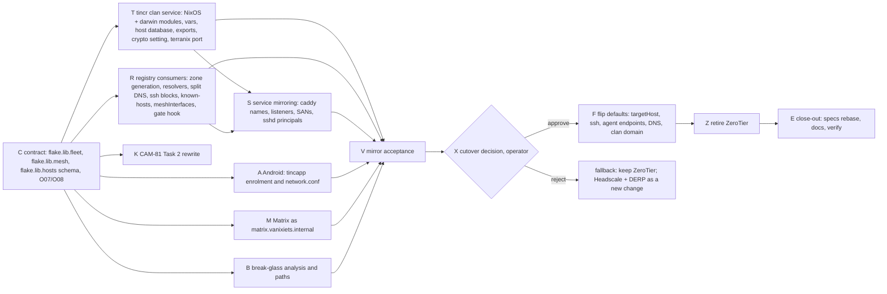

## Context

The fleet's private network today is one ZeroTier network, `db4344343b14b903`, whose controller runs on cinnabar under clan-core's `zerotier` service (`modules/clan/inventory/services/zerotier.nix`).
Six NixOS machines join through the clan service's `peer` tag (cinnabar, electrum, galena, scheelite, magnetite, pyrite); four darwin machines (stibnite, blackphos, argentum, rosegold) run the Homebrew cask `zerotier-one` and two Android phones (pixel7, pixel11) run the ZeroTier app, all six admitted by hand through the controller's `allowedIps`.
Names under `.zt` are served by a hand-written dnsmasq on cinnabar (6 service and 11 machine records, `modules/machines/nixos/cinnabar/zt-dns.nix`), which the controller pushes to members; NixOS clients route `~zt` to it through systemd-resolved on the `09-zerotier` network and darwin clients through `/etc/resolver/zt` (`modules/system/zt-dns.nix`).

The coupling to ZeroTier is spread across the tree (inventory re-verified on 2026-11-17 against the working copy):

- 15 Nix files under `modules/` hold a literal `fddb:4344:343b:14b9:` address, plus `zerotier-join.sh` and 8 vars files; 5 files hold `10.147.17.x`.
- 9 firewall openings in 8 files match `zt+`, two of them through `flake.lib.zerotierInterfaces`; `zerotier-mss-clamp` and `nginx-metrics-location`'s `allow fddb:…::/64` add two more.
- The otel ingress certificate carries `IP:${flake.lib.hosts.magnetite.zt},DNS:magnetite.zt` (`modules/clan/services/otel-collector/flake-module.nix:947`), and every nix-grpc builder certificate carries `DNS:<name>.zt` plus `IP:` for each literal builder address (`modules/clan/services/nix-builders/flake-module.nix:99-102`).
- All ten machines deploy through a literal `.zt` name: inventory `deploy.targetHost = "root@<host>.zt"` for the six NixOS machines, `clan.core.networking.targetHost = "<user>@<host>.zt"` for the four darwin machines.
- 10 ssh client blocks and 10 known-hosts entries restate the addresses (`modules/home/core/ssh.nix`, `modules/system/ssh-known-hosts.nix`), which is architectural-principles O07/O08.
- Matrix on cinnabar runs tuwunel with `server_name = "matrix.zt"`, and hermes's home room is `!Tthf05aI9YvVVsCF2d:matrix.zt`.
- About ten checks and VM tests name ZeroTier or `.zt` (`zerotier-mss-clamp`, `zerotierone-controller`, `ssh-identity`, `ntfy-tls-verification`, `obs-query`, `otel-collector-config`, `otel-collector-darwin`, `nix-builders-wiring`, `fleet-ingress`, `caddy-root-from-vars`, `devloop-ingest`).
- GCP's terranix firewall opens ZeroTier's port (`modules/terranix/gcp.nix:121`, `allow_zerotier`).

Two partial abstractions exist: `flake.lib.hosts` (one host, `magnetite.zt`, consumed by otel, cognee and `checks/fleet-alert.nix`) and `flake.lib.zerotierInterfaces` (2 of the 9 openings).
CAM-81 (`bind-mesh-writes-to-their-host`, Linear In Progress, tasks 1.1–1.3 done) plans in its Task 2 to grow `flake.lib.hosts.<host>.zt` to seven hosts and to pin magnetite's neighbour entries with MACs computed by ZeroTier's own algorithm.

The decision to leave is prospective (Q1, operator, 2026-11-17): vanixiets is not in violation of ZeroTier's controller licence, and the motivation is to follow the technology's trajectory rather than be forced off it later.
That trajectory is visible in the controller's move to a non-commercial licence at 1.16 (F1, F18), in clan's maintainers dropping ZeroTier during 2026 for meshes they already ran (F2, F13), and in clan moving deploy traffic to `p2p-ssh-iroh` (F3).
Performance is not a reason (F7).

tincr is Mic92's Rust implementation of tinc 1.1, at HEAD `fd92f216` (2026-11-17) with no release.
It ships `nixosModules.tincr` and `darwinModules.tincr` (aarch64-darwin only), relays through peers when no direct path exists, and punches UDP holes through observed addresses (F21).
Qubasa/infra's `services/tincr` (local clone `a00b9b1`, 2026-09-24; the GitHub repository returns 404) is a modern `clan.service` for it with hash-derived ULA addressing, a key generator, a host database from every peer's public key, `StrictSubnets`, and invitation hooks for non-clan devices; it has no darwin module, no `exports`, and hard-coded post-quantum crypto lines.
tincapp (`org.pacien.tincapp`, a C tinc 1.1 client) joins a tincr mesh provided every link it touches keeps tincr's default cipher and key exchange (F22); its Google Play build is installed on pixel11 (operator, 2026-11-17), which is the Android test device; pixel7 is mostly retired.

Stakeholders: the operator (crs58), who administers every host; raquel and janettesmith, the primary users of blackphos and rosegold, whose laptops the operator administers remotely over the mesh; the agents that deploy and read the fleet.

## Goals / Non-Goals

**Goals:**

- Every fleet member (NixOS host, darwin host, Android device) reaches every fleet service and every other member by a canonical name `<name>.vanixiets.internal` over a tincr mesh with no single controller.
- One registry, `flake.lib.hosts`, is the only place a member's name or overlay address is written; the zone records, ssh blocks, known-hosts, certificate SANs, firewall interface keys and deploy targets are generated from it.
- The mesh is built in parallel task groups from one contract, mirrored alongside ZeroTier, and adopted at a single operator-approved cutover decision, after which ZeroTier is retired completely.
- Each host class has a stated recovery path that does not depend on the mesh, introduced where one is missing and warranted.
- The task groups decompose into a DAG of subagent tasks deliverable as stacked pull requests.

**Non-Goals:**

- A Headscale, NetBird or wireguard mesh; Headscale with self-hosted DERP is recorded as the fallback only.
- Kubernetes networking (ADR-009 D9.15's deferred wireguard admin overlay stays as decided there).
- Pinning ZeroTier's controller to 1.14.2 or changing the darwin ZeroTier package before retirement (Q1).
- Migrating Matrix history (D3).
- Post-quantum key exchange on the mesh while an Android client cannot carry it (D9).
- Changing what CAM-81 binds or how; only where its Task 2 reads addresses from (D5).

## The contract

Every task group builds against these names; the contract is the first pull request and nothing else lands before it.

| Kind | Name | Value or shape |
|---|---|---|
| Lib | `flake.lib.fleet.label` | `"vanixiets"` |
| Lib | `flake.lib.fleet.domain` | `"vanixiets.internal"` (`<label>.internal`) |
| Lib | `flake.lib.mesh.instance` | `"vanixiets"`: the clan instance name, the tincr network name and the hash seed |
| Lib | `flake.lib.mesh.prefixOf instance` | `fd` + sha256(`"tincr-" + instance`) hex 0–1, then three hextets from hex 2–13, as `/64`; for `vanixiets` this is `fd09:836d:82f8:3d7d::/64` (evaluated 2026-11-17 with Qubasa's formula) |
| Lib | `flake.lib.mesh.addressOf instance name` | prefix plus the first four hextets of sha256(`name`), the same function the clan service and the invitation hook use |
| Lib | `flake.lib.mesh.port` | `655` (TCP and UDP) |
| Lib | `flake.lib.mesh.crypto` | `"default"` (ChaCha20-Poly1305, X25519); the only other accepted value is `"pq"` (`aes-256-gcm`, `x25519-mlkem768`) |
| Lib | `flake.lib.mesh.resolvers` | `[ "cinnabar" "magnetite" ]`, each serving the zone on its own mesh address |
| Lib | `flake.lib.mesh.interface` | NixOS `"tinc-vanixiets"` (tincr's default `tinc-<network>`); darwin `"utun10"` (tincr's default unit `10 +` index) |
| Lib | `flake.lib.hosts.<name>` | `{ class; fqdn; address; endpoints; deployUser; services; zerotier; }`, one entry per mesh member, phones included |
| Field | `class` | `"nixos"`, `"darwin"` or `"android"` |
| Field | `fqdn` | `"<name>.${fleet.domain}"`, derived, never written |
| Field | `address` | `mesh.addressOf mesh.instance name`, derived, never written |
| Field | `endpoints` | `[ "<public name or address> [port]" ]` other peers dial; `[ ]` behind NAT |
| Field | `deployUser` | `"root"` for NixOS, the admin account for darwin, `null` for android |
| Field | `services` | service labels whose canonical name `<label>.${fleet.domain}` resolves to this member (cinnabar: `kanban`, `matrix`, `hermes`, `ntfy`, `omnigraph`, `radicle`) |
| Field | `zerotier` | `{ address; memberId; }`, transitional, deleted at retirement; the only home of a ZeroTier address in the tree |
| Lib | `flake.lib.meshRecords` | list of `{ name; address; }` for every member's `fqdn` and every service label, the zone's single source |
| Lib | `flake.lib.meshInterfaces config` | firewall interface keys: `[ (zerotier key) "tinc-vanixiets" ]` until retirement, `[ "tinc-vanixiets" ]` after; replaces `flake.lib.zerotierInterfaces` |
| Service | `modules/clan/services/tincr` | `clan.service` `tincr`, role `peer`, settings `endpoints`, `devices`, `crypto`; `nixosModule` and `darwinModule` per instance; `exports.networking.priority = 1100` and per-peer `peer.hosts` |
| Inventory | `flake.clan.inventory.instances.tincr` | instance name `vanixiets`; every NixOS and darwin machine in `peer`; phones in `devices` |

Every address in the table is computable at evaluation time from a name, so no consumer reads a vars file to learn one.
A key change does not move an address; renaming a member does, and is a deliberate act.

## Task-group DAG

C is a serial prefix of one small pull request.
R, T, A, K, M and B are authored in parallel by separate subagents, each owning disjoint files (plan.md lists them); S starts once R's helper names and T's interface name exist, which the contract already fixes, so S can be authored in parallel and only its deploy waits for T's deploy.
V is the integration point where every group's evidence is read together; X is the only operator decision; F and Z are sequential and Z is the only irreversible group.
Each group is one stacked pull request on top of C, except A and B, whose work is mostly runtime (A adds one package; B adds a module only if D4 warrants one).

## Decisions

### D1: One change with parallel task groups and one cutover decision

- **Choice**: a single change whose task groups (C, R, T, A, K, M, B, S) build the tincr mesh and mirror every name and service over it while ZeroTier stays untouched, followed by one operator-approved cutover decision (X) that gates flipping the defaults (F) and retiring ZeroTier (Z).
- **Rationale**: while ZeroTier runs unchanged the system is redundant, so nothing before X needs its own go/no-go; the one dependency between workstreams (the zone needs the mesh addresses) is fixed in the contract rather than by sequencing.
  CAM-106 already ran two phases inside one change.
- **Alternatives considered**: a staged series of four changes (groundwork, tincr pilot, iroh, retirement), rejected because it serialized work that redundancy makes safe to parallelize and put a go/no-go at every stage; a single big-bang switch, rejected because it gives no point at which the new mesh is proven before the old one is gone.

### D2: Canonical names `<name>.vanixiets.internal` from a transport-neutral `flake.lib.hosts`

- **Choice**: every member and service gets the canonical name `<name>.vanixiets.internal`; `flake.lib.hosts` is extended to every member with the fields in the contract, and the zone records, ssh blocks, known-hosts, certificate SANs, firewall interface keys and deploy targets are generated from it.
  No field is named after a transport except the transitional `zerotier` attribute, which is deleted at retirement together with every reader of it.
  O07 and O08 in `docs/notes/development/architectural-principles.md` are rewritten to name `flake.lib.hosts` and its fields and marked resolved by this change.
- **Rationale**: ICANN reserved `.internal` for private use in 2024, so it is never delegated and never collides with a public name; the fleet label lets a second fleet reuse the framework as `<name>.<fleet>.internal`.
  `flake.lib.hosts` already has consumers, so extending it moves them rather than adding a second registry (F17).
  Nesting the ZeroTier fields under one transitional attribute keeps a single registry (O07's intent) while making the retirement diff one attribute per member plus its readers.
- **Alternatives considered**: a new `flake.machines.<host>.meta` namespace as O07/O08 wrote, rejected because it would leave `flake.lib.hosts`'s consumers on a second registry; keeping `.zt` as an alias, rejected (operator) because it names the transport and is not reserved; a subdomain of an owned domain, rejected because public certificates would publish host names in certificate transparency logs and the names would depend on keeping the registration; `.vanixiets` and `home.arpa`, rejected as unreserved and residential-scoped respectively; a separate `flake.lib.zerotierHosts` table, rejected because it splits a member's identity across two registries for the life of the mirror.
- **Boundary**: first-party source; consumers read it at evaluation, so the delivered configuration of a host changes only when that host deploys (Migration Plan lists the waves).

### D3: Matrix is redeployed fresh as `matrix.vanixiets.internal`

- **Choice**: tuwunel on cinnabar gets `server_name = "matrix.vanixiets.internal"` on an emptied database; accounts are re-registered with the registration token, the hermes bot re-invited, and `hermes-agent.nix`'s `channelsAllowlist`, `homeRoom` and `homeRoomName` re-pointed to the new IDs; openclaw's two `matrix.zt` references are updated though openclaw stays disabled.
- **Rationale**: a homeserver's server name is the suffix of every user ID, room ID and alias it creates and the name its signing keys are bound to, so renaming it changes the identity of everything already stored; tuwunel's example configuration states the server name "CANNOT BE CHANGED AFTER WITHOUT A DATABASE WIPE" (`tuwunel-example.toml`, read 2026-11-17).
  The server was a test server and its history is not needed (operator), so a fresh start costs nothing a migration would save.
- **Alternatives considered**: keeping one `matrix.zt` record indefinitely, rejected because it keeps `.zt` alive for one host and the history it preserves is not wanted; a second homeserver beside the old one, rejected as needless.

### D4: Break-glass access is decided per host class

- **Choice**: a recovery path that does not depend on the mesh is required for every host the operator administers remotely, and is introduced only where none exists:

| Host class | Members | Path independent of the mesh | Action here |
|---|---|---|---|
| VPS with a public address | cinnabar, magnetite (Hetzner); galena, scheelite (GCP, when provisioned); electrum (disabled in terranix) | SSH on the public address (CAM-81's rollback already uses `root@magnetite.scientistexperience.net`), the provider console, and clan `emergency-access` for boot failures | record each host's public endpoint in `endpoints`; prove `clan machines update <host> --target-host root@<public>` once per VPS before Z |
| NixOS behind NAT | pyrite | none today besides ZeroTier, which Z removes | pyrite needs unattended remote recovery, because it runs VM tests and remote builds (operator, 2026-11-17); `p2p-ssh-iroh` (NixOS-only, its own QUIC hole punching and relays, a separate failure domain from tincr) is the leading candidate, chosen at B from evidence that it reaches pyrite with tincr stopped, as a clan instance on pyrite used through `clan ssh` and an explicit `--target-host` override only |
| darwin laptops | stibnite, blackphos, argentum, rosegold | the person at the machine: its primary user can boot the previous nix-darwin generation; iroh has no darwin module | document the person-at-the-machine steps for raquel and janettesmith; no new transport |
| Android | pixel11; pixel7 best-effort | not administered over the mesh | none |

- **Rationale**: two paths are worth their cost only where losing the one path leaves a host unreachable when it matters; for the VPSes a second path already exists, for the Macs the only remote-independent path is a person, and pyrite, which runs VM tests and remote builds unattended, is the one host that needs a new one.
- **Alternatives considered**: adopting iroh fleet-wide as a second transport, rejected because it carries no service traffic, cannot serve the Macs, and adds nothing while ZeroTier remains; ruling iroh out, rejected (operator) as overzealous.

### D5: CAM-81's Task 2 is rewritten here to read the neutral registry

- **Choice**: task group K edits CAM-81's own artifacts (`design.md` D7, `tasks.md` 2.1–2.2, `plan/task-2.md`, its interface contract table) on CAM-81's chain under CAM-81's story, so that CAM-81 reads members and canonical overlay addresses from `flake.lib.hosts.<host>.address` and ZeroTier addresses from `flake.lib.hosts.<host>.zerotier.address`, adds no field named `zt`, and states that its ZeroTier MAC pinning (`flake.lib.zerotierMac`, the `09-zerotier` neighbour entries) and its address binding on ZeroTier sources are removed at this change's retirement, when the binding's addresses become the tincr ones.
  CAM-81 holds its Task 2 until C lands (operator, 2026-11-17; its tasks 1.1–1.3 are done and 2.x not started), and K then rewrites it.
- **Rationale**: the contract's author is best placed to state how CAM-81 consumes it, and doing it as a task here keeps the rewrite inside the DAG instead of as a note someone has to act on; editing on CAM-81's chain keeps each change's artifacts with its own story.
- **Alternatives considered**: recording the dependency for CAM-81's owner only, rejected because CAM-81 is In Progress and would otherwise build seven `zt` fields this change must undo (F15); letting CAM-81 land as written and rewriting after, rejected for the same reason.

### D6: tincr through a first-party clan service written with Qubasa/infra as reference

- **Choice**: `modules/clan/services/tincr/` is a first-party `clan.service` written for this repository, using Qubasa/infra `services/tincr/default.nix` at `a00b9b1` only as a design reference, with that provenance recorded in its README; tincr itself enters as a flake input `tincr` (`github:Mic92/tincr`, `inputs.nixpkgs.follows = "nixpkgs"`) pinned in `flake.lock`, its `nixosModules.tincr` and `darwinModules.tincr` imported by the service's `perMachine`.
  Beyond what Qubasa's covers: a `darwinModule` per instance mapping to `services.tincr` on darwin; `exports.networking.priority = 1100` and per-peer `peer.hosts` from `flake.lib.hosts.<name>.fqdn`; crypto as the `crypto` setting (D9); the address function in `flake.lib.mesh`, shared by the service and the registry; tincr's in-mesh DNS stub not enabled (D11).
- **Rationale**: Qubasa's service already solves keys, host database, addressing, `StrictSubnets` and phone invitations in the modern service shape; clan-core and clan-community have no tincr service (re-verified at clan-core `d718bcf9`).
  Priority 1100 places tincr above wireguard (1000) and ZeroTier (900) and below `internet` (2000) and iroh (3000) in clan's network list.
- **Alternatives considered**: vpn-bench's `clanModules/tincr`, rejected as benchmark-shaped (a `bootstrap` role, `Slice = benchmark.slice`, upstream `services.tinc` with tincr as the package, no darwin); mulatta/dots' naru modules, rejected because their host database lives in an external flake and keys are prompted; waiting for a clan-core tincr service, rejected because there is no sign of one.
- **Boundary**: vendored-versus-first-party: the service is first-party code and is not tracked against Qubasa's clone; tincr stays a third-party input whose upgrades are flake-lock bumps.
  Qubasa/infra carries no licence file, so its code is all rights reserved and is not copied (operator, 2026-11-17); Qubasa is asked in parallel for a grant (task 3.1), which would only permit later reuse, not change this design.
  Source-versus-delivered: the darwin module's launchd daemon and `/etc/resolver` file are delivered by activation, so they are verified on the host after `just activate`, not by reading source.

### D7: Hash-derived IPv6 ULA addressing, IPv6 only

- **Choice**: one `/64`, `fd09:836d:82f8:3d7d::/64`, derived from the instance name; each member's address is the prefix plus 64 bits of sha256 of its name; the service asserts that every derived address in the inventory and `devices` is unique; the mesh carries no IPv4.
- **Rationale**: addresses computable at evaluation time make the zone, SANs, known-hosts, firewall and deploy targets pure functions of the registry, and phones get the same function through the invitation hook.
  The only IPv4 consumers of ZeroTier's `10.147.17.0/24` are cinnabar's caddy and dnsmasq listen lists (which also listen on IPv6), the disabled openclaw, one check fixture and a comment, so IPv4 brings nothing to carry over.
- **Alternatives considered**: addresses generated as vars, rejected because every consumer would then read vars files at evaluation, as `otel-collector-config` and `otel-collector-darwin` do today with `vars/shared/zerotier-ip-magnetite-zerotier`; an IPv4 subnet beside the ULA, rejected for want of a consumer.

### D8: darwin through tincr's darwin module on all four Macs

- **Choice**: the service's `darwinModule` configures `services.tincr.networks.vanixiets` (launchd daemon `org.tincr.vanixiets`, `utun10`, addresses through tincr's `tinc-up`) on stibnite, blackphos, argentum and rosegold, and writes `/etc/resolver/vanixiets.internal` naming both resolvers.
- **Rationale**: tincr's darwin module supports aarch64-darwin only; all four Macs are aarch64-darwin (`nixpkgs.hostPlatform = "aarch64-darwin"` in each machine module and in `flake.lib.machineSystems`, read 2026-11-17).
  It also removes the hand-installed cask and hand admission, so the Macs join from the inventory like the NixOS hosts.
- **Alternatives considered**: tincr through Homebrew or by hand, rejected as a repeat of today's out-of-band ZeroTier install; wireguard for the Macs, rejected because it is hub-and-spoke and unnecessary once tincr's darwin module covers them (F22).
- **Boundary**: source-versus-delivered: the darwin module has no `openFirewall`, `dns` or `socketActivation` options, so what reaches the host is read after activation (`launchctl print system/org.tincr.vanixiets`, `ifconfig utun10`, `scutil --dns`).

### D9: tincr's default crypto mesh-wide

- **Choice**: `crypto = "default"`: no `SPTPSCipher` or `SPTPSKex` lines, so every link uses ChaCha20-Poly1305 and X25519; the service rejects `crypto = "pq"` by assertion while any `devices` entry exists.
- **Rationale**: tincapp is a C tinc 1.1 client, every link involving a C node must stay on the defaults (tincr `README.md` "Compatibility", `docs/COMPAT.md`), and host files carry the setting mesh-wide [INFERENCE]; tincapp's Google Play build is already installed on one of the operator's phones (operator, 2026-11-17), so the default is what the Android path will actually exercise.
  vpn-bench measured the defaults, so the benchmark evidence applies to this choice and not to the post-quantum one.
- **Alternatives considered**: Qubasa's `x25519-mlkem768` with `aes-256-gcm`, rejected for now because it locks out tincapp and is unmeasured; per-link crypto, rejected because tincr's host files do not scope it per link.
  Revisit when an Android client that can carry the post-quantum setting is published (tincr's own app, PR #94, unmerged since 2026-09-07).

### D10: Android through tincapp

- **Choice**: each phone is a `devices` entry with its Ed25519 public key and enrols by a `tinc invite` from cinnabar, whose invitation hook hands it its derived address and every peer's host file; a package `tincapp-network-<phone>` renders the phone's `network.conf` (`Address = <address>/128`, `Route = <prefix>`, `DNSServer` for both resolvers, `SearchDomain = vanixiets.internal`) for the operator to place in tincapp's network directory.
  pixel11 is the test device and the only phone in the cutover verification; pixel7 enrols best-effort, and nothing in V, X, F or Z depends on it, including its own ZeroTier removal (operator, 2026-11-17).
- **Rationale**: tincapp runs no `tinc-up` and takes its interface addresses, routes and DNS servers only from `network.conf` (tincapp user documentation, read 2026-11-17), so the file is the Android equivalent of the darwin resolver file and the NixOS network unit.
- **Alternatives considered**: tincr's own Android app, rejected while unpublished (F-Droid 404, PR #94 open); keeping the phones on ZeroTier, rejected because it keeps the controller alive for two devices.

### D11: The zone is generated and served by dnsmasq on two resolvers

- **Choice**: a generated dnsmasq configuration on cinnabar and magnetite answers `vanixiets.internal` from `flake.lib.meshRecords`, listens on each resolver's own mesh address, and forwards everything else to quad9 as cinnabar does today; NixOS clients route `~vanixiets.internal` to both resolvers through systemd-networkd on `tinc-vanixiets`, darwin clients through `/etc/resolver/vanixiets.internal`, phones through `DNSServer` in `network.conf`.
  tincr's in-mesh DNS stub is not enabled.
- **Rationale**: the stub answers only `<node>.<suffix>` and returns NXDOMAIN for anything else, so it cannot serve service names under the same suffix, and it does not exist on darwin's module or on tincapp; two resolvers remove the single name server that cinnabar is today.
  Forwarding stays because tincapp's `DNSServer` makes the resolver the phone's only one while the VPN is up.
- **Alternatives considered**: the tincr stub for member names plus a resolver for services, rejected because two answerers for one suffix conflict; one resolver on cinnabar, rejected as a single point of failure the migration is meant to remove.

### D12: StrictSubnets on every node, no TunnelServer

- **Choice**: every node runs `StrictSubnets = yes`, so a node accepts a subnet only from the host file the inventory generated; no node runs `TunnelServer`.
- **Rationale**: tincr's gossip is unsigned and any admitted node can otherwise claim another's subnet (`docs/OPERATING.md:3-7`); `StrictSubnets` closes that, and it is what makes declaring phones in `devices` meaningful.
  `TunnelServer` stops a node forwarding gossip between its meta connections, which would cut the peer discovery hole punching relies on, and every member is administered by the operator.
- **Alternatives considered**: `TunnelServer` on the VPSes, rejected because it turns them into concentrators and blocks peers behind NAT from learning each other's addresses.
- **Consequence**: adding a member means every peer must redeploy to learn its host file; the invitation hook covers the inviter only.

### D13: Deploy targets are generated from the registry and flipped at cutover

- **Choice**: at F, inventory `deploy.targetHost` becomes `"root@${hosts.<name>.fqdn}"` for each NixOS machine and darwin `clan.core.networking.targetHost` becomes `"${hosts.<name>.deployUser}@${hosts.<name>.fqdn}"`, both generated; the service's `exports.networking` lists every peer so clan's network view includes the mesh.
- **Rationale**: an explicit target keeps deploys predictable, and an override (`--target-host root@<public>`) is the break-glass path for the VPSes (D4).
  Because clan uses inventory `deploy.targetHost` first and skips network selection when it is set (`clan_lib/network/network.py:211-234`), the priority export does not choose deploy paths while targets are set; it becomes the deploy path only if a later change removes the targets, which is noted rather than done here.
- **Alternatives considered**: removing inventory targets now and relying on priority selection, rejected because clan's selection would pick `p2p-ssh-iroh` (3000) over tincr wherever B adds it, turning a break-glass path into the default.

### D14: One firewall helper for the mesh interfaces

- **Choice**: `flake.lib.meshInterfaces config` replaces `flake.lib.zerotierInterfaces` and the seven raw `zt+` sites; it returns ZeroTier's backend-specific key and `tinc-vanixiets` during the mirror and `tinc-vanixiets` alone after Z; every opening uses it.
  `nginx-metrics-location`'s `allow` becomes the mesh prefix from `flake.lib.mesh`.
  The ZeroTier MSS clamp is retired, not ported: tincd clamps TCP MSS itself (`ClampMSS = yes` by default, `docs/TROUBLESHOOTING.md:49`).
- **Rationale**: one helper makes the mirror and the retirement single edits.

### D15: Certificates reissued from the registry

- **Choice**: the otel ingress certificate's SANs and each nix-grpc builder certificate's SANs are generated from `flake.lib.hosts`: during the mirror they carry both the ZeroTier entries and the canonical name and mesh address; Z reissues them without the ZeroTier entries; `otel-ca` and the nix-grpc CA are unchanged.
  sshd's certificate `searchDomains` gains `vanixiets.internal` at S and loses `zt` at Z, so clan reissues the host certificates with the new principals.
- **Rationale**: a client connecting by the new name or address must find it in the certificate before F flips any endpoint.
  Every vars regeneration runs with `CLAN_NO_COMMIT=1` (clan commits by itself otherwise) and only for the named generators.

### D16: Checks on the lowest rung that observes each failure

- **Choice**:
  - `flake.lib.mesh` gets a nix-unit test beside it: the prefix for `vanixiets`, two known host addresses, the address of a phone computed by the invitation hook's shell formula equal to the Nix function's, and uniqueness over the registry.
  - The tincr service gets a clan VM test (three nodes: one public, two behind separate NATs on the pattern of tincr's `nix/nixos-test-nat.nix`) asserting a direct UDP link between the two NATed nodes, resolution of a member and a service name through the generated zone, and `StrictSubnets` refusing a subnet from an undeclared key.
  - Registry-to-consumer relations that are pure generation are not re-checked (a check restating the generator is vacuous); the existing machine checks (`nixos-<host>`, `darwin-stibnite`) evaluate the consumers.
  - Retired at Z: `zerotier-mss-clamp`, `zerotier-mss-clamp-runtime` and its `-nftables` variant, `zerotierone-controller`.
  - Renamed or re-pointed: `ssh-identity`, `ntfy-tls-verification`, `obs-query`, `otel-collector-config`, `otel-collector-darwin`, `nix-builders-wiring`, `fleet-ingress`, `caddy-root-from-vars`, `devloop-ingest`.
- **Rationale**: the placement ladder in `preferences-nix-checks-architecture`; the VM test is the only regulator that can observe NAT traversal and StrictSubnets.
  Every new or changed check records its evaluation cost before and after.

### D17: Spec deltas state the end state and are rebased at close-out

- **Choice**: this change's deltas now modify only the requirements whose meaning changes (the ingress receiver's address, the ZeroTier admission requirement, the notification-service and stibnite reachability assumptions, the `overlay network` designation) and add the mesh capabilities; E rebases every delta onto the corpus as it stands then and extends them to every remaining requirement that names ZeroTier, `.zt` or an `fddb:` address (73 matches in 9 specs on 2026-11-17).
- **Rationale**: those remaining mentions are evidence of live state, which changes only at F and Z, and CAM-81 and others modify the same requirements before this change can archive.

### D18: Headscale with self-hosted DERP is the fallback, not built

- **Choice**: if X rejects tincr, ZeroTier stays as it is, tincr is removed or left dormant by the operator's choice, and a new change proposes Headscale with self-hosted DERP on cinnabar, preceded by A3's benchmark with NAT in the path.
- **Rationale**: Headscale has the strongest native clients on every platform here; it needs a clan service and its own controller, which is why it is the fallback rather than the lead.

## Risks / Trade-offs

- [Risk] tincr has no release, no root LICENSE file (only `Cargo.toml`'s GPL-2.0-or-later) and a small maintainer circle (F12, F21) → Mitigation: the flake input pins a reviewed revision; upgrades are deliberate lock bumps; ZeroTier stays untouched until X, and D18 is the exit.
- [Risk] TCP simultaneous-open punching fails behind port-translating NAT ("known v1 limitation") → Mitigation: UDP hole punching through observed addresses and relay through a peer remain; V observes what pyrite and a Mac behind real NAT actually get (`tinc -n vanixiets info <node>` reporting direct UDP versus "indirectly via").
- [Risk] Relay through a peer puts a third host on the path for members that cannot punch → Mitigation: the VPSes are the dialable peers; relayed traffic stays end-to-end encrypted by SPTPS between the two endpoints.
- [Risk] Unsigned gossip lets an admitted node reroute traffic → Mitigation: `StrictSubnets` on every node (D12); membership is the operator's inventory.
- [Risk] Qubasa/infra has no licence file → Mitigation: the service is written first-party with Qubasa's as reference only; Qubasa is asked for a grant in parallel.
- [Risk] tincapp is a C tinc client pinned to the defaults, and a phone outside the inventory → Mitigation: D9 keeps the defaults; the device's key is declared in `devices`, so `StrictSubnets` accepts nothing else under its name.
- [Risk] Two resolvers double the zone's moving parts → Mitigation: both render from the same `flake.lib.meshRecords`, so they cannot disagree on content.
- [Risk] Every peer must redeploy to admit a new member (D12) → accepted; the fleet is twelve members.
- [Risk] Darwin hosts of other people (blackphos, rosegold) lose remote administration if tincr fails there after Z → Mitigation: V requires a deploy over tincr to at least one of them before X; their recovery path is the person at the machine (D4).
- [Trade-off] Two certificate reissues (mirror and retirement) → accepted for a clean end state without ZeroTier SANs.
- [Trade-off] Running two meshes until Z costs ports, daemons and one more interface on every host → accepted as the price of a reversible path.
- [Trade-off] CAM-81 changes shape mid-flight (D5) → accepted to avoid building seven fields this change must undo.

## Migration Plan

Deployment waves (each host's behaviour changes only when it deploys; shared registry edits take effect host by host):

1. **Mirror (after C, R, T, S, A, M, B land)**: deploy cinnabar and magnetite first (dialable endpoints and resolvers), then pyrite, then the four Macs with `just activate` or `clan machines update` under the operator, then enrol the test phone.
   ZeroTier keeps carrying every default: `.zt` names, deploy targets and agent endpoints are unchanged.
   Rollback: remove the `tincr` instance and redeploy; nothing depends on it yet.
2. **Mirror acceptance (V)**: the matrix in tasks.md group 9, from each host class over tincr with the ZeroTier interface excluded from the route, recorded in `cutover.md`.
3. **Cutover decision (X)**: the operator approves or rejects in `cutover.md`, with date and evidence; rejection goes to D18.
4. **Flip (F)**: deploy targets, ssh short-alias HostNames, agent and builder endpoints, nix-builders addresses, clan `meta.domain`, sshd `searchDomains` and the docs move to canonical names; every host is deployed over its new name.
   Rollback: revert the flip pull request and redeploy over the `.zt` names, which still resolve.
5. **Soak**: seven days (operator, 2026-11-17) with ZeroTier running and unused; any regression reverts F.
6. **Retire (Z)**: delete the `zerotier` instance and its controller hooks, `zerotier-mss-clamp`, `zt-dns` (both), `zt-services-trust`'s ZeroTier naming, the casks, `zerotier-join`, the gate hook's `*.zt` rule, the transitional `zerotier` registry fields and their readers, CAM-81's ZeroTier pinning, the ZeroTier certificate SANs, GCP's `allow_zerotier` rule, the ZeroTier checks and VM tests; the operator removes the ZeroTier app from pixel11, and from pixel7 whenever it is next at hand, the controller's removal not waiting on pixel7.
   Irreversible in practice: the network's identity and controller state are discarded.
7. **Close-out (E)**: rebase and extend the spec deltas (D17), regenerate the satisfaction projection at archive, archive.

## Open Questions

Resolved by the operator on 2026-11-17:

1. **Qubasa/infra's licence.** No licence file means all rights reserved: the service is written first-party with Qubasa's as reference only, and Qubasa is asked for a grant in parallel (task 3.1).
2. **CAM-81 sequencing.** CAM-81 holds its Task 2 until C lands; K then rewrites it (its tasks 1.1–1.3 are done, 2.x not started).
3. **pyrite's recovery path.** pyrite needs unattended recovery, because it runs VM tests and remote builds; B leans to `p2p-ssh-iroh` for pyrite and decides from evidence.
4. **Which phone has tincapp.** pixel11, the test device and the only phone in the cutover verification; pixel7 enrols best-effort and gates nothing.
5. **Soak length.** Seven days.
6. **Linear project.** No fleet, infrastructure or networking project exists in the workspace (checked 2026-11-17), so CAM-109 stays in "Migrate to nixbot and herculesCI CI/CD".

None remain open at proposal time.
