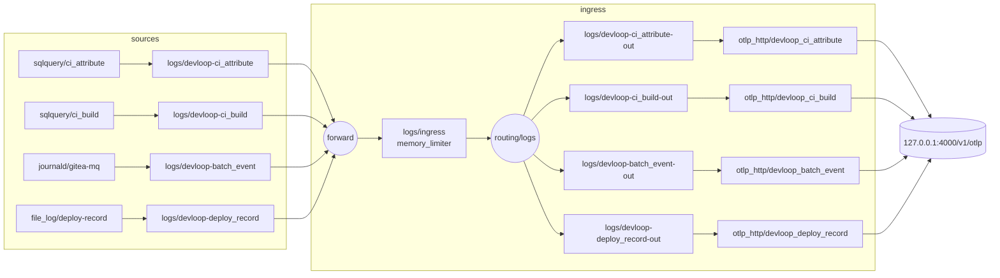

### Task 6: Documentation

Implements `tasks.md` 6.1–6.5 (design D1, D4, D6, D7, D8, D9, D10, D11, D16, Risks, Migration Plan; DC `The past week of the dev loop can be asked about`, DC `A deploy can be attributed to the commits that built it`, DC `A gap in the dev-loop history reaches a person within a day`, DCI `devloop-reconcile runs daily as its own reader`, FA `Pull-request builds that wait too long to start reach a person as a warning`).

This task is `tasks.md` group 6 and lands as pull request 6, after Task 5's pull request has merged and D5 is deployed; it changes prose only, adds no check and deploys nothing, so it has no evaluation-cost measurement, no gate and no deploy step.
The runbook describes the system as deployed, so Step 2 reads the facts the new section states from magnetite, read-only, and any fact Step 2 contradicts is corrected in the section text before Step 6 writes it.
RED before GREEN: Step 3 writes the question-equality script and Step 4 runs it and the documentation probe against today's files, both failing; the section, the rendering and the README and skill edits follow; Step 8 shows the script passing and rejecting two mutant pages, and Step 15 shows every probe term present.
The three SQL blocks are rendered from `nix eval --raw .#.lib.devloopCollection.questions.<name>` by Step 7, never typed, because Task 3 owns their text.
The leading dot in `.#.lib` keeps nix from resolving `lib` as `legacyPackages.<system>.lib`, nixpkgs' library, which is what `.#lib` alone resolves to.

**Files:**
- Modify: `packages/docs/src/content/docs/development/operations/fleet-observability.md` (`:3`, `:6`, `:12`, `:18`, `:20`, after `:18`, after `:23`, `:30`, `:109`, `:112`, after `:124`, `:125`, `:139`, after `:150`, new section before `:328`, `:344-345`; 350 lines today)
- Modify: `modules/clan/services/otel-collector/README.md` (`:3`, `:41`, new section after `:42`, after `:56`, `:83-84`, after `:86`, after `:134`, after `:144`, `:147`, `:154`, after `:157`, `:161`, `:164-165`; 186 lines today)
- Modify: `modules/README.md` (`:51`, after `:55`, after `:62`, after `:72`; 103 lines today)
- Modify: `modules/home/ai/plugins/nix-build-operations/.apm/skills/nix-flake-pr-cycle/SKILL.md` (after `:82`; 220 lines today; hand-authored, no `generatedBy` front matter, `modules/home/ai/plugins/README.md:18`)
- Modify: `openspec/changes/stand-up-devloop-collection/tasks.md` (`:71-74`, ticks only)
- Create (git-ignored): `logs/s2-evidence/6.1-check-questions.sh`, `logs/s2-evidence/6.1-render-questions.sh`, and the evidence logs `6.1-ground-<ts>.log`, `6.x-probe-before-<ts>.log`, `6.1-render-<ts>.log`, `6.1-check-questions-<ts>.log`, `6.1-check-mutants-<ts>.log`, `6.1-linkcheck-<ts>.log`, `6.x-probe-after-<ts>.log`, `6.5-fmt-<ts>.log`, `6.4-delivered-<ts>.log` under `logs/s2-evidence/`

**Interfaces:**
- Consumes: `flake.lib.devloopCollection.questions.formationToLand`, `.queueWait`, `.buildOutcome` (Task 3; `queueWait` counts each build's first attempt, the `ci_build` row with the smallest `finished_at` per `build_id`); `flake.lib.otelCollectorSchema.devloop.tables` and its four tables `ci_attribute`, `ci_build`, `batch_event`, `deploy_record` with the Global Constraints' columns, keys and time indexes (Task 2); receivers `sqlquery/ci_attribute`, `sqlquery/ci_build`, `journald/gitea-mq`, `file_log/deploy-record`, processors `resource/devloop-<table>` and `resource/strip-database`, pipelines `logs/devloop-<table>`, `logs/ingress`, `logs/devloop-<table>-out`, connector `routing/logs`, exporters `otlp_http/devloop_<table>`, `queueBytes` keys `devloop_ci_attribute`, `devloop_ci_build`, `devloop_batch_event`, `devloop_deploy_record` (Task 3); units `devloop-pg-grants.service` (granting once per boot or activation, not re-run when nixbot restarts), `devloop-reconcile.service`, `devloop-reconcile.timer`; environment `DEVLOOP_RECONCILE_DAY`, `DEVLOOP_RECONCILE_DATABASE`; output lines `devloop-reconcile: C<n> <name>: ok|FAIL <detail>` and clauses `C1 attributes` … `C7 current-system`, `C7` retrying the store read every 10 s for up to 120 s, exit 1 and 2 (Task 4); rule `PullRequestQueueWaitBurn`, counting each build's first attempt (Task 5); `checks.x86_64-linux.devloop-queries` with its marker clause over `modules/nixos/nixbot-abandon-optional-attributes.patch:145-147` and its two negative controls, and mutants `renameCached`, `selectError`, `grantWithoutError` (Task 2); `vmTests.x86_64-linux.devloop-ingest` with cases `firstStart`, `writerOrdering`, `overlap`, `tableShape`, `switch`, `documentedQueries`, `reconcile`, `burnRule`; R3.1 mutants `logsQueueNotPersistent`, `otlpInLogsPipeline`, `reconcileNotNotified` and clause `logsTakeLocalReceiver`; `checks.x86_64-linux.fleet-alert` legs `burnRuleLeg`, `twoDatabaseLeg`; `flake.lib.deployRecordObligations`; the store's `regulator-password` at `/run/secrets/vars/per-machine/magnetite/greptimedb-users/regulator-password` (`nix eval --raw .#nixosConfigurations.magnetite.config.clan.core.vars.generators.greptimedb-users.files.regulator-password.path`, read 2026-10-21).
- Produces: the runbook section `## Querying devloop` that Task 7's 7.7 and Task 8's 9.1 follow; the collector README's `## Logs path`; the `modules/README.md` entries for `devloop-queries`, the per-database `fleet-alert` replay and the container test; the `nix-flake-pr-cycle` line requiring `devloop-ingest` before merge.

Vendor behaviour the replay procedure rests on, read at `open-telemetry/opentelemetry-collector-contrib@aaf5045a2` (the 0.155.0 release commit) and `open-telemetry/opentelemetry-collector@v0.155.0`:
- `extension/storage/filestorage/extension.go:68-77`: a component's storage file is `<directory>/<kind>_<type>_<name>[_<client name>]`, passed through `sanitize` (`:163-195`), which keeps letters, digits, `.`, `-` and `_`.
- `pkg/stanza/adapter/storage.go:15-35`: every stanza-based receiver and `sqlquery` ask for a client of kind receiver with an empty client name, after deleting every `_` from the component type, so `file_log` becomes `filelog`; `receiver/sqlqueryreceiver/logs_receiver.go:96` uses that function, and `pkg/stanza/adapter/receiver.go:40-43` calls it at start for `journald` (`receiver/journaldreceiver/factory.go:17`) and `file_log` (`receiver/filelogreceiver/filelog.go:20`).
- So the four position files are `receiver_sqlquery_ci_attribute`, `receiver_sqlquery_ci_build`, `receiver_journald_gitea-mq` and `receiver_filelog_deploy-record` in `/var/lib/opentelemetry-collector/queue` (`modules/clan/services/otel-collector/flake-module.nix:30`, `:351-353`) `[INFERENCE: derived from the cited code, not yet listed on magnetite; Step 2 lists the directory]`.
- `exporter/exporterhelper/internal/queue/persistent_queue.go:560` (core): an exporter's queue file is `exporter_<type>_<name>_<signal>`, so the logs queues are `exporter_otlp_http_devloop_<table>_logs`.
- `receiver/sqlqueryreceiver/logs_receiver.go:123`, `:276`, `:305-311`: a query's cursor is stored under the key `query-<n>: <SQL>.trackingValue`, and with no stored value the receiver starts from `tracking_start_value`; so a changed query text also starts from `tracking_start_value`.
- `pkg/stanza/operator/input/journald/input.go:53`, `:116`, `:186` and `config_linux.go:97`, `:202`: `journald` keeps `lastReadCursor` and resumes with `--after-cursor`, and with none it reads from the journal's start under `start_at: beginning`.
- `pkg/stanza/fileconsumer/internal/checkpoint/checkpoint.go:23`, `:63-64`: `file_log` keeps its file offsets under `knownFiles`, and with none it reads the file from its start under `start_at: beginning`.

- [ ] **Step 1: Confirm the preconditions**

Run from `$REPO`:

```bash
jj git fetch
jj log --no-graph -r 'main@origin & ::@' -T 'commit_id.shortest(12) ++ "\n"'
jj file show -r main@origin modules/vm-tests/devloop-ingest.nix | rg -c 'burnRule'
rg -n '^D5_END=' logs/s2-evidence/window.env
ls logs/s2-evidence/7.6-*.log
```

Expected: the first command prints one commit (the working copy descends from the current `main@origin`); the count is at least `1` (Task 5's case has landed); `D5_END=` has a value; the 7.6 evidence files exist.
If any line is missing, stop: the runbook would describe a system that is not yet deployed.

- [ ] **Step 2: Read the facts the section states, read-only**

Run:

```bash
export EV="$(git rev-parse --show-toplevel)/logs/s2-evidence"; mkdir -p "$EV"
{
  echo '$ rg -o clause names modules'; rg -o -N --no-filename 'C[1-7] (attributes|builds|batch-lines|batch-liveness|batch-fields|deploys|current-system)\b' modules | sort -u
  echo '$ rg -n PullRequestQueueWaitBurn modules/nixos/fleet-alert/rules.nix'; rg -n -A4 'PullRequestQueueWaitBurn' modules/nixos/fleet-alert/rules.nix
  echo '$ notified units'; nix eval --json .#nixosConfigurations.magnetite.config.services.observability-notify.units
  ssh magnetite.zt 'bash -s' <<'EOF'
set -u
echo '$ sudo ls -1 /var/lib/opentelemetry-collector/queue'
sudo ls -1 /var/lib/opentelemetry-collector/queue
echo '$ regulator-password readable'
sudo test -r /run/secrets/vars/per-machine/magnetite/greptimedb-users/regulator-password && echo readable
devloop_sql() {
  printf 'user = "regulator:%s"\n' "$(sudo cat /run/secrets/vars/per-machine/magnetite/greptimedb-users/regulator-password)" |
    curl --config - --silent --show-error --fail-with-body \
      'http://127.0.0.1:4000/v1/sql?db=devloop' --data-urlencode "sql=$1" |
    jq -r '.output[0].records | (.schema.column_schemas | map(.name)), (.rows[] | map(if . == null then "NULL" else tostring end)) | @tsv'
}
echo '$ devloop_sql "SHOW TABLES"'
devloop_sql 'SHOW TABLES'
echo '$ systemctl show devloop-reconcile.timer -p TimersCalendar --value'
systemctl show devloop-reconcile.timer -p TimersCalendar --value
EOF
} 2>&1 | tee "$EV/6.1-ground-$(date -u +%Y%m%dT%H%M%SZ).log"
```

Expected:
- seven clause names, `C1 attributes`, `C2 builds`, `C3 batch-lines`, `C4 batch-liveness`, `C5 batch-fields`, `C6 deploys`, `C7 current-system`;
- the rule's entry with `database = "devloop"` and `language = "sql"`;
- the notified units including `devloop-pg-grants` and `devloop-reconcile`;
- the queue directory listing `receiver_sqlquery_ci_attribute`, `receiver_sqlquery_ci_build`, `receiver_journald_gitea-mq`, `receiver_filelog_deploy-record`, `exporter_otlp_http_fleet_metrics` and the four `exporter_otlp_http_devloop_<table>_logs`;
- `readable`;
- a header line followed by `batch_event`, `ci_attribute`, `ci_build` and `deploy_record`, which confirms the helper's `.schema.column_schemas` path on GreptimeDB 1.2.1;
- a calendar line containing `*-*-* 02:15:00 UTC`.

If a position file has another name (a hashed name, `filestorage` extension `:84`, or another type spelling), use the listed names in Step 6's section and in the Interfaces note above; if the helper prints no header, replace `(.schema.column_schemas | map(.name)), ` with nothing in both helper definitions of Step 6.

- [ ] **Step 3: Write the question-equality script and the rendering script**

The two independently defined values the equality script compares are the question strings evaluated from the flake at the tree under test (`flake.lib.devloopCollection.questions`, written by Task 3) and the `sql` blocks of the delivered page's `## Querying devloop` section; the page's blocks are copies, so the comparison catches a later change to either side that the other does not follow.

Create `logs/s2-evidence/6.1-check-questions.sh` with exactly:

```bash
#!/usr/bin/env bash
# Compares each sql block of PAGE's "## Querying devloop" section, in order,
# with flake.lib.devloopCollection.questions evaluated from the current tree.
# Usage, from the repository root: 6.1-check-questions.sh PAGE
set -euo pipefail
page=$1
work=$(mktemp -d)
trap 'rm -rf "$work"' EXIT
awk '/^## Querying devloop$/ { f = 1; next } f && /^## / { exit } f' "$page" > "$work/section.md"
awk -v dir="$work" '
  /^```sql$/ { n++; f = 1; printf "" > (dir "/block-" n ".sql"); next }
  f && /^```$/ { f = 0; next }
  f { print > (dir "/block-" n ".sql") }
' "$work/section.md"
names=(formationToLand queueWait buildOutcome)
blocks=$(find "$work" -name 'block-*.sql' | wc -l | tr -d ' ')
status=0
if [ "$blocks" -ne "${#names[@]}" ]; then
  echo "FAIL: the section has $blocks sql blocks, expected ${#names[@]}"
  status=1
fi
for i in "${!names[@]}"; do
  name=${names[$i]}
  block="$work/block-$((i + 1)).sql"
  q=$(nix eval --raw ".#.lib.devloopCollection.questions.$name")
  printf '%s\n' "$q" > "$work/$name.sql"
  if [ ! -f "$block" ]; then
    echo "FAIL: questions.$name has no sql block"
    status=1
  elif diff -u "$work/$name.sql" "$block"; then
    echo "ok: sql block $((i + 1)) equals questions.$name"
  else
    echo "FAIL: sql block $((i + 1)) differs from questions.$name"
    status=1
  fi
done
if grep -n '^@@devloop-question' "$page"; then
  echo "FAIL: an unrendered question marker remains"
  status=1
fi
exit "$status"
```

Create `logs/s2-evidence/6.1-render-questions.sh` with exactly:

```bash
#!/usr/bin/env bash
# Replaces each line "@@devloop-question <name>@@" of PAGE with a sql block
# holding flake.lib.devloopCollection.questions.<name>, evaluated from the
# current tree. Usage, from the repository root: 6.1-render-questions.sh PAGE
set -euo pipefail
page=$1
work=$(mktemp -d)
trap 'rm -rf "$work"' EXIT
for name in formationToLand queueWait buildOutcome; do
  q=$(nix eval --raw ".#.lib.devloopCollection.questions.$name")
  printf '%s\n' "$q" > "$work/$name.sql"
done
awk -v dir="$work" '
  /^@@devloop-question [A-Za-z]+@@$/ {
    name = $2; sub(/@@$/, "", name); file = dir "/" name ".sql"
    if ((getline line < file) <= 0) { print "missing question " name > "/dev/stderr"; exit 1 }
    print "```sql"
    print line
    while ((getline line < file) > 0) print line
    close(file)
    print "```"
    next
  }
  { print }
' "$page" > "$work/page.md"
cp "$work/page.md" "$page"
echo "rendered: $(grep -c '^```sql$' "$page") sql blocks"
```

Run: `chmod +x logs/s2-evidence/6.1-check-questions.sh logs/s2-evidence/6.1-render-questions.sh`
Expected: exits 0.
`printf '%s\n' "$q"` drops any trailing newlines of the evaluated string in both scripts, so a block equals its question up to trailing newlines.

- [ ] **Step 4: Run the failing probes**

Run:

```bash
RB=packages/docs/src/content/docs/development/operations/fleet-observability.md
CR=modules/clan/services/otel-collector/README.md
SK=modules/home/ai/plugins/nix-build-operations/.apm/skills/nix-flake-pr-cycle/SKILL.md
{
  for p in '## Querying devloop' 'db=devloop' 'DEVLOOP_RECONCILE_DAY' 'receiver_sqlquery_ci_attribute' 'PullRequestQueueWaitBurn' 'dependency_failed' 'outputs_out' '100,000 rows'; do
    printf '%s %s\n' "$(rg -c -F -- "$p" "$RB" || echo 0)" "$p"
  done
  echo "\$ rg -n 'nothing until S2|S2: dev-loop metrics|SLO burn rule \(S2\)' $RB"; rg -n 'nothing until S2|S2: dev-loop metrics|SLO burn rule \(S2\)' "$RB" || true
  echo '$ 6.1-check-questions.sh'; logs/s2-evidence/6.1-check-questions.sh "$RB"; echo "check-exit=$?"
  echo '$ 6.2 verify'; rg -n "routing/logs|devloop_ci_attribute|sqlquery|journald|file_log" "$CR" || echo 'no logs path in the collector README'
  echo '$ 6.3 verify'; rg -n "devloop-queries|devloop-ingest|per rule database" modules/README.md || echo 'no devloop entries in modules/README.md'
  echo '$ 6.4 source'; rg -n 'devloop-ingest' "$SK" || echo 'no devloop-ingest line in the skill'
} 2>&1 | tee "$EV/6.x-probe-before-$(date -u +%Y%m%dT%H%M%SZ).log"
```

Expected (the failing state): `0` before every term; the lines `:30`, `:344` and `:345`; `FAIL: the section has 0 sql blocks, expected 3`, three `FAIL: questions.<name> has no sql block` lines and `check-exit=1`; `no logs path in the collector README`; `no devloop entries in modules/README.md`; `no devloop-ingest line in the skill`.

- [ ] **Step 5: Update the runbook's opening, "What runs where" and the databases table (6.1)**

In `packages/docs/src/content/docs/development/operations/fleet-observability.md`, replace `:3`:

```yaml
description: "Operating the fleet's telemetry store, metrics collector and alerting: dashboard access, alerts and failure notices on fleet-alerts, the dead-man on cinnabar, the hourly envelope, credential rotation and retention."
```

with:

```yaml
description: "Operating the fleet's telemetry store, metrics collector, dev-loop record and alerting: dashboard access, querying devloop, alerts and failure notices on fleet-alerts, the dead-man on cinnabar, the hourly envelope, the daily reconcile, credential rotation and retention."
```

Replace `:6`:

```markdown
This runbook is for the operator of the fleet's telemetry store and alerting, as deployed by slices S1 and S3.
```

with:

```markdown
This runbook is for the operator of the fleet's telemetry store, its dev-loop record and alerting, as deployed by slices S1, S2 and S3.
```

Replace `:12`:

```markdown
S1's store and collector, and S3's alert evaluator, run on magnetite; ntfy and S3's dead-man run on cinnabar.
```

with:

```markdown
S1's store and collector, S2's dev-loop collection and S3's alert evaluator run on magnetite; ntfy and S3's dead-man run on cinnabar.
```

Replace `:18`:

```markdown
- `opentelemetry-collector.service` collects magnetite's host, unit, process-memory, ZFS, OOM-kill and service metrics and writes them to the store.
```

with:

```markdown
- `opentelemetry-collector.service` collects magnetite's host, unit, process-memory, ZFS, OOM-kill and service metrics and writes them to the store; it also copies nixbot's builds and attributes, gitea-mq's batch transitions and magnetite's deploy records into `devloop`.
- `devloop-pg-grants.service` grants the collector's and the reconcile's PostgreSQL roles their columns of nixbot's database once per boot or activation, after waiting up to 300 s for the columns to exist.
- `devloop-reconcile.timer` runs `devloop-reconcile.service` at 02:15 UTC to compare the previous UTC day of `devloop` with its sources.
```

Replace `:20`:

```markdown
- `fleet-alert.timer` runs `fleet-alert.service` on magnetite every 60 s: it evaluates the alert rules against `fleet`, posts a heartbeat to `fleet-heartbeat`, and posts alerts to `fleet-alerts`.
```

with:

```markdown
- `fleet-alert.timer` runs `fleet-alert.service` on magnetite every 60 s: it evaluates each alert rule against its own database, `fleet` or, for `PullRequestQueueWaitBurn`, `devloop`, posts a heartbeat to `fleet-heartbeat`, and posts alerts to `fleet-alerts`.
```

Insert after `:23` (the `ntfy-sh.service` bullet):

```markdown
- Every NixOS and darwin machine activated since S2 appends one line to `/var/log/deploy-record.jsonl` at each activation and at boot; S2 collects magnetite's file only.
```

Replace `:30`:

```markdown
| `devloop` | 365 days | nothing until S2 |
```

with:

```markdown
| `devloop` | 365 days | the collector, from S2: nixbot's builds and attributes, gitea-mq's batch transitions and magnetite's deploy records |
```

- [ ] **Step 6: Write the "Querying devloop" section (6.1)**

Insert before `:328` (`## Declaring a per-table TTL`), so that the section follows "Deploying the alerting changes" and ends with one blank line:

````markdown
## Querying devloop

S2 copies the dev loop into the `devloop` database on magnetite: every finished nixbot attribute and build, every gitea-mq batch transition and every activation of magnetite.
The store keeps one row per key and time for 365 days, and no error text, log line or message body is stored.
Every night `devloop-reconcile` compares the previous UTC day with the sources, so a gap reaches `fleet-alerts` within a day.

### Reaching the SQL API

Both read-only accounts can read `devloop`: `perses` from the workstation through the SSH tunnel of "Reaching the dashboard", and `regulator` on magnetite.
In the dashboard, set the connection database to `devloop` and use Table Query.
In a shell, define a helper that gives curl the password on standard input, so it never appears on a command line.
On the workstation, with the tunnel open:

```sh
devloop_sql() {
  printf 'user = "perses:%s"\n' "$(clan vars get magnetite greptimedb-users/perses-password)" |
    curl --config - --silent --show-error --fail-with-body \
      'http://127.0.0.1:4000/v1/sql?db=devloop' --data-urlencode "sql=$1" |
    jq -r '.output[0].records | (.schema.column_schemas | map(.name)), (.rows[] | map(if . == null then "NULL" else tostring end)) | @tsv'
}
```

On magnetite:

```sh
devloop_sql() {
  printf 'user = "regulator:%s"\n' "$(sudo cat /run/secrets/vars/per-machine/magnetite/greptimedb-users/regulator-password)" |
    curl --config - --silent --show-error --fail-with-body \
      'http://127.0.0.1:4000/v1/sql?db=devloop' --data-urlencode "sql=$1" |
    jq -r '.output[0].records | (.schema.column_schemas | map(.name)), (.rows[] | map(if . == null then "NULL" else tostring end)) | @tsv'
}
```

`devloop_sql 'SHOW TABLES'` then lists the four tables.
The database comes from `?db=devloop` or from the dashboard's connection database; a query run against `public` finds no table.
Quote column names in double quotes, as the queries below do: `status` is a reserved word in GreptimeDB's SQL parser.

### The four tables

`flake.lib.otelCollectorSchema.devloop.tables` in `modules/clan/services/otel-collector/schema.nix` is the one list of tables and columns, and the store keeps nothing outside it.

| Table | One row per | Columns | Key | Time index |
|---|---|---|---|---|
| `ci_attribute` | finished attribute of a nixbot build | `build_id`, `attr`, `system`, `status`, `cached`, `abandoned`, `drv_path`, `outputs_out`, `started_at`, `finished_at`, `eval_wall_ms`, `eval_alloc_bytes`, `commit_sha`, `branch`, `pr_number`, `project` | `build_id`, `attr` | `finished_at` |
| `ci_build` | finished nixbot build | `build_id`, `created_at`, `started_at`, `finished_at`, `eval_duration_ms`, `status`, `pr_number`, `branch` | `build_id` | `finished_at` |
| `batch_event` | gitea-mq batch transition | `batch`, `msg`, `build`, `sha`, `failed_check`, `members`, `landed`, `ejected`, `builds`, `flaky`, `ts` | `batch`, `msg` | `ts` |
| `deploy_record` | activation or boot of a host | `host`, `closure`, `previous_closure`, `ts` | `host` | `ts` |

- `ci_attribute.status` is nixbot's attribute status: `succeeded`, `skipped_local` (already in the cache, not built), `failed`, `failed_eval`, `dependency_failed`, `ignored_failure`, `cancelled`, `building` or `pending`.
- `abandoned` is true only for an `ignored_failure` row whose error is nixbot's abandonment marker, an optional attribute that had not finished when the required attributes had settled; other `ignored_failure` rows are real failures of optional attributes.
- `outputs_out` is the attribute's `out` output path; `commit_sha`, `branch`, `pr_number` and `project` (`owner/name`) are its build's.
- `pr_number` is set for pull-request builds only; `main` builds and `gitea-mq/batch/<n>` builds have none.
- `ci_build.created_at` is when nixbot queued the build and `started_at` when it started; a build cancelled before it started has no `started_at`.
- `batch_event.msg` is one of `batch formed` (with `members`), `batch built` (with `build` and `sha`), `batch landed` (with `sha`), `batch bisecting` (with `build` and `failed_check`) and `batch done` (with `landed`, `ejected`, `builds` and `flaky`); `ts` is the journal's time of the line.
- A bisected batch repeats `batch built`, `batch landed` and `batch bisecting`, and each repetition is its own row, because its time differs.
- `deploy_record.closure` is the system the host activated and `previous_closure` the one it replaced; a record without `previous_closure` is a boot, not a deploy, and `ts` has whole seconds.
- An empty value is stored as `NULL`.

A row that arrives again with the same key and time replaces the stored one, because the tables are created with `append_mode = 'false'`; the collector re-reads every nixbot row about five times while it is younger than five minutes, and the store keeps it once.

### The three questions

Each question covers the past 7 days.

Formation to land is, for each batch, the time from its `batch formed` row to its `batch done` row.
`batch done` occurs once per batch; the `batch landed` rows of a bisected batch are kept but are not the endpoint.

@@devloop-question formationToLand@@

Queue wait is the 50th, 90th and 99th percentile of `started_at - created_at` over the first attempt of each pull-request build that started.
A restarted build keeps its `build_id` and `created_at` and gets new start and finish times, so the store holds a second `ci_build` row for it whose wait counts from the original creation; only the row with the smallest `finished_at` per `build_id`, the first attempt, is counted.
ADR-005 D5-R4's objective is a 90th percentile of at most one hour.

@@devloop-question queueWait@@

Per-build outcome classifies each `ci_attribute` row of the window.
`succeeded` and `skipped_local` pass; `failed`, `failed_eval` and an `ignored_failure` that is not `abandoned` are the derivation's own failures; `dependency_failed` fails the build but is not the derivation's own outcome; `cancelled`, `building`, `pending` and abandoned rows are no outcome.
A `drv_path` is flaky in the window when it has both a pass row and an own-failure row there.
A build fails when any of its rows that is neither abandoned nor of a flaky `drv_path` is an own failure or `dependency_failed`.

@@devloop-question buildOutcome@@

The store cannot attribute a `dependency_failed` row to the derivation that failed under it.
nixbot names that derivation only in its error text, which `devloop` never stores, and no dependency edge is collected.
So a build whose only failures are `dependency_failed` rows below a flaky derivation still counts as failed.
Flakiness and abandonment are computed when a query runs, so a change to their definitions reinterprets the whole year.

### Attributing a deploy to its commits

A deploy's `closure` is the `outputs_out` of the passing `checks.x86_64-linux.nixos-magnetite` attribute of every build that produced that system:

```sh
devloop_sql "$(cat <<'SQL'
SELECT d."ts", d."closure", a."commit_sha", a."branch", a."pr_number", a."build_id"
FROM "deploy_record" d
JOIN "ci_attribute" a ON a."outputs_out" = d."closure"
WHERE d."host" = 'magnetite'
  AND a."attr" = 'checks.x86_64-linux.nixos-magnetite'
  AND a."status" IN ('succeeded', 'skipped_local')
ORDER BY d."ts" DESC
LIMIT 20
SQL
)"
```

One deploy can match several rows, one per build that produced the same closure, such as a pull request's build and the merge queue's; each of their commits built it.
A deploy whose closure matches no row was built outside CI, an activation outside the closure operator in ADR-005 D5-R7's terms.
A boot record repeats the booted closure with no `previous_closure`, so a deploy is a record whose `closure` differs from the host's previous record.

### When devloop-reconcile fails

`devloop-reconcile.service` runs at 02:15 UTC over the previous UTC day, from 00:00 to 24:00, as its own PostgreSQL role, the journal reader and the store's `regulator`.
It prints one line per clause, `devloop-reconcile: C<n> <name>: ok` or `devloop-reconcile: C<n> <name>: FAIL <detail>`, and exits 1 when any clause fails.
It exits 2 when it cannot read a source or the store at all.
Either failure posts `FAILED devloop-reconcile.service on magnetite` to `fleet-alerts`.
Read the run on magnetite:

```sh
sudo journalctl -u devloop-reconcile -n 20 --no-pager
systemctl show devloop-reconcile -p ExecMainStatus
```

| Clause | Fails when | Check first |
|---|---|---|
| `C1 attributes` | a nixbot attribute `(build_id, attr, finished_at)` of the day is missing from `ci_attribute`, or `ci_attribute` holds one nixbot cannot explain | `sudo journalctl -u opentelemetry-collector --since -1d --no-pager \| grep sqlquery`; then replay `sqlquery/ci_attribute` |
| `C2 builds` | the same for `ci_build` against nixbot's builds | the same, for `sqlquery/ci_build` |
| `C3 batch-lines` | the day's count of `gitea-mq.service` batch lines differs from `batch_event`'s for some `msg` | `sudo journalctl -u opentelemetry-collector --since -1d --no-pager \| grep journald`; then replay `journald/gitea-mq` |
| `C4 batch-liveness` | nixbot finished a `gitea-mq/batch/` build that day but `batch_event` has no `batch built` row | `sudo journalctl -u gitea-mq.service --since -1d --no-pager \| grep 'msg="batch'`; a renamed message stops the copy, and this clause is its only guard |
| `C5 batch-fields` | a `batch done` row lacks `landed`, `ejected`, `builds` or `flaky` | the `batch done` lines in the same journal; gitea-mq has changed that message's keys |
| `C6 deploys` | the day's lines of `/var/log/deploy-record.jsonl` and `deploy_record`'s rows for magnetite differ in number | `sudo journalctl -u opentelemetry-collector --since -1d --no-pager \| grep file_log`; then replay `file_log/deploy-record` |
| `C7 current-system` | the latest `deploy_record` row for magnetite does not name `readlink -f /run/current-system`, after the reconcile has retried the store read every 10 s for 120 s while the file's last line already names it | the last line of `/var/log/deploy-record.jsonl` and whether the last activation appended one |

A stored attribute row that nixbot no longer has is accepted when nixbot's current `finished_at` for that `(build_id, attr)` is empty or later, because a restarted attribute keeps its key and finishes again.
Any other extra row means a table keeps duplicates, so compare `SHOW CREATE TABLE "<table>"` with `append_mode = 'false'` before replaying anything.
For an exit 2, check `systemctl status devloop-pg-grants postgresql greptimedb` first.
`devloop-pg-grants` grants once per boot or activation and does not run again when nixbot restarts, so a nixbot migration that drops and recreates a granted column removes the grant until the next activation.
That shows as permission errors in `sudo journalctl -u opentelemetry-collector --since -1d --no-pager | grep sqlquery` and as a failed `C1` or `C2`, or an exit 2; `sudo systemctl restart devloop-pg-grants` grants again, and a replay restores the missed rows.

After fixing the cause, run the failed day again instead of waiting for the night, with a runtime drop-in naming the day as `YYYY-MM-DD`:

```sh
printf "[Service]\nEnvironment=DEVLOOP_RECONCILE_DAY=2026-10-20\n" | sudo systemctl edit --runtime --stdin --drop-in=rerun-day devloop-reconcile
sudo systemctl start devloop-reconcile
sudo journalctl -u devloop-reconcile -n 20 --no-pager
sudo systemctl revert devloop-reconcile
```

A passing run posts `RESOLVED devloop-reconcile.service on magnetite`, whatever day it checked, so rerun the day that failed rather than another.
Revert the drop-in after the run, so the next night checks its own previous day.
`DEVLOOP_RECONCILE_DATABASE` names the store database the same way, and a drop-in setting it to a database that does not exist forces a failure end to end, as "Forcing a failure deliberately" does for the envelope.

The timer is `Persistent=true`, so after magnetite was down at 02:15 the reconcile runs once at boot, for the previous day only.
Days missed while magnetite was down are never reconciled by themselves: rerun each of them with `DEVLOOP_RECONCILE_DAY` as above, one day per start.

### Replaying a gap

Each receiver keeps its position in the collector's storage directory, `/var/lib/opentelemetry-collector/queue`, in its own file:

| Receiver | Position file | Feeds | Without its file it reads |
|---|---|---|---|
| `sqlquery/ci_attribute` | `receiver_sqlquery_ci_attribute` | `ci_attribute` | nixbot's whole retained history, 10,000 rows a minute |
| `sqlquery/ci_build` | `receiver_sqlquery_ci_build` | `ci_build` | nixbot's whole retained history, 10,000 rows a minute |
| `journald/gitea-mq` | `receiver_journald_gitea-mq` | `batch_event` | the whole retained journal of `gitea-mq.service` |
| `file_log/deploy-record` | `receiver_filelog_deploy-record` | `deploy_record` | the whole of `/var/log/deploy-record.jsonl` |

The `exporter_otlp_http_*` files in the same directory hold rows not yet written to the store; never remove one.
To replay a gap that a reconcile clause names, remove that receiver's position file while the collector is stopped:

```sh
sudo ls -1 /var/lib/opentelemetry-collector/queue
sudo systemctl stop opentelemetry-collector
sudo rm /var/lib/opentelemetry-collector/queue/receiver_sqlquery_ci_attribute
sudo systemctl start opentelemetry-collector
```

The receiver then starts from its beginning and sends every row again, and the store keeps one row per key and time, so only the missing rows are added.
nixbot keeps 90 days of builds, and the journal kept gitea-mq's lines from 2026-09-16 when S2 was deployed, so a replay restores only what the source still holds.
A replay of `sqlquery/ci_attribute` sends about 200,000 rows in about 20 minutes; wait until `devloop_sql 'SELECT count(*) FROM "ci_attribute"'` stops rising, then rerun the failed day as above.
A record the store's pipeline cannot convert fails the whole OTLP request with HTTP 400, which the exporter drops as permanent, while `sqlquery` has already advanced its cursor past it; so one bad record can lose up to 10,000 nixbot rows, one page, or a batch of journal or deploy-record lines.
No alert reports that at once: `C1`, `C3` or `C6` fails the next morning, and the replay above restores the rows once the cause is fixed.
The collector also stores each nixbot query's position under a key that contains the query's text, so a merged change to an export query replays that query's whole history at its first start.

### The row budget

ADR-004 bounds `devloop` at 100,000 rows a day.
The busiest day before S2, 2026-10-14, would send about 64,800 attribute rows, counting each row's five re-reads, and store 12,867.
S2's deploy of the collection (D3) sent nixbot's retained history, about 200,000 attribute rows in about 20 polls, and exceeded the budget on that day only, as the design accepted; `verify.md` records that day's sent and stored counts.
A replay of `sqlquery/ci_attribute` exceeds it the same way, once.
Count the stored rows per day:

```sh
devloop_sql "$(cat <<'SQL'
SELECT date_trunc('day', "finished_at") AS "day", count(*) AS "rows"
FROM "ci_attribute"
WHERE "finished_at" >= now() - INTERVAL '14 days'
GROUP BY 1
ORDER BY 1
SQL
)"
```

### When PullRequestQueueWaitBurn fires

`PullRequestQueueWaitBurn` is a `warning` that reads `devloop` through SQL: it holds when at least 10 pull-request builds finished their first attempt in the trailing 24 hours and more than one in ten of those first attempts waited over an hour from `created_at` to `started_at`, and it fires after holding for an hour.
A restarted build's later attempts are left out, because their wait counts from the build's original creation.
Its expression is in `modules/nixos/fleet-alert/rules.nix`.
It is posted once as `[FIRING] PullRequestQueueWaitBurn` with no host, is never posted again while it fires, and resolves after 5 minutes without the condition.
On a day with fewer than 10 pull-request builds it stays silent, so a single slow build cannot fire it.
A missing `devloop` or `ci_build` table fails the query, which freezes only the rules on `devloop` and raises one `StoreQueryFailing` whose message names `devloop`; the `fleet` rules keep being evaluated and posted.

When it fires, list the slow builds:

```sh
devloop_sql "$(cat <<'SQL'
SELECT c."build_id", c."pr_number", c."branch", c."created_at", c."started_at", c."finished_at"
FROM "ci_build" c
JOIN (SELECT "build_id", min("finished_at") AS "first_finished" FROM "ci_build" GROUP BY "build_id") f
  ON c."build_id" = f."build_id" AND c."finished_at" = f."first_finished"
WHERE c."pr_number" IS NOT NULL
  AND c."started_at" > c."created_at" + INTERVAL '1 hour'
  AND c."finished_at" >= now() - INTERVAL '24 hours'
ORDER BY c."created_at"
SQL
)"
```

Then see whether nixbot's queue is still deep with `nixbot-logs queue`, and read each slow pull request's builds with `nixbot-logs builds --pr <pr_number>`.
Run the queue-wait question above for the week: a 90th percentile over one hour breaks ADR-005 D5-R4's objective.
D5-R4's response is to move attributes out of the pull-request lane through D5-R1, by pull request, rather than to add evaluators, because nixbot's evaluator is memory-bound.

````

The section above uses the receiver file names Step 2 listed; if Step 2 listed other names, write those instead in the replay table and command.
The slow-build query joins `ci_build` with its own first-attempt rows, as the rule and `queueWait` do; that GreptimeDB 1.2.1 runs this join is `[INFERENCE]`, confirmed by `devloop-ingest`'s `burnRule` and `documentedQueries` cases, which pass on magnetite before Task 5 merges (Step 1 confirms it has merged).

- [ ] **Step 7: Render the three questions into the section (6.1)**

Run:

```bash
jj st --no-pager >/dev/null
logs/s2-evidence/6.1-render-questions.sh "$RB" 2>&1 | tee "$EV/6.1-render-$(date -u +%Y%m%dT%H%M%SZ).log"
rg -n -A3 '^```sql$' "$RB"
```

Expected: `rendered: 3 sql blocks`; each `sql` fence opens in the "The three questions" subsection, below the paragraph that describes its question, in the order formation to land, queue wait, per-build outcome.
Read the three blocks against design D8: if a question does not compute what its paragraph states, stop and report it to the orchestrator; Task 3's text is corrected in its own module, never in the page.

- [ ] **Step 8: Show the equality check passing and rejecting two mutant pages (6.1)**

Run:

```bash
logs/s2-evidence/6.1-check-questions.sh "$RB" 2>&1 | tee "$EV/6.1-check-questions-$(date -u +%Y%m%dT%H%M%SZ).log"; echo "check-exit=${PIPESTATUS[0]}"
```

Expected: `ok: sql block 1 equals questions.formationToLand`, `ok: sql block 2 equals questions.queueWait`, `ok: sql block 3 equals questions.buildOutcome`, no `FAIL` line and `check-exit=0`.

Write the two mutants and run the script on each:

```bash
M=$(mktemp -d)
awk '/^```sql$/ { n++; print; if (n == 2) { getline; print $0 " -- mutant" }; next } { print }' "$RB" > "$M/changed-block.md"
awk '/^```sql$/ { n++; if (n == 3) { skip = 1; next } } skip && /^```$/ { skip = 0; next } !skip' "$RB" > "$M/missing-block.md"
{
  for m in changed-block missing-block; do
    echo "=== mutant $m"
    if logs/s2-evidence/6.1-check-questions.sh "$M/$m.md"; then echo "mutant $m NOT rejected"; else echo "mutant $m rejected"; fi
  done
} 2>&1 | tee "$EV/6.1-check-mutants-$(date -u +%Y%m%dT%H%M%SZ).log"
```

Expected: for `changed-block`, a diff whose `+` line ends in ` -- mutant`, `FAIL: sql block 2 differs from questions.queueWait` and `mutant changed-block rejected`; for `missing-block`, `FAIL: the section has 2 sql blocks, expected 3`, `FAIL: questions.buildOutcome has no sql block` and `mutant missing-block rejected`; no `NOT rejected` line.

- [ ] **Step 9: Add the burn rule and the S2 units to the alert and notice sections (6.1)**

Replace `:109`:

```markdown
An alert's title is `[FIRING] <alert> <host>` or `[RESOLVED] <alert> <host>`; an alert that carries no host, such as `StoreQueryFailing`, `RuleSignalMissing` for a whole selector, `AlertBudgetExceeded` or `WeeklyPipelineTest`, has no host in its title.
```

with:

```markdown
An alert's title is `[FIRING] <alert> <host>` or `[RESOLVED] <alert> <host>`; an alert that carries no host, such as `RuleSignalMissing` for a whole selector, `AlertBudgetExceeded`, `WeeklyPipelineTest` or `PullRequestQueueWaitBurn`, has no host in its title, and `StoreQueryFailing` names the database that stopped answering in the host's place, as in `[FIRING] StoreQueryFailing devloop`.
```

Insert after `:124` (the `WeeklyPipelineTest` row):

```markdown
| `PullRequestQueueWaitBurn` | warning | for 1 h, at least 10 pull-request builds finished their first attempt in the trailing 24 h and more than 10% of those first attempts waited over 1 h from creation to start | list the slow builds and follow "When PullRequestQueueWaitBurn fires" under "Querying devloop" |
```

Replace `:112`:

```markdown
Time spent frozen does not count as absence: after a store outage or a host's silence, an alert resolves only 5 minutes after the first unfrozen evaluation that no longer sees its condition.
```

with:

```markdown
Time spent frozen does not count as absence: after the store stopped answering on an alert's database, or after a host's silence, an alert resolves only 5 minutes after the first unfrozen evaluation that no longer sees its condition.
```

Replace `:125`:

```markdown
| `StoreQueryFailing` | critical | the store has not answered the evaluator for 3 min; every other alert is frozen meanwhile | `systemctl status greptimedb greptimedb-schema` and `sudo journalctl -u greptimedb -n 100 --no-pager` on magnetite; starting the store also starts `greptimedb-schema` again; alerts resume when the store answers |
```

with:

```markdown
| `StoreQueryFailing` | critical | the store has not answered the evaluator's queries on one database for 3 min; the message names the database, there is one instance per failing database, and only that database's alerts are frozen meanwhile, so a `devloop` failure leaves the `fleet` alerts working | `systemctl status greptimedb greptimedb-schema` and `sudo journalctl -u greptimedb -n 100 --no-pager` on magnetite, and `sudo journalctl -u fleet-alert -n 20 --no-pager`, which names the failed database; for `devloop` alone, also `devloop_sql 'SHOW TABLES'` under "Querying devloop"; starting the store also starts `greptimedb-schema` again; that database's alerts resume when the store answers it |
```

Replace `:139`:

```markdown
The notified units on magnetite are `greptimedb`, `greptimedb-schema`, `greptimedb-envelope`, `opentelemetry-collector`, `fleet-alert` and magnetite's `zfs-set-*` and `zfs-assert-*` oneshots; on cinnabar it is `fleet-deadman`.
```

with:

```markdown
The notified units on magnetite are `greptimedb`, `greptimedb-schema`, `greptimedb-envelope`, `opentelemetry-collector`, `fleet-alert`, `devloop-pg-grants`, `devloop-reconcile` and magnetite's `zfs-set-*` and `zfs-assert-*` oneshots; on cinnabar it is `fleet-deadman`.
```

Insert after `:150` (the `FAILED fleet-deadman.service on cinnabar` sentence):

```markdown
A `FAILED devloop-reconcile.service on magnetite` means a day of `devloop` differs from its sources, or a source could not be read; "When devloop-reconcile fails" under "Querying devloop" says what each clause means.
A `FAILED devloop-pg-grants.service on magnetite` means a column the dev-loop readers are granted did not appear in nixbot's database within 300 s of the unit's start, which a nixbot migration renaming or dropping it causes; the collector's nixbot queries fail until the grants apply, and `sudo journalctl -u devloop-pg-grants -n 20 --no-pager` names the column.
The grants are not applied again when nixbot restarts, so a grant lost to a later migration posts no `FAILED` of this unit; it shows as the collector's query errors and as a `FAILED devloop-reconcile.service on magnetite` the next morning.
```

- [ ] **Step 10: Update "Not covered yet" (6.1)**

Replace `:344-345`:

```markdown
- S2: dev-loop metrics into `devloop`: nixbot, gitea-mq and deploy records.
- S3 left for later slices: the filesystem, NVMe, launchd and `HostProbeStale` rules (S4, S5), the dev-loop SLO burn rule (S2), and an external watch of cinnabar and ntfy themselves (CAM-76).
```

with:

```markdown
- S2 left for later slices: the deploy records of the hosts other than magnetite, collected once S4 and S5 run collectors there, while `devloop-reconcile` checks magnetite's alone; dashboards over `devloop` (S6); and attributing a `dependency_failed` attribute to the derivation that failed under it, which would need error text or dependency edges that S2 does not store.
- S3 left for later slices: the filesystem, NVMe, launchd and `HostProbeStale` rules (S4, S5), and an external watch of cinnabar and ntfy themselves (CAM-76).
```

Run:

```bash
nix build --no-link -L .#checks.x86_64-linux.package-vanixiets-docs-test-linkcheck 2>&1 | tee "$EV/6.1-linkcheck-$(date -u +%Y%m%dT%H%M%SZ).log" | tail -n 5
```

Expected: the build succeeds (exit 0); a failure names the broken link, which is fixed in the page before continuing.
If it fails on a link outside this page, record it in the log and ask the orchestrator; never edit another page under this task.

- [ ] **Step 11: Describe the logs path in the collector README (6.2)**

In `modules/clan/services/otel-collector/README.md`, replace `:3`:

```markdown
This clan service collects fleet metrics into the GreptimeDB telemetry store, and its `agent` role imports the failure notifier that posts unit failures to ntfy.
```

with:

```markdown
This clan service collects fleet metrics into the GreptimeDB telemetry store and carries the dev-loop record's logs into `devloop`, and its `agent` role imports the failure notifier that posts unit failures to ntfy.
```

Replace `:41`:

```markdown
In S1 only `fleet` receives data; the `devloop` and `agent` routes exist so S2 and S7 add producers without restructuring the ingress.
```

with:

```markdown
Only `fleet` receives metrics; the `devloop` and `agent` metrics routes exist so later slices add metric producers without restructuring the ingress, and `devloop`'s rows arrive on the logs path below.
```

Insert after `:42` (the blank line before `## The schema is the single source`), ending with one blank line:

````markdown
## Logs path

S2 adds a logs path that copies the dev-loop record into `devloop`, one table per source.
`modules/nixos/devloop-collection.nix` (`flake.modules.nixos.devloop-collection`, imported by magnetite) defines four receivers, each with `storage: file_storage`, so its position survives a restart:

- `sqlquery/ci_attribute` and `sqlquery/ci_build` read nixbot's PostgreSQL database every 60 s over the local socket as the peer-authenticated role `opentelemetry-collector`, with a cursor on `finished_at` that re-reads a five-minute overlap in pages of 10,000 rows.
- `journald/gitea-mq` reads the five `msg="batch …"` lines of `gitea-mq.service` and keeps only the `batch_event` keys.
- `file_log/deploy-record` reads `/var/log/deploy-record.jsonl` with `json_parser`.



Each receiver feeds its own pipeline `logs/devloop-<table>`, which runs `memory_limiter` and `resource/devloop-<table>`, setting `vanixiets.database = devloop`, `vanixiets.table = <table>` and `host.name`, and exports to the `forward` connector.
In the ingress, `logs/ingress` runs `forward`, `memory_limiter` and then `routing/logs`, a second instance of the routing connector with one route per table matching both attributes.
A second instance is needed because one routing instance resolves every route's pipelines as pipelines of the signal it routes (`open-telemetry/opentelemetry-collector-contrib@aaf5045a2:connector/routingconnector/router.go:161-190`).
Each route ends in `logs/devloop-<table>-out`, which runs `resource/strip-database`, deleting `vanixiets.database` and `vanixiets.table`, into its own exporter: `otlp_http/devloop_ci_attribute`, `otlp_http/devloop_ci_build`, `otlp_http/devloop_batch_event` or `otlp_http/devloop_deploy_record`.
Each exporter posts to `http://127.0.0.1:4000/v1/otlp` as `collector` with `x-greptime-db-name: devloop`, `x-greptime-log-table-name: <table>`, `x-greptime-pipeline-name: devloop_<table>` and `x-greptime-hints: auto_create_table=false`, because one exporter carries one table header and one pipeline header.
The store's pipeline `devloop_<table>` keeps exactly the allow-listed fields, and `greptimedb-schema` creates the tables beforehand with `append_mode = 'false'`, so a re-read row replaces the stored one.
With `auto_create_table=false`, a write that races the schema job is rejected instead of creating an append-mode table that would keep every duplicate.
A record the pipeline cannot convert fails the whole request with HTTP 400, which the exporter drops as permanent; for `sqlquery` the cursor has already moved past it, so up to 10,000 rows are lost until a cursor reset, and `devloop-reconcile`'s `C1`, `C3` and `C6` are the detectors (runbook, "Replaying a gap").
No `skip_error` is set, because per-row loss would then be silent.
No `logs/*` pipeline takes the local `otlp` receiver.

````

Insert after `:56` (the `process.minBytes` bullet):

```markdown
- `devloop.tables`: the `devloop` allow-list, table name to `{ columns, primaryKey, timeIndex }`, each column `{ name; type; nullable; }` with `type` one of `int64`, `string`, `boolean` and `timestamp`.
  From it `modules/nixos/devloop-collection.nix` renders the store's `CREATE TABLE` statements and ingest pipelines, the nixbot queries' column aliases and order, and the gitea-mq and deploy-record keep-lists.
  A column added to an existing table is created by the pipeline's first write of it; a changed type needs an explicit migration.
```

Replace `:83-84`:

```markdown
Every exporter uses a persistent `file_storage` sending queue under `/var/lib/opentelemetry-collector/queue`, sized in bytes.
`fleet` gets 400 MiB and `devloop` and `agent` get 48 MiB each, so the total stays under 512 MiB and `fleet` holds at least 24 hours at the assumed rate.
```

with:

```markdown
Every exporter uses a persistent `file_storage` sending queue under `/var/lib/opentelemetry-collector/queue`, sized in bytes; the logs receivers keep their positions in the same directory, as `receiver_<type>_<name>` files beside the exporters' `exporter_otlp_http_<name>_<signal>` files.
`fleet` gets 400 MiB, `agent` 48 MiB, `devloop` (metrics) 4 MiB, `devloop_ci_attribute` 32 MiB, and `devloop_ci_build`, `devloop_batch_event` and `devloop_deploy_record` 4 MiB each, 496 MiB in all, so the total stays under 512 MiB and `fleet` holds at least 24 hours at the assumed rate.
```

Insert after `:86` (the `max_elapsed_time` sentence):

```markdown
`devloop_ci_attribute` holds about a day of store outage on the busiest day, about 64,800 attribute rows at roughly 0.5 KiB each; a fuller queue loses rows from the store's copy only, which `devloop-reconcile` reports and a receiver replay restores (runbook, "Replaying a gap").
```

Insert after `:134` (the last Hazards bullet):

```markdown
- `sqlquery` stores each query's position under a key that contains the query's text (`open-telemetry/opentelemetry-collector-contrib@aaf5045a2:receiver/sqlqueryreceiver/logs_receiver.go:123`, `:276`), so a changed export query starts again from `tracking_start_value` and re-sends nixbot's retained history once; the store keeps one row per key, but that day exceeds ADR-004's 100,000 rows.
- The `sqlquery` logs signal is at Development stability and `journald` at Alpha in 0.155.0, so a collector bump runs `vmTests.x86_64-linux.devloop-ingest` before merge.
```

Insert after `:144` (the magnetite R8.2 bullet):

```markdown
- `modules/nixos/devloop-collection.nix`: the collector's `SupplementaryGroups` contains `systemd-journal`, so `journald/gitea-mq` can read the journal.
```

Replace `:147`:

```markdown
R3.1 covers loopback endpoints, the 64 MiB floor stage, the 40-unit cap, owner aliases, metrics-only pipelines, queue storage and sizes, `memory_limiter` under `MemoryMax`, the override scope, the notifier wiring against the failure-path policy, and the order after the schema job.
```

with:

```markdown
R3.1 covers loopback endpoints, the 64 MiB floor stage, the 40-unit cap, owner aliases, the signals pipelines may carry, queue storage and sizes over every exporter including the four logs exporters (mutant `logsQueueNotPersistent`), no `logs/*` pipeline taking the local OTLP receiver (`logsTakeLocalReceiver`, mutant `otlpInLogsPipeline`), `memory_limiter` under `MemoryMax`, the override scope, the notifier wiring against the failure-path policy, which includes `devloop-*` units (mutant `reconcileNotNotified`), and the order after the schema job.
```

Replace `:154`:

```markdown
Two runtime tests live in the on-demand `vmTests` lane, outside the pull-request checks:
```

with:

```markdown
Three runtime tests live in the on-demand `vmTests` lane, outside the pull-request checks:
```

Insert after `:157` (the `greptimedb-pipeline` coverage line):

```markdown
- `vmTests.x86_64-linux.devloop-ingest` (`modules/vm-tests/devloop-ingest.nix`) is a systemd-nspawn container test needing `uid-range`, so it builds on magnetite.
  It runs PostgreSQL with nixbot's migrations, the store with its schema job, the collector with the logs path, a stub `gitea-mq.service` and `devloop-reconcile`, and covers every `otlp_http/devloop_<table>` exporter's first send, the tables' shape against the allow-list, writer ordering, overlap deduplication, the deploy-record line, each reconcile clause's mutant, the burn rule and the three documented queries on the real store.
```

Replace `:164-165`:

```sh
nix build -L --no-link .#vmTests.x86_64-linux.greptimedb-pipeline
nix build -L --no-link --max-jobs 0 .#vmTests.x86_64-linux.greptimedb-pipeline
```

with:

```sh
nix build -L --no-link .#vmTests.x86_64-linux.greptimedb-pipeline
nix build -L --no-link --max-jobs 0 .#vmTests.x86_64-linux.greptimedb-pipeline
nix build -L --no-link .#vmTests.x86_64-linux.devloop-ingest
nix build -L --no-link --max-jobs 0 .#vmTests.x86_64-linux.devloop-ingest
```

and in `:161` replace `Run the container test on magnetite` with `Run a container test on magnetite`.

- [ ] **Step 12: List the dev-loop checks and the container test in `modules/README.md` (6.3)**

Replace `:51`:

```markdown
`checks.x86_64-linux.fleet-alert` runs `promtool` over the rules rendered by `nixos/fleet-alert/rules.nix`, replays canned store answers through a loopback fixture server against the evaluator in `nixos/fleet-alert.nix` with a recording `ntfy-send`, and compares `nixos/fleet-alert/transition.jq` with a Python reference model under a derandomized Hypothesis test.
```

with:

```markdown
`checks.x86_64-linux.fleet-alert` runs `promtool` over the PromQL rules rendered by `nixos/fleet-alert/rules.nix`, replays canned PromQL and SQL answers per rule database through a loopback fixture server against the evaluator in `nixos/fleet-alert.nix` with a recording `ntfy-send`, and compares `nixos/fleet-alert/transition.jq` with a Python reference model under a derandomized Hypothesis test.
```

Insert after `:55` (`ntfy's enforcement of the access entries, … not by these checks.`):

```markdown
The dev-loop checks are gated the same way and need no runtime host.
`checks.x86_64-linux.devloop-queries` requires nixbot's abandonment patch, `nixos/nixbot-abandon-optional-attributes.patch`, to contain `flake.lib.devloopCollection.abandonMarker` in its production context, the three added lines that return it for an abandoned attribute, and carries two negative controls that must not satisfy it: the marker with its last character changed, and the patch's test lines alone.
It also applies the nixbot input's migrations to a sandboxed PostgreSQL, creates the two reader roles with the column grants rendered by `nixos/devloop-collection.nix`, loads fixture rows, and runs the two export queries as `opentelemetry-collector` and the reconcile's queries as `devloop-reconcile`; it requires the result columns to equal the `devloop` allow-list, `abandoned` to be true only for the marker row, no result cell to contain a fixture error string, and the five-minute overlap and tied rows to be read, and it rejects the mutants `renameCached`, `selectError` and `grantWithoutError`.
`checks.x86_64-linux.fleet-alert` also replays `PullRequestQueueWaitBurn` against `devloop` through the fixture server's `/v1/sql` and requires each rule's query to reach its own database.
The five x86_64-linux NixOS machine checks (cinnabar, electrum, galena, magnetite, pyrite) require the deploy-record snippet in the machine's activation through `flake.lib.deployRecordObligations`; the darwin machines and the deferred scheelite carry the snippet, but no gating check holds it there.
The receivers, the store's pipelines and `devloop-reconcile` against the real store are verified by `devloop-ingest` below and at deployment, not by these checks.
```

Insert after `:62` (the `greptimedb-pipeline` line of the code block):

```sh
nix build .#vmTests.x86_64-linux.devloop-ingest               # Magnetite, uid-range
```

Insert after `:72` (`It uses local File storage, … nothing about OOM behaviour.`), with one blank line before it:

```markdown

`devloop-ingest` runs PostgreSQL with the nixbot input's migrations and fixture rows, the telemetry store with its schema job, the collector with the dev-loop logs path, a stub `gitea-mq.service` printing fixture batch lines, and `devloop-reconcile` in one systemd-nspawn container.
It establishes that each `otlp_http/devloop_<table>` exporter's first send succeeds after the schema job, and fails when the job omits its table, that every table's columns equal the allow-list with no `body` column, that rows re-read on three polls are stored once, that an activation appends exactly one deploy-record line naming both closures, that each `devloop-reconcile` clause fails on its mutant and passes on the fixture day, that `PullRequestQueueWaitBurn`'s query returns a row only for its firing fixture, and that the three documented questions return their fixture answers.
It uses fixture nixbot rows and a stub gitea-mq, so the backfill's size, the widest `finished_at` tie and a change in gitea-mq's real messages are observed only on magnetite, at deployment and by `devloop-reconcile`; and a container shares the build host's kernel, so it establishes nothing about memory limits.
Run it on Magnetite before merging any change to the dev-loop receivers, pipelines, allow-list or reconcile, and name its log in the pull request.
```

- [ ] **Step 13: Add the `devloop-ingest` line to the `nix-flake-pr-cycle` skill (6.4)**

The skill sources are under `modules/home/ai/plugins/*/.apm/skills/` (`modules/home/ai/README.md:14`, "Source versus delivered"); `nix-flake-pr-cycle` lives at `modules/home/ai/plugins/nix-build-operations/.apm/skills/nix-flake-pr-cycle/SKILL.md` and carries no `generatedBy` front matter, so it is hand-authored (`modules/home/ai/plugins/README.md:18`).
Confirm:

```bash
rg -n '^generatedBy' "$SK" || echo 'hand-authored'
```

Expected: `hand-authored`.

Insert after `:82` (the blank line after `The \`logs/\` directory is already gitignored … without polluting tracked state.`), ending with one blank line:

```markdown
A change to the dev-loop collection's receivers, pipelines, allow-list or reconcile (`modules/nixos/devloop-collection.nix`, the `devloop` tables in `modules/clan/services/otel-collector/schema.nix`, the `routing/logs` path in `modules/clan/services/otel-collector/flake-module.nix`, or `flake.lib.devloopReconcile`) also runs `nix build .#vmTests.x86_64-linux.devloop-ingest -L 2>&1 | tee logs/devloop-ingest-$(date -u +%Y%m%dT%H%M%SZ).log` on magnetite before merge, because no gating check runs them against the real store, and the pull request names that log.

```

- [ ] **Step 14: Run the probe again**

Run:

```bash
{
  for p in '## Querying devloop' 'db=devloop' 'DEVLOOP_RECONCILE_DAY' 'receiver_sqlquery_ci_attribute' 'PullRequestQueueWaitBurn' 'dependency_failed' 'outputs_out' '100,000 rows'; do
    printf '%s %s\n' "$(rg -c -F -- "$p" "$RB" || echo 0)" "$p"
  done
  echo "\$ rg -n 'nothing until S2|S2: dev-loop metrics|SLO burn rule \(S2\)' $RB"; rg -n 'nothing until S2|S2: dev-loop metrics|SLO burn rule \(S2\)' "$RB" || echo 'no stale S2 line'
  echo '$ 6.1-check-questions.sh'; logs/s2-evidence/6.1-check-questions.sh "$RB"; echo "check-exit=$?"
  echo '$ 6.2 verify'; rg -n "routing/logs|devloop_ci_attribute|sqlquery|journald|file_log" "$CR"
  echo '$ 6.3 verify'; rg -n "devloop-queries|devloop-ingest|per rule database" modules/README.md
  echo '$ 6.4 source'; rg -n 'devloop-ingest' "$SK"
} 2>&1 | tee "$EV/6.x-probe-after-$(date -u +%Y%m%dT%H%M%SZ).log"
```

Expected: every count at least `1`; `no stale S2 line`; three `ok:` lines and `check-exit=0`; the 6.2 lines matching each of `routing/logs`, `devloop_ci_attribute`, `sqlquery`, `journald` and `file_log`; the 6.3 lines matching each of `devloop-queries`, `devloop-ingest` and `per rule database`, and no `devloop-signals` line; one `devloop-ingest` line in the skill.

- [ ] **Step 15: Format (6.5)**

Run:

```bash
jj st --no-pager >/dev/null
nix fmt -- "$RB" "$CR" modules/README.md "$SK" 2>&1 | tee "$EV/6.5-fmt-$(date -u +%Y%m%dT%H%M%SZ).log"
nix fmt -- --fail-on-change 2>&1 | tee -a "$EV"/6.5-fmt-*.log; echo "fmt-exit=${PIPESTATUS[0]}"
```

Expected: the first command exits 0 (treefmt runs only `nixfmt`, `modules/formatting.nix:12-13`, so it reports the four Markdown files as unmatched and changes nothing); `fmt-exit=0`.

- [ ] **Step 16: Tick the task items**

In `openspec/changes/stand-up-devloop-collection/tasks.md`, with the edit tool, change only the leading `- [ ]` of `:71` (6.1), `:72` (6.2) and `:73` (6.3) to `- [x]`.
6.4 is ticked by Step 19 after its delivered file is read, and 6.5 by the orchestrator when nixbot is green; both ticks ride in Task 8's commit.
Run: `rg -n '^- \[x\] 6\.[1-5] ' openspec/changes/stand-up-devloop-collection/tasks.md`
Expected: exactly three lines, 6.1, 6.2 and 6.3.

- [ ] **Step 17: Commit**

Run:

```bash
jj new --no-edit -r main@origin -m 'docs(observability): S2 devloop runbook, collector logs path, check index and skill line'
change="$(jj log --no-graph -r 'children(main@origin) & empty() & description(substring:"docs(observability): S2 devloop runbook")' -T 'change_id.shortest(8)')"
jj squash --from @ --into "$change" --keep-emptied --use-destination-message -- \
  packages/docs/src/content/docs/development/operations/fleet-observability.md \
  modules/clan/services/otel-collector/README.md \
  modules/README.md \
  modules/home/ai/plugins/nix-build-operations/.apm/skills/nix-flake-pr-cycle/SKILL.md \
  openspec/changes/stand-up-devloop-collection/tasks.md
jj diff --name-only -r "$change"
```

Expected: the last command lists exactly those five files.
If `jj diff -r @ -- openspec/changes/stand-up-devloop-collection/tasks.md` showed hunks other than the three ticks before the squash, squash that file with `--interactive` and select only the ticks.
The orchestrator rebases the development join, pushes, opens pull request 6 and enqueues it.

- [ ] **Step 18: Pull request merged (tasks.md 6.5)**

The orchestrator's pull request shows nixbot green, including `checks.x86_64-linux.package-vanixiets-docs-test-linkcheck` and `treefmt`, and merges through the queue.
Verify: `jj git fetch && jj log --no-graph -r 'main@origin & description(substring:"docs(observability): S2 devloop runbook")' -T 'commit_id.shortest(12) ++ "\n"'` prints one commit.
6.1's equality verify is Step 8's run on the committed tree, whose page and question modules the merge does not change; a conflicting rebase by the orchestrator reruns Step 8 before pushing.

- [ ] **Step 19: Verify the delivered skill line after activation (6.4)**

After pull request 6 merges and stibnite is activated from `origin/main` (`just activate` on stibnite, `justfile:93`), run:

```bash
{
  for root in ~/.claude/skills ~/.agents/skills; do
    echo "\$ rg -n devloop-ingest $root/nix-flake-pr-cycle/SKILL.md"
    rg -n 'devloop-ingest' "$root/nix-flake-pr-cycle/SKILL.md" || echo "MISSING in $root/nix-flake-pr-cycle"
  done
} 2>&1 | tee "$EV/6.4-delivered-$(date -u +%Y%m%dT%H%M%SZ).log"
```

Expected: one line per file and no `MISSING`; `~/.claude/skills/*` are read-only store symlinks and `~/.agents/skills/*` real-file copies (`modules/home/ai/README.md:15-16`), so both delivery forms are checked.
Then, with the edit tool, change only the leading `- [ ]` of `tasks.md:74` (6.4) to `- [x]`; the tick rides in Task 8's commit.

---

